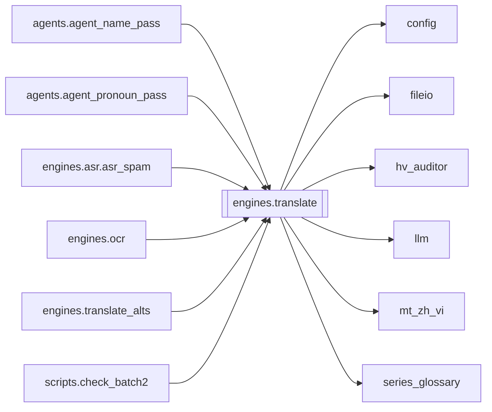

# `engines.translate`

[← Index](../generated/module-index.md) · [Brain home](../README.md)

<!-- AUTO:START — sinh bởi scripts/brain_build.py 2026-11-11 02:38. Đừng sửa tay khối này. -->
**File:** `engines/translate.py` · **Lớp:** `translate` · **2992 dòng** (2686 code) · **53 hàm**, **0 class** · sha1 `b36f55a005`

> translate.py — STAGE dịch: "lập phương án" (hồ sơ nhân vật + XƯNG HÔ) rồi dịch CÓ NGỮ CẢNH, khớp độ dài. Nâng cấp so với bản cũ:

### Phụ thuộc

- **Gọi tới (import nội bộ):** [config](./config.md), [fileio](./fileio.md), [hv_auditor](./hv_auditor.md), [llm](./llm.md), [mt_zh_vi](./mt_zh_vi.md), [series_glossary](./series_glossary.md)
- **Được dùng bởi:** [agents.agent_name_pass](./agents.agent_name_pass.md), [agents.agent_pronoun_pass](./agents.agent_pronoun_pass.md), [engines.asr.asr_spam](./engines.asr.asr_spam.md), [engines.ocr](./engines.ocr.md), [engines.translate_alts](./engines.translate_alts.md), [scripts.check_batch2](./scripts.check_batch2.md)
- **Được nhắc tên file `.py` (subprocess/script) bởi:** [restart_server](./restart_server.md), [scripts.check_batch2](./scripts.check_batch2.md), [server](./server.md), [translate](./translate.md)
- **Test:** `tests/test_layout_paths.py`, `tests/test_pronoun_postpass.py`, `tests/test_pronoun_qa_slim_plan.py`
- **Thư viện ngoài:** `context_studio`, `manifest`, `preset_switcher`, `pronoun_consistency`, `script_lint`, `subs`, `vram`

### Hàm & class top-level

| Tên | Dòng | Dài | Tham số | Docstring |
|---|---:|---:|---|---|
| `_tmodel` | 59 | 3 | `` | TRANSLATE_MODEL đọc lúc gọi (server import module 1 lần — MODEL ở trên bị đóng băng). |
| `_rmodel` | 64 | 2 | `` |  |
| `_is_llama_local_model` | 68 | 9 | `m` |  |
| `_meaning_rules` | 84 | 61 | `` | Quy tắc chống dịch đen / lệch ngữ cảnh (lồng tiếng phim). |
| `_style_rules` | 147 | 30 | `` | Quy tắc Manhua / short-drama: cứng Hán Việt + mềm hiện đại + xưng hô. |
| `_character_rules` | 179 | 13 | `` | Chống nhầm nhân vật / sai giới tính khi dịch thoại. |
| `_is_ancient_fantasy_genre` | 201 | 22 | `plan` | True khi phương án/genre thuộc tu tiên·cổ trang·wuxia·xianxia (không mixed đô thị). |
| `_is_mixed_genre` | 225 | 12 | `plan` |  |
| `_mixed_address_rules` | 239 | 19 | `` | Đô thị dị năng + võ/KH: xưng hô hiện đại + cổ phong Hán Việt. |
| `_ancient_address_rules` | 260 | 19 | `` | Chỉ inject khi genre tu tiên/cổ — không áp cho đô thị hiện đại. |
| `_translate_rules` | 281 | 8 | `plan` | Gộp nghĩa + văn phong + nhân vật (+ xưng hô theo genre). |
| `_ocr_name_hints` | 290 | 25 | `work_dir` | Tên/chữ trên hình từ ocr.json (nếu có) — gợi ý cho PLAN. |
| `_resolve_translate_mode` | 317 | 26 | `mode, model, n_todo` | Trả 'oneshot' / 'batch'. |
| `_has_cjk` | 345 | 3 | `text` | Còn ký tự Hán trong bản dịch = model dịch sót/hỏng (đặc biệt model nhỏ local). |
| `_salvage_mixed_vi` | 373 | 45 | `vi, zh, plan` | Cứu VI lẫn Hán (vd «Đạt được 100% 增幅.») — không thì trả '' để vá lại. |
| `_plan_mode` | 420 | 3 | `` | file = upload full ZH SRT (Aurora); sample = mẫu cũ (head/mid/tail). |
| `_plan_json_schema` | 425 | 24 | `target` |  |
| `_plan_seed_blocks` | 451 | 52 | `name_hints, series_plan, soft_ocr` | OCR = seed mềm (có thể sai). Series characters = kế thừa mạnh. |
| `_normalize_plan_data` | 505 | 27 | `data` |  |
| `_remap_scenes_cue_to_i` | 534 | 33 | `plan, cue_to_i` | Nếu GPT trả range theo số thứ tự cue SRT (1..N) → map về segment i. |
| `_build_plan_from_file` | 569 | 86 | `work_dir, segments, target, model, name_hints, series_plan` | Upload full ZH SRT → GPT đọc file (Aurora) → glossary. OCR chỉ seed mềm. |
| `_build_plan_sample` | 657 | 80 | `segments, target, model, name_hints, series_plan` | Fallback: mẫu head/mid/tail (plan cũ). |
| `build_plan` | 739 | 39 | `segments, target, model, name_hints, series_plan, work_dir` | Lập glossary: mặc định upload full ZH SRT (PLAN_MODE=file); fallback sample. |
| `_plan_block` | 780 | 110 | `p` | Đổ plan ra text nhét vào mọi prompt dịch. CHỐNG LỖI: model đôi khi trả |
| `_plan_block_for_qa` | 892 | 72 | `p` | Plan block gọn cho pronoun-QA / GPT vá đỏ — chỉ genre+style+pronouns. |
| `_resolve_scene_context` | 966 | 62 | `plan, rows` | Xác định phân cảnh hiện tại của lô câu thoại (Scene-based context injection). |
| `_norm_zh_cue` | 1061 | 6 | `zh` | Chuẩn hóa cue ZH để khớp lock (bỏ dấu câu/space). |
| `ensure_hard_terms` | 1069 | 81 | `plan` | Gắn seed chengyu/taunt vào glossary.terms (không đè bản tay đã có). |
| `hard_term_lock_map` | 1152 | 30 | `plan` | zh_norm → vi bắt buộc — CHỈ type=lock (+ seed lock). Chengyu/idiom = mềm trong prompt. |
| `apply_hard_term_locks` | 1184 | 39 | `rows, plan` | Post-pass: cue ZH khớp lock → ghi đè VI (chuẩn, không phụ thuộc LLM). |
| `normalize_vi_thousands` | 1231 | 14 | `text` | Dấu nghìn chuẩn Việt: 31 000 / 31,000 → 31.000. |
| `apply_style_polish` | 1247 | 249 ⚠️ | `rows, plan` | Post-pass deterministic: sửa calque / văn mẫu thường gặp (mixed short-drama). |
| `_is_modernish_genre` | 1498 | 28 | `plan` | Chỉ đô thị THUẦN — không ép detox khi mixed (phim có thể sang tu tiên). |
| `_char_aliases` | 1528 | 16 | `plan` | vi_name_lower → {zh, vi, aliases…} để khớp tên trong câu. |
| `_pronoun_pairs` | 1546 | 14 | `plan` |  |
| `_detox_modern_pronouns` | 1562 | 24 | `vi, zh` | Ép Ta/Ngươi → Tôi/Cậu cho thoại đô thị (giữ «ông ta/cô ta/chúng ta»). |
| `apply_pronoun_postpass` | 1588 | 64 | `rows, plan` | Post-pass deterministic xưng hô — không phụ thuộc LLM nhớ ma trận. |
| `_salvage_items` | 1654 | 23 | `text` | Vớt từng object {"i":.., "vi":..} kể cả khi JSON TỔNG THỂ hỏng (model |
| `translate_oneshot` | 1679 | 66 | `rows, plan_block, target, model, plan` | Dịch TOÀN BỘ danh sách câu trong 1 lần gọi LLM (llama-server ctx lớn). |
| `translate_batch` | 1747 | 85 | `rows, plan_block, prev_ctx, target, model, plan` | LƯỢT 1 — DỊCH NGHĨA KỊCH BẢN CHUẨN XÁC (Semantic Accuracy) theo Phân Cảnh (Scene) + Series Glossary. Trả {i: vi}. |
| `_translate_safe` | 1834 | 26 | `rows, plan_block, prev_ctx, target, model, plan` | Dịch 1 lô CÓ CHỐNG LỖI: nếu parse hỏng hoặc LLM nuốt câu, CHIA ĐÔI lô rồi thử lại. |
| `_style_voice_banner` | 1862 | 24 | `plan` | Gợi ý văn phong linh hoạt — KHÔNG khóa modern↔cổ (phim có thể đổi cảnh). |
| `_style_exemplars` | 1888 | 36 | `plan, rows_pool, limit` | 3–5 câu mẫu giữ giọng (ưu tiên có tên NV glossary). |
| `review_batch` | 1926 | 81 | `rows, plan_block, prev_ctx, target, model, plan, exemplars_pool` | LƯỢT 2 — BẢN ĐỊA HÓA LỜI THOẠI LỒNG TIẾNG & KHỚP NHỊP PHỤ ĐỀ (Voice Dubbing Localization). |
| `run_review` | 2009 | 201 ⚠️ | `work_dir, batch, target, model, force` | LƯỢT 2: soát bản dịch nháp (script.json) bằng model chính xác (minimax) rồi |
| `count_script_missing` | 2212 | 10 | `work_dir` | Đếm câu trống trong script.json (nguồn sự thật cho UI / auto-vá). |
| `translate_coverage_gap` | 2224 | 35 | `work_dir` | Số câu ASR chưa có trong script (salvage lúc Dừng hay ghi thiếu). |
| `translate_ready_for_tts` | 2261 | 13 | `work_dir` | True chỉ khi dịch đủ coverage ASR + không còn VI trống. |
| `_trivial_vi` | 2276 | 39 | `zh` | Câu chỉ cười/thán từ — không cần LLM (model hay trả lại chữ Hán → _has_cjk xoá). |
| `_compress_zh_for_llm` | 2317 | 3 | `zh` | Rút chuỗi cười/spam trước khi gửi LLM (tránh timeout / trả Hán). |
| `clean_zh_spam` | 2322 | 35 | `zh, max_rep, max_len` | Rút 哈/呃/嗯/啊 spam + cụm chữ lặp (区域的区域的…) từ ASR. |
| `run_translate` | 2359 | 610 ⚠️ | `work_dir, batch, target, force, model, mode, auto_review` |  |
| `main` | 2971 | 18 | `argv` |  |

**Hàm dài ≥120 dòng:** `run_translate` (610, L2359), `apply_style_polish` (249, L1247), `run_review` (201, L2009)

### Config / env keys (16)

`AUTO_REVIEW`, `AUTO_SWITCH_PRESETS`, `FALLBACK_MODEL`, `LLM_MODEL`, `PLAN_FILE_TIMEOUT`, `PLAN_MODE`, `PLAN_MODEL`, `REVIEW_MODEL`, `REVIEW_PRESET`, `TRANSLATE_BATCH`, `TRANSLATE_CTX_LINES`, `TRANSLATE_FILL_ROUNDS`, `TRANSLATE_MODE`, `TRANSLATE_MODEL`, `TRANSLATE_ONESHOT_MAX`, `TRANSLATE_PRESET`

**File/artifact nhắc tới:** `asr.json`, `context_pack.json`, `glossary.json`, `ocr.json`, `script.display.json`, `script.json`, `style_lock.json`, `sub.vi.srt`

**Tín hiệu rủi ro (đếm tĩnh):** broad_except=49 · file_writes=8 · swallow_except=10

### Lịch sử (từ docs/)

- **Fix logs (20):**
  - [Studio SOP: 1 job / ghế — ASR→NMT→Aurora∥ REVIEW→TTS→mux→Done→next](../../fixes/2026-11-11-studio-1job-pipeline.md)
  - [Pass1 413 — chặn upload theo số cue, fallback chat phình](../../fixes/2026-11-11-pass1-upload-size.md)
  - [REVIEW CLI song song + heal làm UI mất/soát % tụt](../../fixes/2026-11-10-review-heal-parallel.md)
  - [UI «backup Aurora» không rà — Gemma bỏ sót NMT vô nghĩa](../../fixes/2026-11-10-review-gpt6-aurora.md)
  - [Brain HOLD vì high hang — cần LLM trace/xử lý rồi mới mở](../../fixes/2026-11-10-brain-hang-llm-fix.md)
  - [Stop lúc soát vẫn nhảy TTS / job không dừng](../../fixes/2026-11-09-stop-during-review-tts.md)
  - [REVIEW Pass1 full VI + duty F nửa câu vô nghĩa](../../fixes/2026-11-09-review-pass1-halfcue.md)
  - [GPT review viết lại NMT đã tốt (Lão tử…)](../../fixes/2026-11-09-review-keep-nmt.md)
  - [REVIEW bỏ sót ASR cắt lặp / chồng câu](../../fixes/2026-11-09-review-asr-merge.md)
  - [NMT draft + glossary gầy + REVIEW GPT mini](../../fixes/2026-11-09-mt-draft-slim-gloss.md)
  - [没大没小 → «chưa lớn không nhỏ» (calque vô nghĩa đã rv)](../../fixes/2026-11-09-meidameixiao-calque.md)
  - [HV Auditor: glossary khóa sai âm Hán Việt (逆→Nghị)](../../fixes/2026-11-09-hv-auditor.md)
  - [Dịch dừng giữa chừng → nhảy TTS với số câu dở (vd 64/398 vs ASR 2698)](../../fixes/2026-11-08-translate-partial-tts-jump.md)
  - [逆天而行 dịch sai «Nghị Thiên Nhi Hành» (đúng: Nghịch…)](../../fixes/2026-11-08-nghich-thien-ni-hanh.md)
  - [Bấm lồng tiếng / dịch xong rồi lại «force: dịch lại từ đầu»](../../fixes/2026-11-06-translate-force-wipe.md)
  - [Pronoun-QA GPT vá đỏ → Aurora 413 (payload quá lớn)](../../fixes/2026-11-06-pronoun-qa-413-slim.md)
  - [Lệch xưng hô sau dịch (Ta–Ngươi / sai self–call)](../../fixes/2026-11-02-pronoun-xung-ho.md)
  - [Đồng nhất xưng hô A–C (analyze full ZH → lock → ledger → QA)](../../fixes/2026-11-02-pronoun-consistency-abc.md)
  - [2026-10-06 — Đợt 4 review: tranh chấp ghi, một bản tiến trình, checkpoint an toàn](../../fixes/2026-10-06-batch4-write-races.md)
  - [2026-10-06 — Đợt 2 review: bảo mật + config một nguồn + LLM sập không để trống câu](../../fixes/2026-10-06-batch2-security.md)
- **Reviews:** [_atoms_engines](../../reviews/_atoms_engines.md), [2026-11-10-review-parallel-aurora](../../reviews/2026-11-10-review-parallel-aurora.md), [2026-11-09-plan-file-review-style-code](../../reviews/2026-11-09-plan-file-review-style-code.md), [2026-11-09-mt-sandbox-job](../../reviews/2026-11-09-mt-sandbox-job.md), [2026-11-09-mt-keepnmt-final](../../reviews/2026-11-09-mt-keepnmt-final.md), [2026-11-09-mt-bench-verdict](../../reviews/2026-11-09-mt-bench-verdict.md), [2026-11-09-mt-60-zh-vi](../../reviews/2026-11-09-mt-60-zh-vi.md), [2026-11-09-glossary-nmt-poc-summary](../../reviews/2026-11-09-glossary-nmt-poc-summary.md), [2026-11-06-v5-part-atoms](../../reviews/2026-11-06-v5-part-atoms.md), [2026-11-06-v5-func-catalog](../../reviews/2026-11-06-v5-func-catalog.md)
- Nhắc trong CHANGELOG: **10** lần · DECISIONS: **0** lần

<!-- AUTO:END -->

<!-- MANUAL:START -->
## Vai trò (viết tay)

_Chưa viết. 2–4 câu: module này chịu trách nhiệm gì trong pipeline, ai gọi nó, nó KHÔNG làm gì._

## Luồng chính

_Các hàm vào (entry) → bước chính → output/side effect. Ghi tên hàm thật._

## Bất biến & hợp đồng

_Điều luôn phải đúng (vd: chỉ ghi manifest qua `Manifest.update`; 1 job / ghế). Vi phạm = bug._

## Bẫy đã biết

_Lỗi từng gặp + link `docs/fixes/...`. Những chỗ dễ sửa sai._

## Ghi chú vận hành

_Config key quan trọng, cần restart gì khi sửa (:8801 / :8802 / hot-reload), cách test._
<!-- MANUAL:END -->
