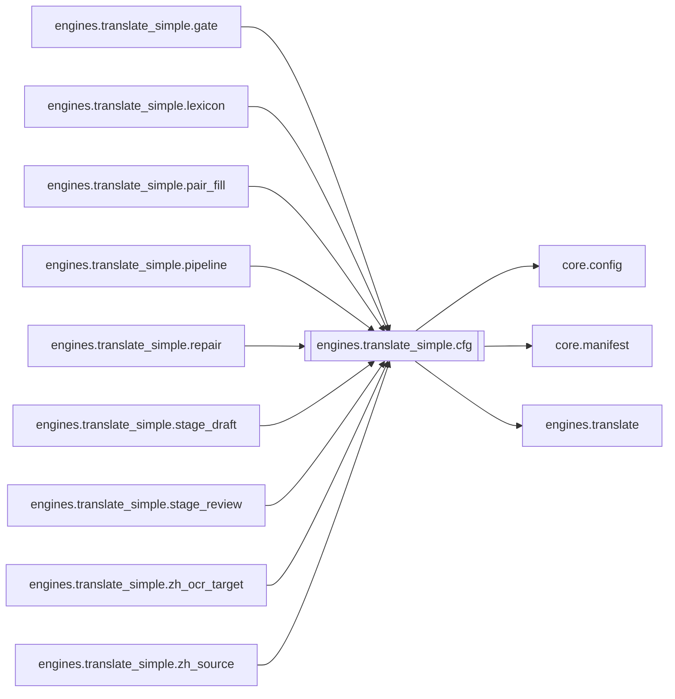

# `engines.translate_simple.cfg`

[← Index](../generated/module-index.md) · [Brain home](../README.md)

<!-- AUTO:START — sinh bởi scripts/brain_build.py 2026-11-17 19:05. Đừng sửa tay khối này. -->
**File:** `engines/translate_simple/cfg.py` · **Lớp:** `misc` · **367 dòng** (262 code) · **45 hàm**, **0 class** · sha1 `d69a6fa6b7`

> Cấu hình luồng simple — mọi khoá prefix SIMPLE_ đọc qua config.get (env > pineline.config.json > mặc định). Không sửa config.json. Khoá: TRANSLATE_PIPELINE       trống/simple = luồng này (MẶC ĐỊNH — V5 F5; job-stamping p

### Phụ thuộc

- **Gọi tới (import nội bộ):** [core.config](./core.config.md), [core.manifest](./core.manifest.md), [engines.translate](./engines.translate.md)
- **Được dùng bởi:** [engines.translate_simple.gate](./engines.translate_simple.gate.md), [engines.translate_simple.lexicon](./engines.translate_simple.lexicon.md), [engines.translate_simple.pair_fill](./engines.translate_simple.pair_fill.md), [engines.translate_simple.pipeline](./engines.translate_simple.pipeline.md), [engines.translate_simple.repair](./engines.translate_simple.repair.md), [engines.translate_simple.stage_draft](./engines.translate_simple.stage_draft.md), [engines.translate_simple.stage_review](./engines.translate_simple.stage_review.md), [engines.translate_simple.zh_ocr_target](./engines.translate_simple.zh_ocr_target.md), [engines.translate_simple.zh_source](./engines.translate_simple.zh_source.md)
- **Test:** `tests/test_simple_junk_park.py`, `tests/test_translate_simple.py`, `tests/test_translate_simple_a7_a8.py`, `tests/test_translate_simple_next.py`

### Hàm & class top-level

| Tên | Dòng | Dài | Tham số | Docstring |
|---|---:|---:|---|---|
| `get` | 55 | 6 | `key, default` |  |
| `_int` | 63 | 10 | `key, default, lo, hi` |  |
| `_float` | 75 | 10 | `key, default, lo, hi` |  |
| `_flag` | 87 | 2 | `key, default` |  |
| `pipeline_default` | 103 | 4 | `` | Luồng mặc định cho job MỚI: TRANSLATE_PIPELINE ∈ LEGACY_VALUES → legacy; trống/simple/khác → simple. |
| `pipeline_is_simple` | 109 | 2 | `` |  |
| `_infer_job_pipeline` | 113 | 12 | `d, wd` | Job chưa đóng dấu (tạo trước F2): suy luồng đã dùng. None = chưa bắt đầu dịch. |
| `job_pipeline` | 127 | 35 | `work_dir, fresh, stamp` | Luồng dịch cho 1 job — mọi đường gọi dịch trong server hỏi hàm này. |
| `deepseek_concurrency` | 168 | 3 | `` | Số request song song cho DeepSeek Official API (mặc định 32, kẹp [1, 64]). |
| `batch` | 173 | 2 | `` |  |
| `batch_for_rows` | 177 | 18 | `n_rows, workers_count, explicit` | Tự chọn cỡ lô review theo số câu và mức song song: |
| `ctx` | 197 | 2 | `` |  |
| `workers` | 201 | 6 | `model` | Số worker song song cho review: DeepSeek dùng DEEPSEEK_CONCURRENCY (32), khác (Aurora/local) dùng SIMPLE_WORKERS (8). |
| `repair_rounds` | 209 | 2 | `` |  |
| `conf_min` | 213 | 2 | `` |  |
| `gate_flag_ratio` | 217 | 2 | `` |  |
| `gate_flag_max` | 221 | 9 | `n_rows` |  |
| `unreviewed_tolerance` | 232 | 9 | `n_rows` | fix 2026-11-13 agentM: số câu chưa soát được nhận bản nháp (thay vì park). Trống = max(3, 0.2% số câu). |
| `missing_batch` | 243 | 2 | `` |  |
| `max_tokens` | 247 | 2 | `` |  |
| `timeout` | 251 | 2 | `` |  |
| `temperature` | 255 | 2 | `` |  |
| `pronoun_analyze` | 259 | 2 | `` |  |
| `nmt_wait_plan` | 263 | 2 | `` |  |
| `nmt_unload` | 267 | 2 | `` |  |
| `trace_max_bytes` | 271 | 2 | `` |  |
| `suggest_pairs` | 275 | 2 | `` |  |
| `lexicon_exclude_golden` | 280 | 2 | `` |  |
| `pair_rules` | 284 | 2 | `` |  |
| `pair_fill` | 288 | 2 | `` |  |
| `pair_fill_min` | 292 | 2 | `` |  |
| `pair_fill_conf` | 296 | 2 | `` |  |
| `pair_fill_model` | 300 | 3 | `work_dir` |  |
| `learn_inferred` | 305 | 2 | `` |  |
| `zh_source` | 309 | 2 | `` |  |
| `zh_ocr_mode` | 313 | 3 | `` |  |
| `zh_ocr_pass_b` | 318 | 2 | `` |  |
| `zh_hs_samples` | 322 | 2 | `` |  |
| `zh_hs_min_ratio` | 326 | 2 | `` |  |
| `zh_namefix` | 330 | 2 | `` |  |
| `zh_namefix_min` | 334 | 2 | `` |  |
| `full_plan_enabled` | 338 | 3 | `` | A7: Lập plan đọc cả phim từ toàn bộ thoại ASR bằng LLM context lớn. |
| `overlap_cues` | 343 | 3 | `` | A8: Số câu ngữ cảnh chồng lấn liền trước cho mỗi lô review (0-10, mặc định 3). |
| `plan_model` | 348 | 9 | `work_dir` | Model LLM dùng cho bước lập plan A7. |
| `review_model` | 359 | 9 | `work_dir` |  |

**File/artifact nhắc tới:** `manifest.json`, `script.json`

**Tín hiệu rủi ro (đếm tĩnh):** broad_except=4

### Lịch sử (từ docs/)

- **Fix logs (2):**
  - [Port V2→V5: luồng dịch `translate_simple` (mặc định) + Demucs trước ASR](../../fixes/2026-11-12-port-simple-demucs.md)
  - [Port V2→V5: Second Brain (Telegram events + gỡ HOLD khi chạy tay) + đóng dấu luồng dịch theo job](../../fixes/2026-11-12-port-brain-hold-pipeline.md)
- Nhắc trong CHANGELOG: **1** lần · DECISIONS: **0** lần

<!-- AUTO:END -->

<!-- MANUAL:START -->
## Vai trò (viết tay)

_Chưa viết. 2–4 câu: module này chịu trách nhiệm gì trong pipeline, ai gọi nó, nó KHÔNG làm gì._

## Luồng chính

_Các hàm vào (entry) → bước chính → output/side effect. Ghi tên hàm thật._

## Bất biến & hợp đồng

_Điều luôn phải đúng (vd: chỉ ghi manifest qua `Manifest.update`; 1 job / ghế). Vi phạm = bug._

## Bẫy đã biết

_Lỗi từng gặp + link `docs/fixes/...`. Những chỗ dễ sửa sai._

## Ghi chú vận hành

_Config key quan trọng, cần restart gì khi sửa (:8801 / :8802 / hot-reload), cách test._
<!-- MANUAL:END -->
