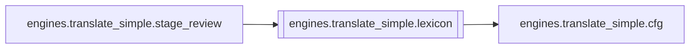

# `engines.translate_simple.lexicon`

[← Index](../generated/module-index.md) · [Brain home](../README.md)

<!-- AUTO:START — sinh bởi scripts/brain_build.py 2026-11-17 19:05. Đừng sửa tay khối này. -->
**File:** `engines/translate_simple/lexicon.py` · **Lớp:** `misc` · **110 dòng** (95 code) · **4 hàm**, **0 class** · sha1 `546e128e78`

> Gợi ý thành ngữ / lóng ZH→VI cho prompt review (dò chuỗi con trong ZH của lô). Nguồn: data/lexicon/idioms_zh_vi.json ({"entries":[{zh, vi, forbid[], note?, re?}]}) + terms type chengyu/idiom/style trong plan (glossary.js

### Phụ thuộc

- **Gọi tới (import nội bộ):** [engines.translate_simple.cfg](./engines.translate_simple.cfg.md)
- **Được dùng bởi:** [engines.translate_simple.stage_review](./engines.translate_simple.stage_review.md)
- **Test:** `tests/test_translate_simple.py`, `tests/test_translate_simple_next.py`, `tests/test_translate_simple_scenarios.py`
- **Thư viện ngoài:** `engines`

### Hàm & class top-level

| Tên | Dòng | Dài | Tham số | Docstring |
|---|---:|---:|---|---|
| `load` | 29 | 30 | `path` |  |
| `_plan_idioms` | 61 | 10 | `plan` |  |
| `hints_for` | 73 | 26 | `zh_texts, plan, limit` | Mục từ điển có zh là chuỗi con của bất kỳ câu ZH nào trong lô (dài trước, không trùng). |
| `hint_lines` | 101 | 10 | `hints` |  |

**File/artifact nhắc tới:** `idioms_zh_vi.json`

**Tín hiệu rủi ro (đếm tĩnh):** broad_except=1

### Lịch sử (từ docs/)

- Fix logs: —
- Nhắc trong CHANGELOG: **0** lần · DECISIONS: **0** lần

<!-- AUTO:END -->

<!-- MANUAL:START -->
## Vai trò (viết tay)

_Chưa viết. 2–4 câu: module này chịu trách nhiệm gì trong pipeline, ai gọi nó, nó KHÔNG làm gì._

## Luồng chính

_Các hàm vào (entry) → bước chính → output/side effect. Ghi tên hàm thật._

## Bất biến & hợp đồng

_Điều luôn phải đúng (vd: chỉ ghi manifest qua `Manifest.update`; 1 job / ghế). Vi phạm = bug._

## Bẫy đã biết

_Lỗi từng gặp + link `docs/fixes/...`. Những chỗ dễ sửa sai._

## Ghi chú vận hành

_Config key quan trọng, cần restart gì khi sửa (:8801 / :8802 / hot-reload), cách test._
<!-- MANUAL:END -->
