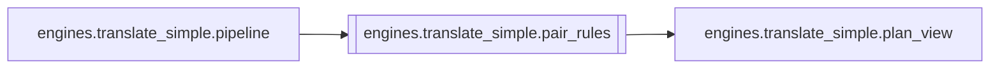

# `engines.translate_simple.pair_rules`

[← Index](../generated/module-index.md) · [Brain home](../README.md)

<!-- AUTO:START — sinh bởi scripts/brain_build.py 2026-11-17 19:05. Đừng sửa tay khối này. -->
**File:** `engines/translate_simple/pair_rules.py` · **Lớp:** `misc` · **295 dòng** (254 code) · **15 hàm**, **0 class** · sha1 `ce2e520799`

> Bước 2 (2026-11-12 next) — điền cặp xưng hô CÒN TRỐNG theo bảng quy tắc quan hệ (cờ SIMPLE_PAIR_RULES=1). Bảng: data/lexicon/pronoun_rules_zh_vi.json (viết tay theo quy ước lồng tiếng Việt — KHÔNG seed từ golden). Quan h

### Phụ thuộc

- **Gọi tới (import nội bộ):** [engines.translate_simple.plan_view](./engines.translate_simple.plan_view.md)
- **Được dùng bởi:** [engines.translate_simple.pipeline](./engines.translate_simple.pipeline.md)
- **Test:** `tests/test_translate_simple_next.py`, `tests/test_translate_simple_next_review.py`

### Hàm & class top-level

| Tên | Dòng | Dài | Tham số | Docstring |
|---|---:|---:|---|---|
| `load_rules` | 31 | 18 | `path` |  |
| `_gender` | 51 | 7 | `c` |  |
| `genre_classes` | 60 | 18 | `plan, rules` |  |
| `_find` | 80 | 9 | `text, kw` | Vị trí đầu tiên của từ khoá trong text (đã lower/NFC); từ khoá Việt khớp trọn từ. -1 nếu không có. |
| `_mask` | 91 | 9 | `text, kws` |  |
| `_first` | 102 | 3 | `text, kws` |  |
| `_by_gender` | 107 | 5 | `rel, ga, gb` |  |
| `_resolve` | 114 | 23 | `rel, text, ga, gb, name_b, name_a` | Vai của A trong quan hệ rel theo mô tả text (A là vế đầu). 'any' = ngang hàng. |
| `_role_of` | 142 | 27 | `text, kws, names` | text nói «<kw> [≤2 từ] của <tên>» hoặc «<名字>的<kw>». |
| `_names` | 171 | 3 | `c` |  |
| `_matrix_texts` | 176 | 20 | `plan, pv` | {(A, B) chuẩn hoá: [mô tả với A là vế đầu]}. |
| `relation_between` | 198 | 44 | `pv, a, b, rules, mtx` | (rel, vai của A: hi/lo/any, nguồn) hoặc None. |
| `_pick` | 244 | 8 | `v, g` |  |
| `forms_for` | 254 | 12 | `rel, side, classes, g_self, g_to` |  |
| `fill` | 268 | 28 | `pv, rules` | Thêm vào pv các cặp CHƯA có mà suy được từ quan hệ. Trả danh sách cặp đã thêm (src=rule). |

**File/artifact nhắc tới:** `pronoun_rules_zh_vi.json`

**Tín hiệu rủi ro (đếm tĩnh):** broad_except=1

### Lịch sử (từ docs/)

- Fix logs: —
- Nhắc trong CHANGELOG: **0** lần · DECISIONS: **0** lần

<!-- AUTO:END -->

<!-- MANUAL:START -->
## Vai trò (viết tay)

_Chưa viết. 2–4 câu: module này chịu trách nhiệm gì trong pipeline, ai gọi nó, nó KHÔNG làm gì._

## Luồng chính

_Các hàm vào (entry) → bước chính → output/side effect. Ghi tên hàm thật._

## Bất biến & hợp đồng

_Điều luôn phải đúng (vd: chỉ ghi manifest qua `Manifest.update`; 1 job / ghế). Vi phạm = bug._

## Bẫy đã biết

_Lỗi từng gặp + link `docs/fixes/...`. Những chỗ dễ sửa sai._

## Ghi chú vận hành

_Config key quan trọng, cần restart gì khi sửa (:8801 / :8802 / hot-reload), cách test._
<!-- MANUAL:END -->
