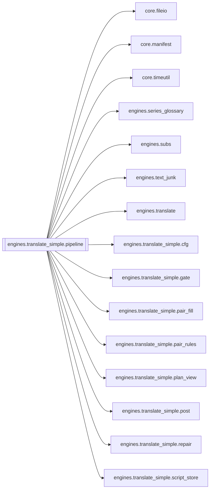

# `engines.translate_simple.pipeline`

[← Index](../generated/module-index.md) · [Brain home](../README.md)

<!-- AUTO:START — sinh bởi scripts/brain_build.py 2026-11-17 19:05. Đừng sửa tay khối này. -->
**File:** `engines/translate_simple/pipeline.py` · **Lớp:** `misc` · **497 dòng** (443 code) · **15 hàm**, **0 class** · sha1 `4aa3f7c2c8`

> Điểm vào luồng dịch simple: `run(work_dir, target, *, progress, stop_check) -> dict`. Ghi: script.json (1–1 với ASR, giữ mọi trường), script.display.json + sub.vi.srt (CUT như luồng cũ), glossary.json (+ style_lock.json)

### Phụ thuộc

- **Gọi tới (import nội bộ):** [core.fileio](./core.fileio.md), [core.manifest](./core.manifest.md), [core.timeutil](./core.timeutil.md), [engines.series_glossary](./engines.series_glossary.md), [engines.subs](./engines.subs.md), [engines.text_junk](./engines.text_junk.md), [engines.translate](./engines.translate.md), [engines.translate_simple.cfg](./engines.translate_simple.cfg.md), [engines.translate_simple.gate](./engines.translate_simple.gate.md), [engines.translate_simple.pair_fill](./engines.translate_simple.pair_fill.md), [engines.translate_simple.pair_rules](./engines.translate_simple.pair_rules.md), [engines.translate_simple.plan_view](./engines.translate_simple.plan_view.md), [engines.translate_simple.post](./engines.translate_simple.post.md), [engines.translate_simple.repair](./engines.translate_simple.repair.md), [engines.translate_simple.script_store](./engines.translate_simple.script_store.md), [engines.translate_simple.stage_draft](./engines.translate_simple.stage_draft.md), [engines.translate_simple.stage_review](./engines.translate_simple.stage_review.md), [engines.translate_simple.suggest](./engines.translate_simple.suggest.md), [engines.translate_simple.validate](./engines.translate_simple.validate.md), [engines.translate_simple.zh_ocr_target](./engines.translate_simple.zh_ocr_target.md), [engines.translate_simple.zh_source](./engines.translate_simple.zh_source.md)
- **Được dùng bởi:** —
- **Test:** `tests/test_simple_junk_park.py`, `tests/test_simple_r1_bugs.py`, `tests/test_translate_simple.py`, `tests/test_translate_simple_next.py`, `tests/test_translate_simple_next_review.py`, `tests/test_translate_simple_scenarios.py`
- **Thư viện ngoài:** `engines`

### Hàm & class top-level

| Tên | Dòng | Dài | Tham số | Docstring |
|---|---:|---:|---|---|
| `_now` | 30 | 7 | `` |  |
| `_manifest_update` | 39 | 13 | `work_dir, fn` | Mọi ghi manifest qua Manifest.update (đọc lại đĩa → sửa → ghi trong khoá). |
| `_set_stage` | 54 | 7 | `work_dir, **kv` |  |
| `_write_outputs` | 63 | 7 | `work_dir, rows` |  |
| `_load_prev_fill` | 72 | 6 | `wd` |  |
| `_write_inferred` | 80 | 8 | `wd, pv, info` |  |
| `_learn_inferred` | 90 | 26 | `wd, pv` | Cổng done + SIMPLE_LEARN_INFERRED=1: thêm cặp suy luận vào glossary.json (không đè cặp có sẵn). |
| `_asr_stutter_i` | 118 | 18 | `segments` | i của câu mà chữ ASR gốc có lặp tất định (để post.apply chỉ gỡ lặp VI ở đúng các câu đó — review agent D). |
| `_heal_zh_stutter` | 138 | 23 | `store` | Sửa lỗi 2026-11-12 (agent A, f0834acf0cc0 i=542 «杀吧杀吧，»): luồng cũ gỡ lặp ASR tất định |
| `_mark_junk` | 168 | 35 | `store` | Câu zh rác (text_junk.is_junk_text: rỗng / chỉ dấu / None-null-nan) → tự soát: vi=«…», rv=1, junk=1, |
| `_review_missing` | 205 | 20 | `store, pv, plan, flags, model, stop_check, progress` | Trước khi park: 1 lượt review CHỈ các câu còn chưa rv (lô nhỏ SIMPLE_MISSING_BATCH) → hậu kỳ + kiểm lại |
| `_accept_unreviewed` | 227 | 22 | `store` | Còn ≤ SIMPLE_UNREVIEWED_TOLERANCE câu chưa soát VÀ mọi câu đó có bản nháp vi (không trống, không chữ Hán) |
| `_script_all_reviewed` | 251 | 12 | `wd` | fix 2026-11-13: script.json đã có và MỌI câu đã soát (rv) → chạy lại (resume sau restart) không cần |
| `_brain_line` | 265 | 11 | `wd, text` | 1 dòng cho Second Brain nếu brain đang chạy trong tiến trình (best-effort, không import mới, không test). |
| `run` | 278 | 220 ⚠️ | `work_dir, target, force, rereview, progress, stop_check` |  |

**Hàm dài ≥120 dòng:** `run` (220, L278)

**File/artifact nhắc tới:** `asr.json`, `glossary.json`, `manifest.json`, `plan_inferred.json`, `script.display.json`, `script.json`, `sub.vi.srt`

**Tín hiệu rủi ro (đếm tĩnh):** broad_except=17 · file_writes=1 · swallow_except=1

### Lịch sử (từ docs/)

- **Fix logs (1):**
  - [Port V2→V5: Second Brain (Telegram events + gỡ HOLD khi chạy tay) + đóng dấu luồng dịch theo job](../../fixes/2026-11-12-port-brain-hold-pipeline.md)
- Nhắc trong CHANGELOG: **0** lần · DECISIONS: **1** lần

<!-- AUTO:END -->

<!-- MANUAL:START -->
## Vai trò (viết tay)

_Chưa viết. 2–4 câu: module này chịu trách nhiệm gì trong pipeline, ai gọi nó, nó KHÔNG làm gì._

## Luồng chính

_Các hàm vào (entry) → bước chính → output/side effect. Ghi tên hàm thật._

## Bất biến & hợp đồng

_Điều luôn phải đúng (vd: chỉ ghi manifest qua `Manifest.update`; 1 job / ghế). Vi phạm = bug._

## Bẫy đã biết

_Lỗi từng gặp + link `docs/fixes/...`. Những chỗ dễ sửa sai._

## Ghi chú vận hành

_Config key quan trọng, cần restart gì khi sửa (:8801 / :8802 / hot-reload), cách test._
<!-- MANUAL:END -->
