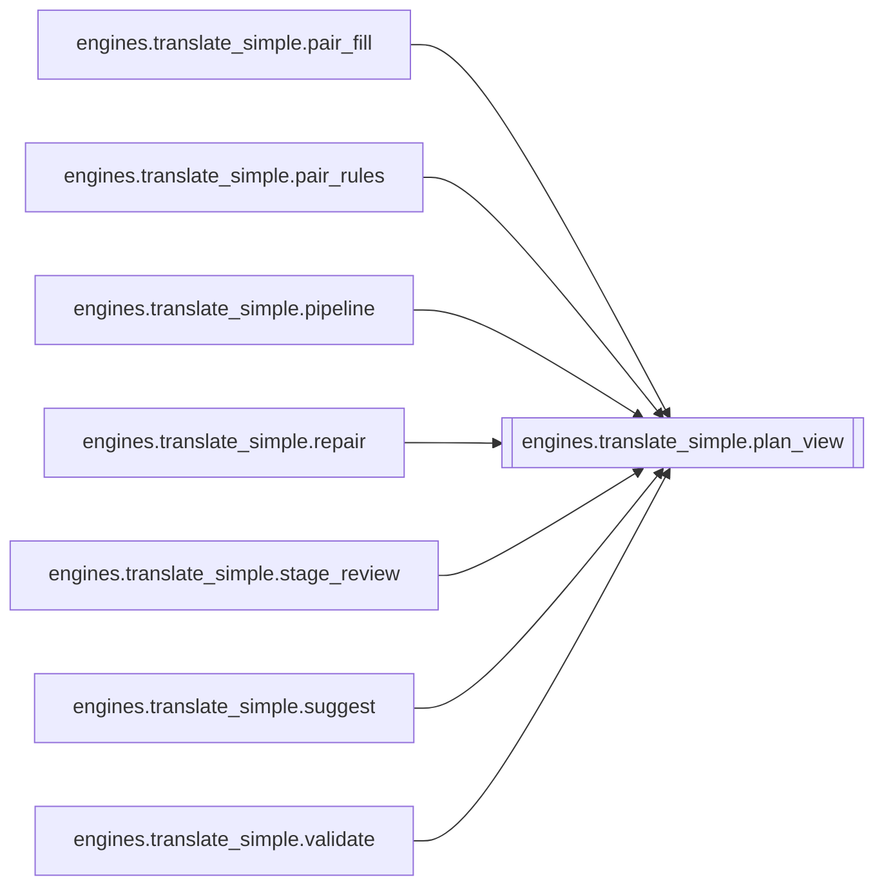

# `engines.translate_simple.plan_view`

[← Index](../generated/module-index.md) · [Brain home](../README.md)

<!-- AUTO:START — sinh bởi scripts/brain_build.py 2026-11-17 19:05. Đừng sửa tay khối này. -->
**File:** `engines/translate_simple/plan_view.py` · **Lớp:** `misc` · **215 dòng** (188 code) · **5 hàm**, **1 class** · sha1 `9b224bb27f`

> Đọc plan (glossary.json) cho luồng simple: nhân vật, cặp xưng hô, cảnh, thuật ngữ — và khối plan thu gọn THEO LÔ (chỉ nhân vật có mặt / cặp liên quan / cảnh phủ lô / thuật ngữ xuất hiện).

### Phụ thuộc

- **Gọi tới (import nội bộ):** —
- **Được dùng bởi:** [engines.translate_simple.pair_fill](./engines.translate_simple.pair_fill.md), [engines.translate_simple.pair_rules](./engines.translate_simple.pair_rules.md), [engines.translate_simple.pipeline](./engines.translate_simple.pipeline.md), [engines.translate_simple.repair](./engines.translate_simple.repair.md), [engines.translate_simple.stage_review](./engines.translate_simple.stage_review.md), [engines.translate_simple.suggest](./engines.translate_simple.suggest.md), [engines.translate_simple.validate](./engines.translate_simple.validate.md)
- **Test:** `tests/test_simple_junk_park.py`, `tests/test_simple_r1_bugs.py`, `tests/test_translate_simple.py`, `tests/test_translate_simple_a7_a8.py`, `tests/test_translate_simple_next.py`, `tests/test_translate_simple_next_review.py`, `tests/test_translate_simple_scenarios.py`

### Hàm & class top-level

| Tên | Dòng | Dài | Tham số | Docstring |
|---|---:|---:|---|---|
| **class `PlanView`** | 54 | 11 method | |  |
| `nfc` | 12 | 2 | `s` |  |
| `norm_name` | 16 | 4 | `s` |  |
| `forms` | 22 | 16 | `v` | «anh / học trưởng» → ['anh', 'học trưởng'] (giữ thứ tự, bỏ trùng). |
| `_alts` | 40 | 2 | `xs` |  |
| `pair_line` | 44 | 8 | `p` | 1 dòng cặp xưng hô cho prompt — review 2026-11-12: tách rõ tự xưng / gọi (trước đây |

### Lịch sử (từ docs/)

- Fix logs: —
- Nhắc trong CHANGELOG: **0** lần · DECISIONS: **0** lần

<!-- AUTO:END -->

<!-- MANUAL:START -->
## Vai trò (viết tay)

_Chưa viết. 2–4 câu: module này chịu trách nhiệm gì trong pipeline, ai gọi nó, nó KHÔNG làm gì._

## Luồng chính

_Các hàm vào (entry) → bước chính → output/side effect. Ghi tên hàm thật._

## Bất biến & hợp đồng

_Điều luôn phải đúng (vd: chỉ ghi manifest qua `Manifest.update`; 1 job / ghế). Vi phạm = bug._

## Bẫy đã biết

_Lỗi từng gặp + link `docs/fixes/...`. Những chỗ dễ sửa sai._

## Ghi chú vận hành

_Config key quan trọng, cần restart gì khi sửa (:8801 / :8802 / hot-reload), cách test._
<!-- MANUAL:END -->
