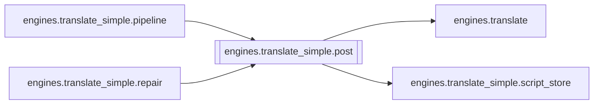

# `engines.translate_simple.post`

[← Index](../generated/module-index.md) · [Brain home](../README.md)

<!-- AUTO:START — sinh bởi scripts/brain_build.py 2026-11-17 19:05. Đừng sửa tay khối này. -->
**File:** `engines/translate_simple/post.py` · **Lớp:** `misc` · **76 dòng** (63 code) · **3 hàm**, **0 class** · sha1 `e91c64acf3`

> Hậu kỳ tất định của luồng simple — KHÔNG regex đổi đại từ: 1) chuẩn dấu nghìn (translate.normalize_vi_thousands) 2) gỡ lặp ASR/VI tất định (translate.heal_obvious_internal_stutter — CÙNG hàm luồng cũ dùng trong

### Phụ thuộc

- **Gọi tới (import nội bộ):** [engines.translate](./engines.translate.md), [engines.translate_simple.script_store](./engines.translate_simple.script_store.md)
- **Được dùng bởi:** [engines.translate_simple.pipeline](./engines.translate_simple.pipeline.md), [engines.translate_simple.repair](./engines.translate_simple.repair.md)
- **Test:** `tests/test_translate_simple_next_review.py`

### Hàm & class top-level

| Tên | Dòng | Dài | Tham số | Docstring |
|---|---:|---:|---|---|
| `_zh_stutter` | 23 | 9 | `T, r, stutter_i` | ZH của câu có lặp ASR: còn lặp (câu rv giữ zh) hoặc ASR gốc lặp (pipeline đã gỡ ở bước dựng script). |
| `heal_vi` | 34 | 10 | `T, vi` | translate.heal_obvious_internal_stutter + dọn dấu phẩy treo («Giết đi,!» → «Giết đi!», «,,» → «,»). |
| `apply` | 46 | 31 | `store, plan, rows` |  |

**Tín hiệu rủi ro (đếm tĩnh):** broad_except=1

### Lịch sử (từ docs/)

- Fix logs: —
- Nhắc trong CHANGELOG: **0** lần · DECISIONS: **0** lần

<!-- AUTO:END -->

<!-- MANUAL:START -->
## Vai trò (viết tay)

_Chưa viết. 2–4 câu: module này chịu trách nhiệm gì trong pipeline, ai gọi nó, nó KHÔNG làm gì._

## Luồng chính

_Các hàm vào (entry) → bước chính → output/side effect. Ghi tên hàm thật._

## Bất biến & hợp đồng

_Điều luôn phải đúng (vd: chỉ ghi manifest qua `Manifest.update`; 1 job / ghế). Vi phạm = bug._

## Bẫy đã biết

_Lỗi từng gặp + link `docs/fixes/...`. Những chỗ dễ sửa sai._

## Ghi chú vận hành

_Config key quan trọng, cần restart gì khi sửa (:8801 / :8802 / hot-reload), cách test._
<!-- MANUAL:END -->
