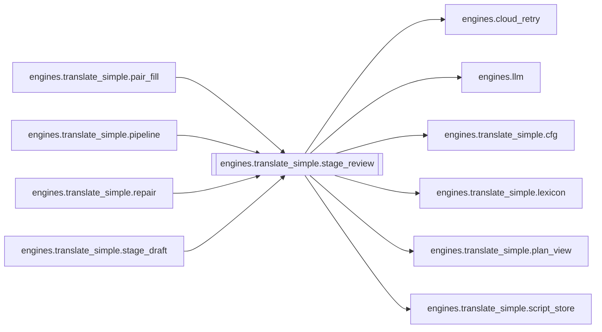

# `engines.translate_simple.stage_review`

[← Index](../generated/module-index.md) · [Brain home](../README.md)

<!-- AUTO:START — sinh bởi scripts/brain_build.py 2026-11-17 19:05. Đừng sửa tay khối này. -->
**File:** `engines/translate_simple/stage_review.py` · **Lớp:** `misc` · **372 dòng** (336 code) · **9 hàm**, **1 class** · sha1 `5d419c3c5c`

> Bước 3: REVIEW cloud theo lô — MỘT lần gọi/lô làm hết: sửa nghĩa, áp xưng hô theo cặp plan, tên/thuật ngữ, thành ngữ, dịch câu trống. Trả mỗi câu {i, vi, spk, to, conf}. - Lô SIMPLE_BATCH câu (mặc định 30) + ngữ cảnh ±SI

### Phụ thuộc

- **Gọi tới (import nội bộ):** [engines.cloud_retry](./engines.cloud_retry.md), [engines.llm](./engines.llm.md), [engines.translate_simple.cfg](./engines.translate_simple.cfg.md), [engines.translate_simple.lexicon](./engines.translate_simple.lexicon.md), [engines.translate_simple.plan_view](./engines.translate_simple.plan_view.md), [engines.translate_simple.script_store](./engines.translate_simple.script_store.md)
- **Được dùng bởi:** [engines.translate_simple.pair_fill](./engines.translate_simple.pair_fill.md), [engines.translate_simple.pipeline](./engines.translate_simple.pipeline.md), [engines.translate_simple.repair](./engines.translate_simple.repair.md), [engines.translate_simple.stage_draft](./engines.translate_simple.stage_draft.md)
- **Test:** `tests/test_simple_junk_park.py`, `tests/test_simple_r1_bugs.py`, `tests/test_translate_simple.py`, `tests/test_translate_simple_a7_a8.py`, `tests/test_translate_simple_next.py`, `tests/test_translate_simple_scenarios.py`
- **Thư viện ngoài:** `engines`

### Hàm & class top-level

| Tên | Dòng | Dài | Tham số | Docstring |
|---|---:|---:|---|---|
| **class `BadOutput`** | 23 | 0 method | | Phản hồi rỗng / cụt / sai schema — lô coi là LỖI. |
| `_decode` | 69 | 39 | `text` | Bóc JSON từ phản hồi. Ném BadOutput khi rỗng / cụt / fence mở / JSON hỏng. |
| `parse_lines` | 110 | 38 | `text, want` | Parse CHẶT. Trả {i: {vi, spk, to, conf, ok}} chỉ cho i ∈ want có vi chuỗi khác rỗng. |
| `parse_new_pairs` | 150 | 19 | `text` | Khoá tuỳ chọn "new_pairs" (đề xuất cặp xưng hô chưa có trong plan). Lỏng: hỏng → []. |
| `_ctx_line` | 172 | 2 | `r, key` |  |
| `build_prompt` | 176 | 27 | `rows, before, after, pv, repair_flags` | (system, user) cho 1 lô. repair_flags → prompt vá (REPAIR_PROMPT + trường loi). |
| `call_llm` | 206 | 20 | `system, user, want, model, stop_check, label, pair_sink` | 1 lần gọi (qua cloud_retry) + parse chặt. Ném lỗi khi lô hỏng. |
| `make_jobs` | 228 | 16 | `rows, todo_idx, batch, ctx, overlap` | Chia các vị trí cần làm (todo_idx, theo thứ tự) thành lô; ngữ cảnh ±ctx lấy theo vị trí trong rows. |
| `apply_result` | 246 | 23 | `store, rows, job, res, step` | Ghi kết quả 1 lô: câu trả hợp lệ → vi + s_spk/s_to/s_conf + rv=1. Câu thiếu → không rv. |
| `run` | 271 | 102 | `store, pv, model, stop_check, progress, rereview, pair_sink, batch` | Review mọi câu chưa rv (rereview=True: mọi câu). Lô lỗi → thử lại 1 lượt lô nhỏ (½), tuần tự. |

**Tín hiệu rủi ro (đếm tĩnh):** broad_except=1 · pools=2

### Lịch sử (từ docs/)

- Fix logs: —
- Nhắc trong CHANGELOG: **0** lần · DECISIONS: **0** lần

<!-- AUTO:END -->

<!-- MANUAL:START -->
## Vai trò (viết tay)

_Chưa viết. 2–4 câu: module này chịu trách nhiệm gì trong pipeline, ai gọi nó, nó KHÔNG làm gì._

## Luồng chính

_Các hàm vào (entry) → bước chính → output/side effect. Ghi tên hàm thật._

## Bất biến & hợp đồng

_Điều luôn phải đúng (vd: chỉ ghi manifest qua `Manifest.update`; 1 job / ghế). Vi phạm = bug._

## Bẫy đã biết

_Lỗi từng gặp + link `docs/fixes/...`. Những chỗ dễ sửa sai._

## Ghi chú vận hành

_Config key quan trọng, cần restart gì khi sửa (:8801 / :8802 / hot-reload), cách test._
<!-- MANUAL:END -->
