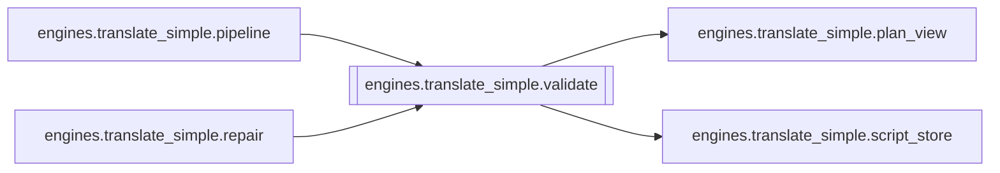

# `engines.translate_simple.validate`

[← Index](../generated/module-index.md) · [Brain home](../README.md)

<!-- AUTO:START — sinh bởi scripts/brain_build.py 2026-11-17 19:05. Đừng sửa tay khối này. -->
**File:** `engines/translate_simple/validate.py` · **Lớp:** `misc` · **236 dòng** (211 code) · **8 hàm**, **0 class** · sha1 `4179b74dba`

> Bộ kiểm tất định — chỉ ĐÁNH CỜ, không sửa. Cờ (row["s_flags"] = list mã): empty    vi trống

### Phụ thuộc

- **Gọi tới (import nội bộ):** [engines.translate_simple.plan_view](./engines.translate_simple.plan_view.md), [engines.translate_simple.script_store](./engines.translate_simple.script_store.md)
- **Được dùng bởi:** [engines.translate_simple.pipeline](./engines.translate_simple.pipeline.md), [engines.translate_simple.repair](./engines.translate_simple.repair.md)
- **Test:** `tests/test_simple_junk_park.py`, `tests/test_simple_r1_bugs.py`, `tests/test_translate_simple.py`, `tests/test_translate_simple_scenarios.py`

### Hàm & class top-level

| Tên | Dòng | Dài | Tham số | Docstring |
|---|---:|---:|---|---|
| `_base` | 58 | 8 | `f` |  |
| `_lex` | 68 | 18 | `` |  |
| `scan` | 92 | 32 | `text, protect` |  |
| `pronoun_violations` | 126 | 41 | `vi, exp_self, exp_call` | Dạng đại từ ngôi 1/2 trong vi KHÔNG thuộc cặp kỳ vọng. [] = ổn / không đủ chứng. |
| `_name_missing` | 169 | 14 | `zh, vi, pv` | Tên VI kỳ vọng (theo ZH) không xuất hiện trong vi (cả tên đầy đủ lẫn 1–2 âm tiết cuối). |
| `check_row` | 185 | 29 | `r, pv, conf_min` | Trả list cờ {code, why} cho 1 hàng (manual / câu rác junk=1 → không cờ). |
| `validate` | 216 | 17 | `rows, pv, conf_min, only` | Gắn row['s_flags'] (mã) và trả {i: [cờ]} cho các câu có cờ. only = chỉ kiểm các i này. |
| `speaker_known` | 235 | 2 | `r` |  |

### Lịch sử (từ docs/)

- Fix logs: —
- Nhắc trong CHANGELOG: **0** lần · DECISIONS: **0** lần

<!-- AUTO:END -->

<!-- MANUAL:START -->
## Vai trò (viết tay)

_Chưa viết. 2–4 câu: module này chịu trách nhiệm gì trong pipeline, ai gọi nó, nó KHÔNG làm gì._

## Luồng chính

_Các hàm vào (entry) → bước chính → output/side effect. Ghi tên hàm thật._

## Bất biến & hợp đồng

_Điều luôn phải đúng (vd: chỉ ghi manifest qua `Manifest.update`; 1 job / ghế). Vi phạm = bug._

## Bẫy đã biết

_Lỗi từng gặp + link `docs/fixes/...`. Những chỗ dễ sửa sai._

## Ghi chú vận hành

_Config key quan trọng, cần restart gì khi sửa (:8801 / :8802 / hot-reload), cách test._
<!-- MANUAL:END -->
