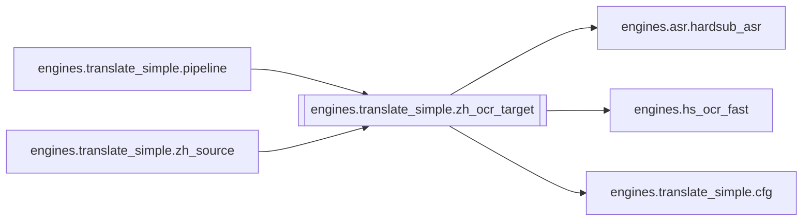

# `engines.translate_simple.zh_ocr_target`

[← Index](../generated/module-index.md) · [Brain home](../README.md)

<!-- AUTO:START — sinh bởi scripts/brain_build.py 2026-11-17 19:05. Đừng sửa tay khối này. -->
**File:** `engines/translate_simple/zh_ocr_target.py` · **Lớp:** `misc` · **279 dòng** (245 code) · **11 hàm**, **0 class** · sha1 `6bf1db919a`

> OCR hardsub CÓ CHỌN LỌC cho luồng simple — SIMPLE_ZH_OCR_MODE=targeted (mặc định) — 2026-11-14. Thay vì OCR cả phim (1efd1014ac77_p03: 16.702 khung, hàng giờ), chỉ OCR 1 khung GIỮA câu ở những câu mà chữ Trung đúng/sai l

### Phụ thuộc

- **Gọi tới (import nội bộ):** [engines.asr.hardsub_asr](./engines.asr.hardsub_asr.md), [engines.hs_ocr_fast](./engines.hs_ocr_fast.md), [engines.translate_simple.cfg](./engines.translate_simple.cfg.md)
- **Được dùng bởi:** [engines.translate_simple.pipeline](./engines.translate_simple.pipeline.md), [engines.translate_simple.zh_source](./engines.translate_simple.zh_source.md)
- **Test:** ❌ chưa có test import trực tiếp
- **Thư viện ngoài:** `numpy`

### Hàm & class top-level

| Tên | Dòng | Dài | Tham số | Docstring |
|---|---:|---:|---|---|
| `_core` | 30 | 2 | `s` |  |
| `accept_conf` | 34 | 7 | `` | Độ tin cậy OCR tối thiểu (chữ thấp nhất của dòng) để THAY chữ ASR — OCR_HS_ACCEPT_CONF (0.8). |
| `_lev` | 43 | 9 | `a, b` | Khoảng cách Levenshtein (thay/thêm/bớt = 1). |
| `align` | 54 | 31 | `asr, ocr_line, min_ratio` | Chữ thay cho câu ASR (giữ dấu câu cuối của ASR) hoặc None (không đổi / không đủ tin). |
| `pick_a` | 87 | 11 | `segments, names` | Vị trí (index) các câu cần OCR ở lượt A. |
| `pick_b` | 100 | 29 | `rows, flags, conf_min, done` | Vị trí các hàng script cần OCR ở lượt B (±1 câu ngữ cảnh), bỏ hàng đã OCR ở lượt A / manual / rác. |
| `_grab_band` | 135 | 26 | `video, t, rect` | 1 khung dải phụ đề tại t (xám). Thử giải mã GPU trước; không ra khung → CPU và nhớ lại. |
| `ocr_times` | 163 | 39 | `work_dir, items, ocr, grab, video, workers, stop_check` | items = [(key, t)] → ({key: chữ OCR}, thống kê). Lấy khung song song (ffmpeg), OCR tuần tự. |
| `_mid` | 204 | 3 | `s` |  |
| `pass_a` | 210 | 36 | `work_dir, segments, names, ocr, grab, video` | Trả (segments mới, báo cáo). Câu được thay: text=OCR, zh_src='ocr', zh_asr=chữ cũ. |
| `pass_b` | 248 | 32 | `work_dir, store, flags, conf_min, done, ocr, grab, video, stop_check` | Sửa TẠI CHỖ store.rows: câu OCR khác ASR → zh mới, zh_asr giữ, bỏ rv (soát lại). Trả báo cáo. |

**Tín hiệu rủi ro (đếm tĩnh):** broad_except=2 · pools=1 · subprocess=1

### Lịch sử (từ docs/)

- Fix logs: —
- Nhắc trong CHANGELOG: **1** lần · DECISIONS: **0** lần

<!-- AUTO:END -->

<!-- MANUAL:START -->
## Vai trò (viết tay)

_Chưa viết. 2–4 câu: module này chịu trách nhiệm gì trong pipeline, ai gọi nó, nó KHÔNG làm gì._

## Luồng chính

_Các hàm vào (entry) → bước chính → output/side effect. Ghi tên hàm thật._

## Bất biến & hợp đồng

_Điều luôn phải đúng (vd: chỉ ghi manifest qua `Manifest.update`; 1 job / ghế). Vi phạm = bug._

## Bẫy đã biết

_Lỗi từng gặp + link `docs/fixes/...`. Những chỗ dễ sửa sai._

## Ghi chú vận hành

_Config key quan trọng, cần restart gì khi sửa (:8801 / :8802 / hot-reload), cách test._
<!-- MANUAL:END -->
