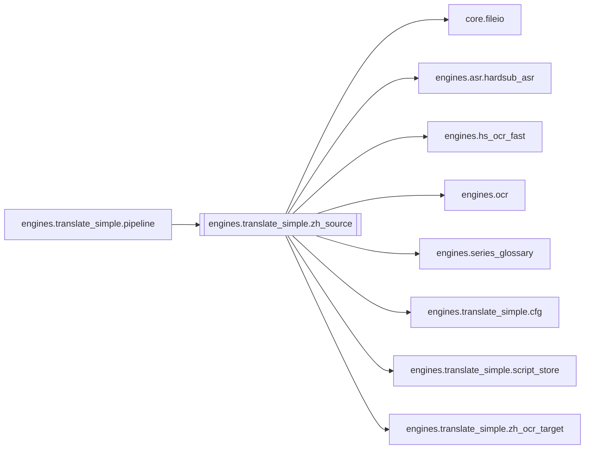

# `engines.translate_simple.zh_source`

[← Index](../generated/module-index.md) · [Brain home](../README.md)

<!-- AUTO:START — sinh bởi scripts/brain_build.py 2026-11-17 19:05. Đừng sửa tay khối này. -->
**File:** `engines/translate_simple/zh_source.py` · **Lớp:** `misc` · **353 dòng** (315 code) · **11 hàm**, **0 class** · sha1 `4a9520b2bc`

> Bước 1 (2026-11-12 next) — chọn NGUỒN chữ ZH cho luồng simple (cờ SIMPLE_ZH_SOURCE=1, mặc định tắt). 1) Phát hiện hardsub (detect): - có cache của render (hardsub_track.json: bands rỗng = không hardsub; hardsub_band.json

### Phụ thuộc

- **Gọi tới (import nội bộ):** [core.fileio](./core.fileio.md), [engines.asr.hardsub_asr](./engines.asr.hardsub_asr.md), [engines.hs_ocr_fast](./engines.hs_ocr_fast.md), [engines.ocr](./engines.ocr.md), [engines.series_glossary](./engines.series_glossary.md), [engines.translate_simple.cfg](./engines.translate_simple.cfg.md), [engines.translate_simple.script_store](./engines.translate_simple.script_store.md), [engines.translate_simple.zh_ocr_target](./engines.translate_simple.zh_ocr_target.md)
- **Được dùng bởi:** [engines.translate_simple.pipeline](./engines.translate_simple.pipeline.md)
- **Test:** `tests/test_translate_simple_next.py`, `tests/test_translate_simple_next_review.py`
- **Thư viện ngoài:** `PIL`, `engines`, `pypinyin`, `rapidocr_onnxruntime`

### Hàm & class top-level

| Tên | Dòng | Dài | Tham số | Docstring |
|---|---:|---:|---|---|
| `_cached` | 35 | 18 | `work_dir` |  |
| `_ffmpeg_grab` | 55 | 7 | `video, t, out` |  |
| `_probe_dur` | 64 | 7 | `video` |  |
| `_img_size` | 73 | 7 | `img` |  |
| `detect` | 82 | 66 | `work_dir, n, min_ratio, find_video, probe_dur, grab, ocr, img_size` | {"has_hardsub", "method", "n_samples", "n_hits", "ratio"}. Các hàm I/O tiêm được (test dùng khung giả). |
| `profile_names` | 151 | 28 | `work_dir` | Tên nhân vật (+ alias) và thuật ngữ ZH từ hồ sơ phim: bảng bộ (series_glossary) + glossary.json. |
| `_pinyin` | 181 | 6 | `` |  |
| `fix_names` | 189 | 44 | `segments, names, min_score, pinyin` | Sửa tên gần đúng TẠI CHỖ trên segments (key text). Trả log [{i, name, from, to, score}]. |
| `_guard_ocr` | 236 | 30 | `merged, H` | merge_hardsub_into_asr chọn cue theo từng câu ASR độc lập ⇒ khi ASR tách 1 dòng hardsub thành 2 câu, cả hai |
| `prepare` | 269 | 56 | `work_dir, segments, detect_fn, cues_fn` | Trả (segments dùng cho dịch, báo cáo). Không ghi asr.json. Lỗi bất kỳ → trả segments gốc + báo cáo lỗi. |
| `sync_rows` | 327 | 27 | `store, segs` | Hàng script đã có (chạy lại): câu KHÔNG manual, CHƯA rv → cập nhật zh theo nguồn mới (giữ zh_asr). |

**File/artifact nhắc tới:** `asr.zhsource.json`, `glossary.json`, `hardsub_band.json`, `hardsub_track.json`, `zh_source.json`

**Tín hiệu rủi ro (đếm tĩnh):** broad_except=11 · subprocess=2 · swallow_except=5

### Lịch sử (từ docs/)

- Fix logs: —
- Nhắc trong CHANGELOG: **0** lần · DECISIONS: **0** lần

<!-- AUTO:END -->

<!-- MANUAL:START -->
## Vai trò (viết tay)

_Chưa viết. 2–4 câu: module này chịu trách nhiệm gì trong pipeline, ai gọi nó, nó KHÔNG làm gì._

## Luồng chính

_Các hàm vào (entry) → bước chính → output/side effect. Ghi tên hàm thật._

## Bất biến & hợp đồng

_Điều luôn phải đúng (vd: chỉ ghi manifest qua `Manifest.update`; 1 job / ghế). Vi phạm = bug._

## Bẫy đã biết

_Lỗi từng gặp + link `docs/fixes/...`. Những chỗ dễ sửa sai._

## Ghi chú vận hành

_Config key quan trọng, cần restart gì khi sửa (:8801 / :8802 / hot-reload), cách test._
<!-- MANUAL:END -->
