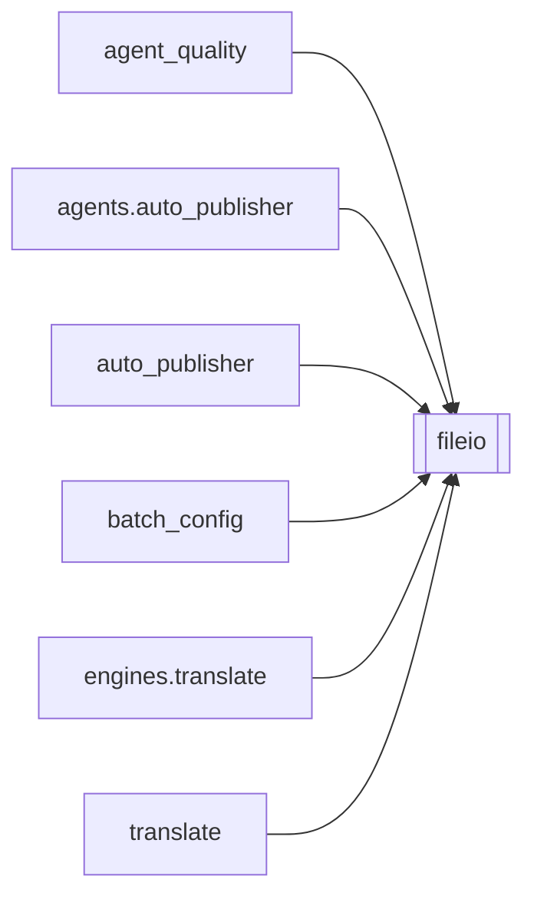

# `fileio`

[← Index](../generated/module-index.md) · [Brain home](../README.md)

<!-- AUTO:START — sinh bởi scripts/brain_build.py 2026-11-11 02:38. Đừng sửa tay khối này. -->
**File:** `fileio.py` · **Lớp:** `control` · **104 dòng** (91 code) · **4 hàm**, **0 class** · sha1 `e820e73bf1`

> Ghi file an toàn giữa nhiều tiến trình (server :8801, sidecar :8802, script). atomic_write_text: ghi temp riêng (pid+thread) rồi os.replace — người đọc không bao giờ thấy file dở. file_lock: khoá liên tiến trình bằng fil

### Phụ thuộc

- **Gọi tới (import nội bộ):** —
- **Được dùng bởi:** [agent_quality](./agent_quality.md), [agents.auto_publisher](./agents.auto_publisher.md), [auto_publisher](./auto_publisher.md), [batch_config](./batch_config.md), [engines.translate](./engines.translate.md), [translate](./translate.md)
- **Test:** ❌ chưa có test import trực tiếp

### Hàm & class top-level

| Tên | Dòng | Dài | Tham số | Docstring |
|---|---:|---:|---|---|
| `atomic_write_text` | 16 | 21 | `path, text, encoding, fsync` |  |
| `atomic_write_json` | 39 | 2 | `path, obj, indent, fsync` |  |
| `read_json_checkpoint` | 43 | 14 | `path, default` | Đọc checkpoint JSON. Hỏng → đổi tên thành .corrupt-<ts> (giữ để cứu) và trả default, |
| `file_lock` | 60 | 45 | `path, timeout, stale_sec` |  |

**Tín hiệu rủi ro (đếm tĩnh):** broad_except=2 · sleep=2 · swallow_except=2

### Lịch sử (từ docs/)

- **Fix logs (3):**
  - [Auto-publish banner stuck 41% sau restart sidecar](../../fixes/2026-11-06-autopub-scan-lock-stuck.md)
  - [2026-10-06 — Đợt 4 review: tranh chấp ghi, một bản tiến trình, checkpoint an toàn](../../fixes/2026-10-06-batch4-write-races.md)
  - [2026-10-06 — Đợt 3 review: opts một nguồn, config file-first, ghi nguyên tử](../../fixes/2026-10-06-batch3-single-source.md)
- **Reviews:** [_atoms_core_server](../../reviews/_atoms_core_server.md), [2026-11-06-v5-part-atoms](../../reviews/2026-11-06-v5-part-atoms.md), [2026-11-06-v5-func-catalog](../../reviews/2026-11-06-v5-func-catalog.md), [2026-11-02-v4-structure-sync](../../reviews/2026-11-02-v4-structure-sync.md)
- Nhắc trong CHANGELOG: **3** lần · DECISIONS: **1** lần

<!-- AUTO:END -->

<!-- MANUAL:START -->
## Vai trò (viết tay)

_Chưa viết. 2–4 câu: module này chịu trách nhiệm gì trong pipeline, ai gọi nó, nó KHÔNG làm gì._

## Luồng chính

_Các hàm vào (entry) → bước chính → output/side effect. Ghi tên hàm thật._

## Bất biến & hợp đồng

_Điều luôn phải đúng (vd: chỉ ghi manifest qua `Manifest.update`; 1 job / ghế). Vi phạm = bug._

## Bẫy đã biết

_Lỗi từng gặp + link `docs/fixes/...`. Những chỗ dễ sửa sai._

## Ghi chú vận hành

_Config key quan trọng, cần restart gì khi sửa (:8801 / :8802 / hot-reload), cách test._
<!-- MANUAL:END -->
