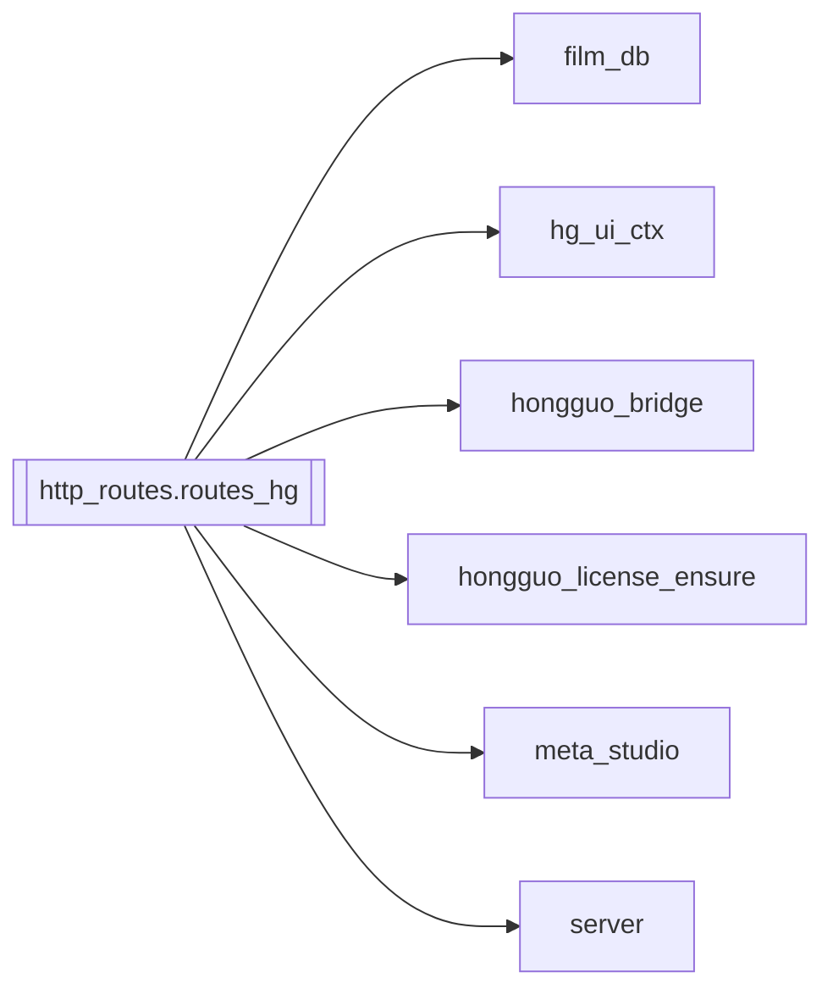

# `http_routes.routes_hg`

[← Index](../generated/module-index.md) · [Brain home](../README.md)

<!-- AUTO:START — sinh bởi scripts/brain_build.py 2026-11-11 02:38. Đừng sửa tay khối này. -->
**File:** `http_routes/routes_hg.py` · **Lớp:** `control` · **993 dòng** (857 code) · **56 hàm**, **3 class** · sha1 `9770ce5365`

> Cầu nối Hongguo Downloader (local :8000): /api/hg/*. Tách từ server.py (đợt 7). Chỉ được nạp từ cuối server.py (sau khi mọi hàm/model lõi đã định nghĩa): truy cập server qua `S.<tên>` để patch `server.<tên>` trong test v

### Phụ thuộc

- **Gọi tới (import nội bộ):** [film_db](./film_db.md), [hg_ui_ctx](./hg_ui_ctx.md), [hongguo_bridge](./hongguo_bridge.md), [hongguo_license_ensure](./hongguo_license_ensure.md), [meta_studio](./meta_studio.md), [server](./server.md)
- **Được dùng bởi:** —
- **Được nhắc tên file `.py` (subprocess/script) bởi:** [restart_server](./restart_server.md), [scripts._tmp_extract_sigs_batch2](./scripts._tmp_extract_sigs_batch2.md)
- **Test:** `tests/test_server_split.py`
- **Thư viện ngoài:** `fastapi`, `pydantic`, `title_mt`

### API routes (58)

| Method | Path | Handler | Dòng |
|---|---|---|---:|
| GET | `/api/disk` | `api_disk` | 82 |
| GET | `/api/hg/baike-info` | `hg_baike_info` | 203 |
| GET | `/api/hg/baike-search` | `hg_baike_search` | 188 |
| POST | `/api/hg/cancel` | `hg_cancel` | 319 |
| GET | `/api/hg/catalog` | `hg_catalog` | 457 |
| POST | `/api/hg/downloads/cancel` | `hg_dl_cancel_one` | 341 |
| POST | `/api/hg/downloads/clear-finished` | `hg_dl_clear_finished` | 330 |
| POST | `/api/hg/downloads/open-folder` | `hg_dl_open_folder` | 387 |
| POST | `/api/hg/downloads/remove` | `hg_dl_remove` | 357 |
| POST | `/api/hg/downloads/retry` | `hg_dl_retry` | 372 |
| GET | `/api/hg/feed` | `hg_feed` | 475 |
| GET | `/api/hg/genres` | `hg_genres` | 446 |
| GET | `/api/hg/img` | `hg_img` | 672 |
| GET | `/api/hg/library` | `hg_library` | 549 |
| POST | `/api/hg/library/delete` | `hg_library_delete` | 744 |
| POST | `/api/hg/library/open` | `hg_library_open` | 734 |
| GET|HEAD | `/api/hg/library/preview` | `hg_library_preview` | 647 |
| POST | `/api/hg/library/seasons/decline` | `hg_seasons_decline` | 782 |
| POST | `/api/hg/library/seasons/discover` | `hg_seasons_discover` | 795 |
| POST | `/api/hg/library/update` | `hg_library_update` | 769 |
| POST | `/api/hg/library/update-info` | `hg_library_update_info` | 757 |
| GET | `/api/hg/library/watchlist` | `hg_library_watchlist` | 815 |
| DELETE | `/api/hg/license/key` | `hg_license_key_clear` | 965 |
| POST | `/api/hg/license/key` | `hg_license_key` | 949 |
| POST | `/api/hg/license/prove` | `hg_license_prove` | 976 |
| GET | `/api/hg/license/status` | `hg_license_status` | 937 |
| POST | `/api/hg/merge` | `hg_merge` | 710 |
| GET | `/api/hg/merge-queue` | `hg_merge_queue` | 722 |
| POST | `/api/hg/merge-queue/clear` | `hg_merge_queue_clear` | 728 |
| GET | `/api/hg/ping` | `hg_ping` | 120 |
| GET|HEAD | `/api/hg/playback/stream` | `hg_playback_stream` | 631 |
| GET | `/api/hg/poster` | `hg_poster` | 693 |
| GET | `/api/hg/preview` | `hg_preview` | 560 |
| GET | `/api/hg/preview/job` | `hg_preview_job` | 619 |
| POST | `/api/hg/preview/start` | `hg_preview_start` | 598 |
| GET | `/api/hg/rank` | `hg_rank` | 415 |
| POST | `/api/hg/rank-episodes` | `hg_rank_episodes` | 521 |
| POST | `/api/hg/resolve` | `hg_resolve` | 171 |
| GET | `/api/hg/search` | `hg_search` | 158 |
| GET | `/api/hg/series/{series_id}` | `hg_series` | 273 |
| GET | `/api/hg/series/{series_id}/qualities` | `hg_series_qualities` | 296 |
| GET | `/api/hg/series/{series_id}/seasons` | `hg_series_seasons` | 284 |
| GET | `/api/hg/settings` | `hg_settings` | 128 |
| POST | `/api/hg/settings` | `hg_settings_update` | 140 |
| GET | `/api/hg/status` | `hg_status` | 308 |
| POST | `/api/hg/submit` | `hg_submit` | 399 |
| POST | `/api/hg/translate-titles` | `hg_translate_titles` | 537 |
| GET | `/api/hg/web-search` | `hg_web_search` | 250 |
| POST | `/api/meta/generate` | `meta_generate` | 833 |
| POST | `/api/meta/generate-title` | `meta_generate_title` | 852 |
| GET | `/api/meta/series-info` | `meta_series_info` | 921 |
| GET | `/api/meta/thumbnail` | `meta_thumbnail_get` | 912 |
| POST | `/api/meta/thumbnail` | `meta_thumbnail` | 882 |
| POST | `/meta/generate` | `meta_generate` | 833 |
| POST | `/meta/generate-title` | `meta_generate_title` | 852 |
| GET | `/meta/series-info` | `meta_series_info` | 921 |
| GET | `/meta/thumbnail` | `meta_thumbnail_get` | 912 |
| POST | `/meta/thumbnail` | `meta_thumbnail` | 882 |

### Hàm & class top-level

| Tên | Dòng | Dài | Tham số | Docstring |
|---|---:|---:|---|---|
| **class `HgRankEpsIn`** | 515 | 0 method | |  |
| **class `HgTranslateTitlesIn`** | 532 | 0 method | |  |
| **class `HgPreviewStartIn`** | 590 | 0 method | |  |
| async `_bind_hg_ui_backend` | 19 | 10 | `request` | Tách Hongguo1 / Hongguo2 theo header hoặc Referer (hg_ui_ctx, không reload). |
| `_hg_base` | 64 | 4 | `override` | Luôn DEFAULT_BASE: `base` từ client từng cho server gửi token Hongguo tới URL bất kỳ. |
| `_hg_err` | 70 | 9 | `e` |  |
| `api_disk` | 82 | 35 | `base` | Dung lượng ổ thư viện Hongguo (sidebar hongguo2). |
| `hg_ping` | 120 | 5 | `base` |  |
| `hg_settings` | 128 | 9 | `base` | Hongguo 2.x settings (saveFolder, quality…) — cùng helper WinUI. |
| `hg_settings_update` | 140 | 15 | `body, base` | Patch settings (quality, saveFolder, merge…) — RPC settings.update. |
| `hg_search` | 158 | 10 | `q, base, expand` |  |
| `hg_resolve` | 171 | 14 | `body, base` | Dán link Hongguo / series_id → meta (khi search không ra, vd. 第十一季). |
| `hg_baike_search` | 188 | 12 | `q, base` | Nhận diện trên duanjubaike → danh sách version → match Hongguo từng cái. |
| `hg_baike_info` | 203 | 44 | `series_id, title, translate` | Chi tiết sâu từ duanjubaike (intro/tags/score/同系列). |
| `hg_web_search` | 250 | 20 | `q` | Scrape hongguoduanju.com/search — dùng khi API Downloader sót mùa. |
| `hg_series` | 273 | 8 | `series_id, base` |  |
| `hg_series_seasons` | 284 | 9 | `series_id, base` | Franchise seasons (S1…Sn) — RPC series.seasons. |
| `hg_series_qualities` | 296 | 9 | `series_id, base` | Quality ladder + bitrate — RPC series.qualities. |
| `hg_status` | 308 | 8 | `base` |  |
| `hg_cancel` | 319 | 8 | `body` |  |
| `hg_dl_clear_finished` | 330 | 8 | `body` |  |
| `hg_dl_cancel_one` | 341 | 13 | `body` | Stop 1 download đang chạy/chờ. |
| `hg_dl_remove` | 357 | 12 | `body` |  |
| `hg_dl_retry` | 372 | 12 | `body` |  |
| `hg_dl_open_folder` | 387 | 9 | `body` |  |
| `hg_submit` | 399 | 13 | `body` |  |
| `hg_rank` | 415 | 28 | `category, board, chart, offset, size, base` | Bảng hot / Browse feed / Catalog. |
| `hg_genres` | 446 | 8 | `limit` |  |
| `hg_catalog` | 457 | 15 | `genre, sort, status, q, page, size` |  |
| `hg_feed` | 475 | 38 | `offset, size, panel, session_id, genre, category_dim_theme, categor…` | Hongguo 2.x Browse = feed.page + selector panel (WinUI facets). |
| `hg_rank_episodes` | 521 | 9 | `body` | Lazy fill episode_cnt cho series trên bảng hot. |
| `hg_translate_titles` | 537 | 9 | `body` | Dịch thô title Trung→Việt (Google gtx + cache) — chỉ để duyệt Hongguo. |
| `hg_library` | 549 | 8 | `base` |  |
| `hg_preview` | 560 | 28 | `series_id, ep, fresh, quality, base` | Xem thử 1 tập — :8000 /dl/preview hoặc RPC playback.prepare → stream local. |
| `hg_preview_start` | 598 | 18 | `body` | Bắt đầu prepare nền (progress poll qua /api/hg/preview/job). |
| `hg_preview_job` | 619 | 9 | `ticket` | Trạng thái job preview async (progress 0..1). |
| `hg_playback_stream` | 631 | 13 | `session` | Stream MP4 đã prepare bởi helper (thư mục hongguo-player). |
| `hg_library_preview` | 647 | 22 | `name, base` | Stream video thư viện Hongguo (merged hoặc tập đầu) — tua được (Range). |
| `hg_img` | 672 | 18 | `url, u, base` | Proxy ảnh cover qua Hongguo /img (HEIC → JPEG) — kèm UI token. |
| `hg_poster` | 693 | 14 | `name, base` | Poster thư viện: /dl/poster (auth) hoặc file local poster.jpg. |
| `hg_merge` | 710 | 9 | `body` | Enqueue merge tuần tự (Hongguo chỉ chạy 1 merge / lúc). |
| `hg_merge_queue` | 722 | 3 | `base` |  |
| `hg_merge_queue_clear` | 728 | 3 | `` |  |
| `hg_library_open` | 734 | 7 | `body` |  |
| `hg_library_delete` | 744 | 10 | `body` |  |
| `hg_library_update_info` | 757 | 9 | `base` | WinUI «Update info» — library.updateInfo. |
| `hg_library_update` | 769 | 10 | `body` |  |
| `hg_seasons_decline` | 782 | 10 | `body` |  |
| `hg_seasons_discover` | 795 | 17 | `body` | Chỉ tìm mùa mới theo watchlist+films+lib — không tải / không gọi Update all. |
| `hg_library_watchlist` | 815 | 14 | `include_deleted` | Danh sách meta watchlist (sau xoá Lib vẫn còn) — không tải. |
| `meta_generate` | 833 | 15 | `body` |  |
| `meta_generate_title` | 852 | 26 | `body` |  |
| `meta_thumbnail` | 882 | 26 | `body` |  |
| `meta_thumbnail_get` | 912 | 5 | `file` |  |
| `meta_series_info` | 921 | 13 | `job_id` |  |
| `hg_license_status` | 937 | 9 | `` | Safe license status for Hongguo 2.x UI — never returns key/proof. |
| `hg_license_key` | 949 | 13 | `body` |  |
| `hg_license_key_clear` | 965 | 8 | `` |  |
| `hg_license_prove` | 976 | 15 | `body` |  |

**Tín hiệu rủi ro (đếm tĩnh):** broad_except=52 · swallow_except=2

### Lịch sử (từ docs/)

- **Fix logs (6):**
  - [`/api/hg/poster` 502 với job_id / `downloads`](../../fixes/2026-11-09-hg-poster-502-junk-name.md)
  - [Hongguo2 thiếu dòng tiếng Việt dưới tiêu đề Trung](../../fixes/2026-11-08-hongguo2-title-vi.md)
  - [Hongguo2: qualities 502 + /api/disk 404](../../fixes/2026-11-08-hongguo2-qualities-disk.md)
  - [Helper Pineline leak / lệch WinUI (spawn riêng)](../../fixes/2026-11-08-helper-singleton-winui-parity.md)
  - [Thumbnail meta 404 sau khi move routes_hg → http_routes/](../../fixes/2026-11-04-http-routes-thumb-root.md)
  - [Đợt 7: gỡ UI cũ, tách server.py](../../fixes/2026-10-06-batch7-ui-split.md)
- **Reviews:** [_atoms_http_agents](../../reviews/_atoms_http_agents.md), [2026-11-07-hongguo-2x-post-restart-test](../../reviews/2026-11-07-hongguo-2x-post-restart-test.md), [2026-11-06-v5-part-atoms](../../reviews/2026-11-06-v5-part-atoms.md), [2026-11-06-v5-func-catalog](../../reviews/2026-11-06-v5-func-catalog.md), [2026-11-02-v4-structure-and-v2-port](../../reviews/2026-11-02-v4-structure-and-v2-port.md), [2026-10-06-code-review](../../reviews/2026-10-06-code-review.md)
- Nhắc trong CHANGELOG: **3** lần · DECISIONS: **0** lần

<!-- AUTO:END -->

<!-- MANUAL:START -->
## Vai trò (viết tay)

_Chưa viết. 2–4 câu: module này chịu trách nhiệm gì trong pipeline, ai gọi nó, nó KHÔNG làm gì._

## Luồng chính

_Các hàm vào (entry) → bước chính → output/side effect. Ghi tên hàm thật._

## Bất biến & hợp đồng

_Điều luôn phải đúng (vd: chỉ ghi manifest qua `Manifest.update`; 1 job / ghế). Vi phạm = bug._

## Bẫy đã biết

_Lỗi từng gặp + link `docs/fixes/...`. Những chỗ dễ sửa sai._

## Ghi chú vận hành

_Config key quan trọng, cần restart gì khi sửa (:8801 / :8802 / hot-reload), cách test._
<!-- MANUAL:END -->
