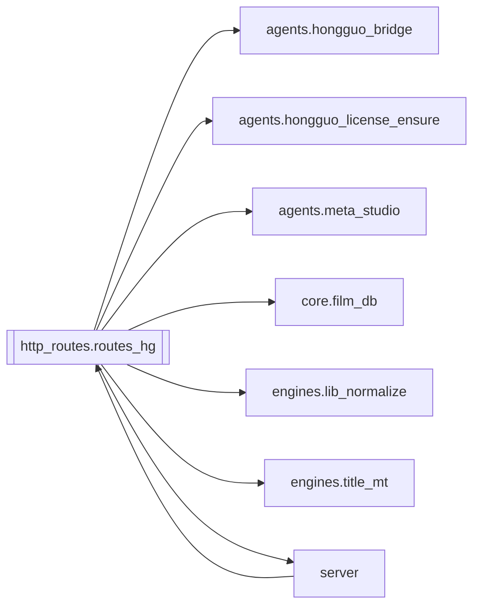

# `http_routes.routes_hg`

[← Index](../generated/module-index.md) · [Brain home](../README.md)

<!-- AUTO:START — sinh bởi scripts/brain_build.py 2026-11-17 19:05. Đừng sửa tay khối này. -->
**File:** `http_routes/routes_hg.py` · **Lớp:** `control` · **1107 dòng** (958 code) · **58 hàm**, **3 class** · sha1 `a33f974e9b`

> Cầu nối Hongguo 2.x (helper RPC stdio): /api/hg/* (= /api/hg2/*). Tách từ server.py (đợt 7). Chỉ được nạp từ cuối server.py (sau khi mọi hàm/model lõi đã định nghĩa): truy cập server qua `S.<tên>` để patch `server.<tên>`

### Phụ thuộc

- **Gọi tới (import nội bộ):** [agents.hongguo_bridge](./agents.hongguo_bridge.md), [agents.hongguo_license_ensure](./agents.hongguo_license_ensure.md), [agents.meta_studio](./agents.meta_studio.md), [core.film_db](./core.film_db.md), [engines.lib_normalize](./engines.lib_normalize.md), [engines.title_mt](./engines.title_mt.md), [server](./server.md)
- **Được dùng bởi:** [server](./server.md)
- **Được nhắc tên file `.py` (subprocess/script) bởi:** [restart_server](./restart_server.md), [scripts._tmp_extract_sigs_batch2](./scripts._tmp_extract_sigs_batch2.md)
- **Test:** `tests/test_server_split.py`
- **Thư viện ngoài:** `PIL`, `fastapi`, `pydantic`

### API routes (62)

| Method | Path | Handler | Dòng |
|---|---|---|---:|
| GET | `/api/disk` | `api_disk` | 70 |
| GET | `/api/hg/baike-info` | `hg_baike_info` | 190 |
| GET | `/api/hg/baike-search` | `hg_baike_search` | 175 |
| POST | `/api/hg/cancel` | `hg_cancel` | 306 |
| GET | `/api/hg/catalog` | `hg_catalog` | 444 |
| POST | `/api/hg/downloads/cancel` | `hg_dl_cancel_one` | 328 |
| POST | `/api/hg/downloads/clear-finished` | `hg_dl_clear_finished` | 317 |
| POST | `/api/hg/downloads/open-folder` | `hg_dl_open_folder` | 374 |
| POST | `/api/hg/downloads/remove` | `hg_dl_remove` | 344 |
| POST | `/api/hg/downloads/retry` | `hg_dl_retry` | 359 |
| GET | `/api/hg/feed` | `hg_feed` | 462 |
| GET | `/api/hg/genres` | `hg_genres` | 433 |
| GET | `/api/hg/img` | `hg_img` | 659 |
| GET | `/api/hg/library` | `hg_library` | 536 |
| POST | `/api/hg/library/delete` | `hg_library_delete` | 786 |
| POST | `/api/hg/library/normalize` | `hg_library_normalize` | 748 |
| GET | `/api/hg/library/normalize/status` | `hg_library_normalize_status` | 779 |
| POST | `/api/hg/library/open` | `hg_library_open` | 738 |
| GET|HEAD | `/api/hg/library/preview` | `hg_library_preview` | 634 |
| POST | `/api/hg/library/seasons/decline` | `hg_seasons_decline` | 824 |
| POST | `/api/hg/library/seasons/discover` | `hg_seasons_discover` | 838 |
| POST | `/api/hg/library/update` | `hg_library_update` | 811 |
| POST | `/api/hg/library/update-info` | `hg_library_update_info` | 799 |
| GET | `/api/hg/library/watchlist` | `hg_library_watchlist` | 858 |
| DELETE | `/api/hg/license/key` | `hg_license_key_clear` | 1079 |
| POST | `/api/hg/license/key` | `hg_license_key` | 1063 |
| POST | `/api/hg/license/prove` | `hg_license_prove` | 1090 |
| GET | `/api/hg/license/status` | `hg_license_status` | 1051 |
| POST | `/api/hg/merge` | `hg_merge` | 714 |
| GET | `/api/hg/merge-queue` | `hg_merge_queue` | 726 |
| POST | `/api/hg/merge-queue/clear` | `hg_merge_queue_clear` | 732 |
| GET | `/api/hg/ping` | `hg_ping` | 107 |
| GET|HEAD | `/api/hg/playback/stream` | `hg_playback_stream` | 618 |
| GET | `/api/hg/poster` | `hg_poster` | 680 |
| GET | `/api/hg/preview` | `hg_preview` | 547 |
| GET | `/api/hg/preview/job` | `hg_preview_job` | 606 |
| POST | `/api/hg/preview/start` | `hg_preview_start` | 585 |
| GET | `/api/hg/rank` | `hg_rank` | 402 |
| POST | `/api/hg/rank-episodes` | `hg_rank_episodes` | 508 |
| POST | `/api/hg/resolve` | `hg_resolve` | 158 |
| GET | `/api/hg/search` | `hg_search` | 145 |
| GET | `/api/hg/series/{series_id}` | `hg_series` | 260 |
| GET | `/api/hg/series/{series_id}/qualities` | `hg_series_qualities` | 283 |
| GET | `/api/hg/series/{series_id}/seasons` | `hg_series_seasons` | 271 |
| GET | `/api/hg/settings` | `hg_settings` | 115 |
| POST | `/api/hg/settings` | `hg_settings_update` | 127 |
| GET | `/api/hg/status` | `hg_status` | 295 |
| POST | `/api/hg/submit` | `hg_submit` | 386 |
| POST | `/api/hg/translate-titles` | `hg_translate_titles` | 524 |
| GET | `/api/hg/web-search` | `hg_web_search` | 237 |
| POST | `/api/meta/ai-image` | `meta_ai_image` | 925 |
| POST | `/api/meta/generate` | `meta_generate` | 876 |
| POST | `/api/meta/generate-title` | `meta_generate_title` | 895 |
| GET | `/api/meta/series-info` | `meta_series_info` | 1035 |
| GET | `/api/meta/thumbnail` | `meta_thumbnail_get` | 1026 |
| POST | `/api/meta/thumbnail` | `meta_thumbnail` | 996 |
| POST | `/meta/ai-image` | `meta_ai_image` | 925 |
| POST | `/meta/generate` | `meta_generate` | 876 |
| POST | `/meta/generate-title` | `meta_generate_title` | 895 |
| GET | `/meta/series-info` | `meta_series_info` | 1035 |
| GET | `/meta/thumbnail` | `meta_thumbnail_get` | 1026 |
| POST | `/meta/thumbnail` | `meta_thumbnail` | 996 |

### Hàm & class top-level

| Tên | Dòng | Dài | Tham số | Docstring |
|---|---:|---:|---|---|
| **class `HgRankEpsIn`** | 502 | 0 method | |  |
| **class `HgTranslateTitlesIn`** | 519 | 0 method | |  |
| **class `HgPreviewStartIn`** | 577 | 0 method | |  |
| `_hg_base` | 52 | 4 | `override` | Luôn DEFAULT_BASE: `base` từ client từng cho server gửi token Hongguo tới URL bất kỳ. |
| `_hg_err` | 58 | 9 | `e` |  |
| `api_disk` | 70 | 34 | `base` | Dung lượng ổ thư viện Hongguo (sidebar hongguo2). |
| `hg_ping` | 107 | 5 | `base` |  |
| `hg_settings` | 115 | 9 | `base` | Hongguo 2.x settings (saveFolder, quality…) — cùng helper WinUI. |
| `hg_settings_update` | 127 | 15 | `body, base` | Patch settings (quality, saveFolder, merge…) — RPC settings.update. |
| `hg_search` | 145 | 10 | `q, base, expand` |  |
| `hg_resolve` | 158 | 14 | `body, base` | Dán link Hongguo / series_id → meta (khi search không ra, vd. 第十一季). |
| `hg_baike_search` | 175 | 12 | `q, base` | Nhận diện trên duanjubaike → danh sách version → match Hongguo từng cái. |
| `hg_baike_info` | 190 | 44 | `series_id, title, translate` | Chi tiết sâu từ duanjubaike (intro/tags/score/同系列). |
| `hg_web_search` | 237 | 20 | `q` | Scrape hongguoduanju.com/search — dùng khi API Downloader sót mùa. |
| `hg_series` | 260 | 8 | `series_id, base` |  |
| `hg_series_seasons` | 271 | 9 | `series_id, base` | Franchise seasons (S1…Sn) — RPC series.seasons. |
| `hg_series_qualities` | 283 | 9 | `series_id, base` | Quality ladder + bitrate — RPC series.qualities. |
| `hg_status` | 295 | 8 | `base` |  |
| `hg_cancel` | 306 | 8 | `body` |  |
| `hg_dl_clear_finished` | 317 | 8 | `body` |  |
| `hg_dl_cancel_one` | 328 | 13 | `body` | Stop 1 download đang chạy/chờ. |
| `hg_dl_remove` | 344 | 12 | `body` |  |
| `hg_dl_retry` | 359 | 12 | `body` |  |
| `hg_dl_open_folder` | 374 | 9 | `body` |  |
| `hg_submit` | 386 | 13 | `body` |  |
| `hg_rank` | 402 | 28 | `category, board, chart, offset, size, base` | Bảng hot / Browse feed / Catalog. |
| `hg_genres` | 433 | 8 | `limit` |  |
| `hg_catalog` | 444 | 15 | `genre, sort, status, q, page, size` |  |
| `hg_feed` | 462 | 38 | `offset, size, panel, session_id, genre, category_dim_theme, categor…` | Hongguo 2.x Browse = feed.page + selector panel (WinUI facets). |
| `hg_rank_episodes` | 508 | 9 | `body` | Lazy fill episode_cnt cho series trên bảng hot. |
| `hg_translate_titles` | 524 | 9 | `body` | Dịch thô title Trung→Việt (Google gtx + cache) — chỉ để duyệt Hongguo. |
| `hg_library` | 536 | 8 | `base` |  |
| `hg_preview` | 547 | 28 | `series_id, ep, fresh, quality, base` | Xem thử 1 tập — :8000 /dl/preview hoặc RPC playback.prepare → stream local. |
| `hg_preview_start` | 585 | 18 | `body` | Bắt đầu prepare nền (progress poll qua /api/hg/preview/job). |
| `hg_preview_job` | 606 | 9 | `ticket` | Trạng thái job preview async (progress 0..1). |
| `hg_playback_stream` | 618 | 13 | `session` | Stream MP4 đã prepare bởi helper (thư mục hongguo-player). |
| `hg_library_preview` | 634 | 22 | `name, base` | Stream video thư viện Hongguo (merged hoặc tập đầu) — tua được (Range). |
| `hg_img` | 659 | 18 | `url, u, base` | Proxy ảnh cover qua Hongguo /img (HEIC → JPEG) — kèm UI token. |
| `hg_poster` | 680 | 31 | `name, base` | Poster thư viện: /dl/poster (auth) hoặc file local poster.jpg. |
| `hg_merge` | 714 | 9 | `body` | Enqueue merge tuần tự (Hongguo chỉ chạy 1 merge / lúc). |
| `hg_merge_queue` | 726 | 3 | `base` |  |
| `hg_merge_queue_clear` | 732 | 3 | `` |  |
| `hg_library_open` | 738 | 7 | `body` |  |
| `hg_library_normalize` | 748 | 28 | `body` | Chuẩn hóa file video đã gộp về Full HD 1080p (NVENC + AAC 48k). |
| `hg_library_normalize_status` | 779 | 4 | `name` | Tiến độ chuẩn hóa: name=… → 1 bộ; không name → mọi bộ đã chạy từ lúc server bật. |
| `hg_library_delete` | 786 | 10 | `body` |  |
| `hg_library_update_info` | 799 | 9 | `base` | WinUI «Update info» — library.updateInfo. |
| `hg_library_update` | 811 | 10 | `body` |  |
| `hg_seasons_decline` | 824 | 11 | `body` |  |
| `hg_seasons_discover` | 838 | 17 | `body` | Chỉ tìm mùa mới theo watchlist+films+lib — không tải / không gọi Update all. |
| `hg_library_watchlist` | 858 | 14 | `include_deleted` | Danh sách meta watchlist (sau xoá Lib vẫn còn) — không tải. |
| `meta_generate` | 876 | 15 | `body` |  |
| `meta_generate_title` | 895 | 26 | `body` |  |
| `meta_ai_image` | 925 | 67 | `body` | Sinh Master Thumbnail AI (GPT local :3377 / Aurora) — parity với sidecar :8802. |
| `meta_thumbnail` | 996 | 26 | `body` |  |
| `meta_thumbnail_get` | 1026 | 5 | `file` |  |
| `meta_series_info` | 1035 | 13 | `job_id` |  |
| `hg_license_status` | 1051 | 9 | `` | Safe license status for Hongguo 2.x UI — never returns key/proof. |
| `hg_license_key` | 1063 | 13 | `body` |  |
| `hg_license_key_clear` | 1079 | 8 | `` |  |
| `hg_license_prove` | 1090 | 15 | `body` |  |

**File/artifact nhắc tới:** `merged.mp4`

**Tín hiệu rủi ro (đếm tĩnh):** broad_except=56 · file_writes=2 · swallow_except=3

### Lịch sử (từ docs/)

- **Fix logs (6):**
  - [`/api/hg/poster` 502 với job_id / `downloads`](../../fixes/2026-11-09-hg-poster-502-junk-name.md)
  - [Hongguo2 thiếu dòng tiếng Việt dưới tiêu đề Trung](../../fixes/2026-11-08-hongguo2-title-vi.md)
  - [Hongguo2: qualities 502 + /api/disk 404](../../fixes/2026-11-08-hongguo2-qualities-disk.md)
  - [Helper Pineline leak / lệch WinUI (spawn riêng)](../../fixes/2026-11-08-helper-singleton-winui-parity.md)
  - [Thumbnail meta 404 sau khi move routes_hg → http_routes/](../../fixes/2026-11-04-http-routes-thumb-root.md)
  - [Đợt 7: gỡ UI cũ, tách server.py](../../fixes/2026-10-06-batch7-ui-split.md)
- **Reviews:** [_atoms_http_agents](../../reviews/_atoms_http_agents.md), [2026-11-07-hongguo-2x-post-restart-test](../../reviews/2026-11-07-hongguo-2x-post-restart-test.md), [2026-11-06-v5-part-atoms](../../reviews/2026-11-06-v5-part-atoms.md), [2026-11-06-v5-func-catalog](../../reviews/2026-11-06-v5-func-catalog.md), [2026-11-02-v4-structure-and-v2-port](../../reviews/2026-11-02-v4-structure-and-v2-port.md), [2026-10-06-code-review](../../reviews/2026-10-06-code-review.md)
- Nhắc trong CHANGELOG: **4** lần · DECISIONS: **0** lần

<!-- AUTO:END -->

<!-- MANUAL:START -->
## Vai trò (viết tay)

_Chưa viết. 2–4 câu: module này chịu trách nhiệm gì trong pipeline, ai gọi nó, nó KHÔNG làm gì._

## Luồng chính

_Các hàm vào (entry) → bước chính → output/side effect. Ghi tên hàm thật._

## Bất biến & hợp đồng

_Điều luôn phải đúng (vd: chỉ ghi manifest qua `Manifest.update`; 1 job / ghế). Vi phạm = bug._

## Bẫy đã biết

_Lỗi từng gặp + link `docs/fixes/...`. Những chỗ dễ sửa sai._

## Ghi chú vận hành

_Config key quan trọng, cần restart gì khi sửa (:8801 / :8802 / hot-reload), cách test._
<!-- MANUAL:END -->
