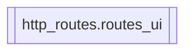

# `http_routes.routes_ui`

[← Index](../generated/module-index.md) · [Brain home](../README.md)

<!-- AUTO:START — sinh bởi scripts/brain_build.py 2026-11-11 02:38. Đừng sửa tay khối này. -->
**File:** `http_routes/routes_ui.py` · **Lớp:** `control` · **102 dòng** (77 code) · **9 hàm**, **0 class** · sha1 `cd3e35a93e`

> Trang UI chính thức V5: /, /ui3, /hongguo, /hongguo2, /workflow, /v5-map. /hongguo2 = skin WinUI 2.x (Browse/Ranking/New/Library). UI chính: static/ui/index3.html.

### Phụ thuộc

- **Gọi tới (import nội bộ):** —
- **Được dùng bởi:** —
- **Được nhắc tên file `.py` (subprocess/script) bởi:** [restart_server](./restart_server.md), [scripts._tmp_extract_sigs_batch2](./scripts._tmp_extract_sigs_batch2.md)
- **Test:** `tests/test_layout_paths.py`
- **Thư viện ngoài:** `fastapi`

### API routes (10)

| Method | Path | Handler | Dòng |
|---|---|---|---:|
| GET | `/` | `index` | 46 |
| GET | `/hongguo` | `ui_hongguo` | 84 |
| GET | `/hongguo2` | `ui_hongguo2` | 89 |
| GET | `/index3.html` | `ui3` | 59 |
| GET | `/index4.html` | `ui4` | 65 |
| GET | `/ui-hg` | `ui_hongguo` | 84 |
| GET | `/ui3` | `ui3` | 59 |
| GET | `/ui4` | `ui4` | 65 |
| GET | `/v5-map` | `ui_v5_map` | 100 |
| GET | `/workflow` | `ui_workflow` | 95 |

### Hàm & class top-level

| Tên | Dòng | Dài | Tham số | Docstring |
|---|---:|---:|---|---|
| `find_index` | 32 | 11 | `` | UI chính: static/ui/index3.html (fallback root / cwd). |
| `index` | 46 | 9 | `` |  |
| `ui3` | 59 | 2 | `` |  |
| `ui4` | 65 | 3 | `` |  |
| `_html_file` | 70 | 10 | `name` |  |
| `ui_hongguo` | 84 | 2 | `` |  |
| `ui_hongguo2` | 89 | 3 | `` | Hongguo Downloader 2.x skin (Browse / Ranking / New / Library). |
| `ui_workflow` | 95 | 2 | `` |  |
| `ui_v5_map` | 100 | 3 | `` | Interactive module/call graph — curated ~40–60 nodes (not full catalog). |

### Lịch sử (từ docs/)

- **Fix logs (2):**
  - [Bỏ Hongguo2 — redirect về Hongguo gốc](../../fixes/2026-11-06-drop-hongguo2.md)
  - [Đợt 7: gỡ UI cũ, tách server.py](../../fixes/2026-10-06-batch7-ui-split.md)
- **Reviews:** [_atoms_http_agents](../../reviews/_atoms_http_agents.md), [2026-11-06-v5-part-atoms](../../reviews/2026-11-06-v5-part-atoms.md), [2026-11-06-v5-func-catalog](../../reviews/2026-11-06-v5-func-catalog.md), [2026-11-02-v4-structure-sync](../../reviews/2026-11-02-v4-structure-sync.md), [2026-11-02-v4-structure-and-v2-port](../../reviews/2026-11-02-v4-structure-and-v2-port.md), [2026-11-02-v4-duplication-audit](../../reviews/2026-11-02-v4-duplication-audit.md), [2026-10-06-code-review](../../reviews/2026-10-06-code-review.md)
- Nhắc trong CHANGELOG: **4** lần · DECISIONS: **0** lần

<!-- AUTO:END -->

<!-- MANUAL:START -->
## Vai trò (viết tay)

_Chưa viết. 2–4 câu: module này chịu trách nhiệm gì trong pipeline, ai gọi nó, nó KHÔNG làm gì._

## Luồng chính

_Các hàm vào (entry) → bước chính → output/side effect. Ghi tên hàm thật._

## Bất biến & hợp đồng

_Điều luôn phải đúng (vd: chỉ ghi manifest qua `Manifest.update`; 1 job / ghế). Vi phạm = bug._

## Bẫy đã biết

_Lỗi từng gặp + link `docs/fixes/...`. Những chỗ dễ sửa sai._

## Ghi chú vận hành

_Config key quan trọng, cần restart gì khi sửa (:8801 / :8802 / hot-reload), cách test._
<!-- MANUAL:END -->
