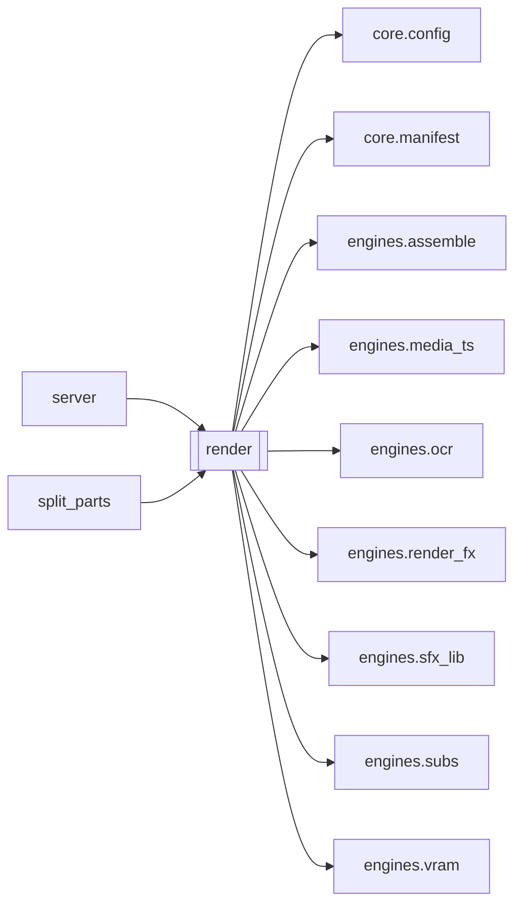

# `render`

[← Index](../generated/module-index.md) · [Brain home](../README.md)

<!-- AUTO:START — sinh bởi scripts/brain_build.py 2026-11-11 02:38. Đừng sửa tay khối này. -->
**File:** `render.py` · **Lớp:** `render` · **3079 dòng** (2710 code) · **72 hàm**, **0 class** · sha1 `c204d34675`

> render.py — STAGE 7 (Ghép + xuất): ráp video lồng tiếng "sạch như bản localize". Video (1 lượt ffmpeg): 1. Zoom+crop / Ken Burns+Drift (uniqueness).

### Phụ thuộc

- **Gọi tới (import nội bộ):** [core.config](./core.config.md), [core.manifest](./core.manifest.md), [engines.assemble](./engines.assemble.md), [engines.media_ts](./engines.media_ts.md), [engines.ocr](./engines.ocr.md), [engines.render_fx](./engines.render_fx.md), [engines.sfx_lib](./engines.sfx_lib.md), [engines.subs](./engines.subs.md), [engines.vram](./engines.vram.md)
- **Được dùng bởi:** [server](./server.md), [split_parts](./split_parts.md)
- **Test:** `tests/test_layout_paths.py`
- **Thư viện ngoài:** `PIL`, `numpy`, `rapidocr_onnxruntime`, `soundfile`

### Hàm & class top-level

| Tên | Dòng | Dài | Tham số | Docstring |
|---|---:|---:|---|---|
| `_ass_colour` | 64 | 10 | `val, default` | #RRGGBB hoặc &HAABBGGRR -> ASS. |
| `_sum_expr` | 79 | 11 | `terms` | a+b+…; ffmpeg chỉ nhận ≤100 hạng tử cộng phẳng → dài thì gom ngoặc cân bằng. |
| `_pw_expr` | 92 | 15 | `ends, vals` | Theo t: vals[i] với i nhỏ nhất có t < ends[i] (ends tăng dần, len = len(vals) - 1), hết → vals[-1]. |
| `_censor_expr` | 109 | 25 | `work_dir` | enable=... cho blur cảnh nhạy cảm. Config CENSOR_RANGES='12-18,90-102' (giây) |
| `_probe_dur` | 136 | 10 | `path` | Độ dài video (giây) để tính % render. |
| `_ffmpeg_progress` | 152 | 132 ⚠️ | `cmd, total, m, cwd, lo, hi` | Chạy ffmpeg + đọc -progress -> cập nhật % vào manifest (mux). Trả (mã, lỗi). |
| `_no_power_throttle` | 286 | 21 | `pid` | Tắt EcoQoS của Windows cho ffmpeg con (tránh bị dồn sang E-core khi console thu nhỏ). |
| `_mp4_video_stts` | 309 | 54 | `video` | (timescale, [count, delta, ...]) từ box stts của track video mp4/mov. |
| `_probe_pts` | 365 | 12 | `video, a, b` |  |
| `squeeze_fixes` | 379 | 55 | `video` | Đoạn mốc thời gian bị nén khi gộp tập khác fps: N khung dài ~0 rồi 1 khung dài hàng phút. |
| `squeeze_setpts` | 436 | 12 | `fixes` | setpts trải lại các đoạn bị nén (rỗng nếu không có). |
| `_cfg_num` | 450 | 6 | `key, default` |  |
| `chunk_plan` | 458 | 8 | `total` | (giây mỗi khúc, số khúc chạy cùng lúc). RENDER_CHUNK_SEC=0 hoặc RENDER_CHUNK_PAR<2 → 1 lượt. |
| `chunk_cuts` | 468 | 19 | `video, total, sec, avoid` | Điểm cắt mỗi ~sec giây, nằm GIỮA 2 khung liền nhau (không trùng mốc khung → không lặp/mất khung). |
| `_run_chunked` | 489 | 190 ⚠️ | `video, work_dir, graph, venc, pre_in, cuts, total, mixed, abit, out…` | Render video theo khúc (giữ mốc gốc), tối đa `par` khúc chạy cùng lúc, ghép copy, gắn audio 1 lần. |
| `_encoder_pref` | 687 | 11 | `` |  |
| `_nvenc_state` | 700 | 9 | `` |  |
| `_nvenc_save` | 711 | 5 | `d` |  |
| `_want_nvenc` | 718 | 14 | `` |  |
| `_nvenc_mark_ok` | 734 | 2 | `` |  |
| `_nvenc_mark_fail` | 738 | 16 | `err` |  |
| `_attach_filter_complex` | 756 | 6 | `cmd, graph, work_dir` | Ghi filtergraph ra file — tránh cắt cmdline Windows (~8191 ký tự). |
| `_ff_input` | 764 | 8 | `path, work_dir` | Đường dẫn -i khi ffmpeg cwd=work_dir: file trong job → tên/relative; ngoài → absolute. |
| `_x264_cmd` | 774 | 15 | `cmd` | Đổi lệnh nvenc → libx264 (bỏ flag chỉ GPU). |
| `normalize_vbitrate` | 791 | 16 | `v, W, H` | Chuẩn hoá bitrate H264: trả (vbit, buf). Cho phép 2M / 4M / 8M. |
| `_find_video` | 813 | 9 | `work_dir` |  |
| `_size` | 824 | 7 | `video` |  |
| `_fps` | 833 | 12 | `video` |  |
| `_esc` | 847 | 4 | `t` | Escape text cho drawtext. |
| `_map_pt` | 853 | 4 | `fx, fy, zoom` | Toạ độ fraction (0-1) sau khi zoom+crop giữa. |
| `_map_box` | 859 | 20 | `x0, y0, x1, y1, zoom, pad` | Map hộp nguồn → sau zoom/crop; None nếu gần như bị crop hết. |
| `_flip_box` | 881 | 7 | `x0, y0, x1, y1, hflip, vflip` |  |
| `_default_wm_corners` | 890 | 20 | `` | Fallback góc kênh khi OCR không bắt được logo hình (ô nhỏ, chỉ mép). |
| `_uploader_hint` | 921 | 6 | `work_dir` |  |
| `_is_wm_text` | 929 | 13 | `txt, uploader` |  |
| `_wm_quadrant` | 944 | 11 | `cx, cy` |  |
| `_expand_logo_pad` | 957 | 27 | `q, x0, y0, x1, y1` | OCR chữ → snap nhẹ về mép góc; giữ kích thước gần bbox, cap nhỏ. |
| `_cap_wm_frac` | 986 | 17 | `x0, y0, x1, y1, q` | Giới hạn hộp che sau map — không cho phình quá mép góc. |
| `_wm_sample_times` | 1005 | 25 | `full_dur` | Mốc giây lấy mẫu watermark trên TOÀN bộ video (không chỉ 3 phút đầu). |
| `_extract_wm_frames` | 1032 | 21 | `video, out_dir, times` | Seek từng mốc → 1 frame JPEG. Nhanh hơn decode cả file. |
| `_merge_wm_timeline` | 1055 | 72 | `hits, stride, full_dur, uploader` | Gộp hit (t,q,x0,y0,x1,y1,txt) → [{t0,t1,x,y,w,h}, …] theo góc + thời gian. |
| `_parse_wm_cache` | 1129 | 19 | `raw` | Đọc cache: list dict timed, hoặc list [x,y,w,h] cũ → coi full video. |
| `detect_overlays` | 1150 | 134 ⚠️ | `work_dir, n_frames, force` | Dò hardsub (đầu phim) + watermark THEO THỜI GIAN trên cả video. |
| `detect_hardsub_band` | 1286 | 4 | `work_dir, n_frames, force` | Tương thích cũ: chỉ trả band. |
| `_hs_cluster_band` | 1295 | 6 | `rows` | (y0,y1) của 1 cụm vị trí — bỏ 5% ngoại lai mỗi phía khi đủ mẫu. |
| `detect_hardsub_track` | 1303 | 217 ⚠️ | `work_dir, force` | Dò toạ độ hardsub THEO THỜI GIAN trên toàn video (file merge đổi vị trí giữa các tập). |
| `_even` | 1522 | 2 | `n` |  |
| `_rounded_bar_alpha` | 1526 | 16 | `w, h, r, alpha` | Biểu thức geq alpha cho hình chữ nhật bo góc (0–255). |
| `_boxblur_r` | 1544 | 8 | `desired, w, h, sub` | Radius boxblur hợp lệ: ffmpeg yêu cầu 2*r < min(w,h) của plane. |
| `_safe_crop` | 1554 | 7 | `w, h, x, y` | crop ffmpeg an toàn khi iw/ih đổi giữa chừng (biểu thức min). |
| `_hardsub_bar_filter` | 1563 | 31 | `bw, bh, bx, by` | Che hardsub: 1× boxblur + lớp đen geq bo góc (không desat). |
| `_hardsub_cover_fullw` | 1596 | 4 | `` | Luôn phủ hết ngang khi che hardsub — OCR x0/x1 thường chỉ ~50% giữa → chữ Trung lòi 2 mép. |
| `_hardsub_track_boxes` | 1602 | 53 | `track, W, H, hflip, vflip` | Dải hardsub (tỉ lệ nguồn) → ô pixel trên canvas TRƯỚC zoom: (bx,by,bw,bh,ranges,tổng giây). |
| `_stretch_cfg` | 1660 | 9 | `` | (sigma ngang, sigma dọc, phủ hết bề ngang) cho kiểu che stretch. |
| `_stretch_chain` | 1671 | 12 | `tag, bx, bw, bh, ty, oy, en` | Che hardsub kiểu kéo giãn: trung bình vài hàng ngay trên ô, kéo dọc phủ ô rồi làm mềm |
| `_stretch_track_filter` | 1685 | 35 | `boxes, W, H` | Kiểu stretch cho mọi dải: khoảng nào nhiều dải cùng hiện thì phủ 1 ô gộp (không chồng 2 lớp). |
| `_hardsub_track_filter` | 1722 | 35 | `boxes, W, H` | Che đúng ô hardsub theo thời gian (không lớp đen). |
| `_srt_to_ass_margins` | 1759 | 42 | `srt, out, W, H, mv_at` | SRT → ASS với MarginV riêng từng câu (mv_at(t_giữa_câu) → px). Trả số câu. |
| `_hardsub_track_filter_dyn` | 1803 | 62 | `boxes, W, H, margin` | Nhiều dải → 1 chuỗi blur chính + 1 chuỗi phụ (chỉ bật lúc 2 dải chồng nhau). |
| `resolve_canvas` | 1867 | 11 | `src_w, src_h, resolution` | Chọn khung xuất: source = giữ gốc; 1080/1k = Full HD (giữ tỉ lệ, tối đa 1920×1080). |
| `_parse_flip` | 1880 | 9 | `flip` |  |
| `build_video_filter` | 1891 | 338 ⚠️ | `W, H, zoom, ocr, srt, hardsub_blur, band, src_w, src_h, flip, censo…` | Trả (filter_comma_chain_without_final_vout, meta). |
| `_pick_dub` | 2232 | 9 | `work_dir` |  |
| `_normalize_audio_mode` | 2243 | 11 | `audio_mode, have_nv` |  |
| `_uses_sidechain` | 2256 | 4 | `mode` | duck / duck_bgm / sfx_lib dùng sidechaincompress — KHÔNG chạy cùng encode video |
| `_stage_note` | 2262 | 16 | `m` | Callback ghi dòng log tiến trình con vào cur_text của stage render (thưa ≥2 s). |
| `_ensure_mixed_audio` | 2280 | 71 | `work_dir, video, dub, no_vocals, vocals, audio_mode, voice_vol, ori…` | Pass 1: mixed_audio.wav (audio-only + sidechain). Trả (path, used_mode). |
| `_mix_signature` | 2353 | 15 | `cmd, af, total, work_dir` | Filter + (đường dẫn, size, mtime) mọi input -i + độ dài — đổi thì phải trộn lại. |
| `_write_mix_signature` | 2370 | 7 | `path, sig` |  |
| `_build_audio_filter` | 2379 | 141 ⚠️ | `cmd, work_dir, dub, no_vocals, vocals, audio_mode, voice_vol, orig_vol` | Dựng filter audio + THÊM input vào cmd. Trả (filter, tên_chế_độ_thực). |
| `run_render` | 2522 | 510 ⚠️ | `work_dir, zoom, add_sub, hardsub_blur, out_name, force, audio_mode,…` |  |
| `main` | 3034 | 42 | `argv` |  |

**Hàm dài ≥120 dòng:** `run_render` (510, L2522), `build_video_filter` (338, L1891), `detect_hardsub_track` (217, L1303), `_run_chunked` (190, L489), `_build_audio_filter` (141, L2379), `detect_overlays` (134, L1150), `_ffmpeg_progress` (132, L152)

### Config / env keys (41)

`BYPASS_SPEED`, `CENSOR_BLUR`, `CENSOR_RANGES`, `HARDSUB_BAR_ALPHA`, `HARDSUB_BAR_RADIUS`, `HARDSUB_BLUR`, `HARDSUB_BLUR_MARGIN`, `HARDSUB_BLUR_MAX_H`, `HARDSUB_BLUR_R`, `HARDSUB_BLUR_W`, `HARDSUB_COVER_FULLW`, `HARDSUB_FIXED_BOTTOM`, `HARDSUB_FORCE_BLUR`, `HARDSUB_FULL_COVER_RATIO`, `HARDSUB_GAP_FILL_SEC`, `HARDSUB_MODE`, `HARDSUB_PAD_BOTTOM`, `HARDSUB_PAD_TOP`, `HARDSUB_REDETECT`, `HARDSUB_STRETCH_FULLW`, `HARDSUB_STRETCH_SIGMA`, `HARDSUB_STRETCH_SIGMA_V`, `HARDSUB_STYLE`, `HARDSUB_TRACK_MAX_SAMPLES`, `RENDER_ENCODER`, `RENDER_SPEED`, `SUB_ALIGN`, `SUB_BOLD`, `SUB_COLOR`, `SUB_FOLLOW_HARDSUB`, `SUB_FONT`, `SUB_FONT_SIZE`, `SUB_MARGIN_L`, `SUB_MARGIN_R`, `SUB_MARGIN_V`, `SUB_OUTLINE`, `SUB_OUTLINE_COLOR`, `SUB_SHADOW`, `WM_FORCE_CORNERS`, `WM_MAX_SAMPLES`, `WM_SAMPLE_SEC`

**File/artifact nhắc tới:** `.follow.ass`, `.nvenc_state.json`, `.partial.mp4`, `_audio.m4a`, `_chunks.txt`, `_filter_complex.txt`, `censor.json`, `dub_fit.wav`, `dub_tts.wav`, `hardsub_band.json`, `hardsub_track.json`, `meta.json`, `mixed_audio.json`, `mixed_audio.partial.wav`, `mixed_audio.wav`, `no_vocals.wav`, `ocr.json`, `output.mp4`, `script.display.json`, `script.json`, `sub.vi.burn.srt`, `sub.vi.srt`, `tts.json`, `tts_fit.json`, `vocals.wav`

**Tín hiệu rủi ro (đếm tĩnh):** broad_except=34 · file_writes=14 · pools=1 · sleep=2 · subprocess=10 · swallow_except=16 · threads=1

### Lịch sử (từ docs/)

- **Fix logs (14):**
  - [Part mux hiện «Sẵn sàng» trong lúc dò hardsub OCR](../../fixes/2026-11-07-mux-heal-hardsub-ocr.md)
  - [Thêm bật/tắt che hardsub (blur)](../../fixes/2026-11-07-hardsub-blur-toggle.md)
  - [Hardsub chỗ có chỗ không — hở theo thời gian (OCR miss)](../../fixes/2026-11-04-hardsub-temporal-gaps.md)
  - [sfx_lib: audio trộn có lúc hụt đuôi (sidechaincompress kết thúc sớm)](../../fixes/2026-10-07-sfxlib-sidechain-short.md)
  - [voice_bgm: nhạc thư viện và audio dừng ở câu thoại cuối (M20)](../../fixes/2026-10-07-m20-voice-bgm-apad.md)
  - [2026-10-06 — Đợt 6 review: bảo trì (git, pytest, M3, dọn script chết)](../../fixes/2026-10-06-batch6-maintenance.md)
  - [2026-10-06 — Đợt 4 review: tranh chấp ghi, một bản tiến trình, checkpoint an toàn](../../fixes/2026-10-06-batch4-write-races.md)
  - [2026-10-06 — Đợt 3 review: opts một nguồn, config file-first, ghi nguyên tử](../../fixes/2026-10-06-batch3-single-source.md)
  - [Đợt 1 — chặn mất dữ liệu (review 6/10)](../../fixes/2026-10-06-batch1-data-loss.md)
  - [2026-09-26 — Port duck/duck_bgm two-pass sang PinelineV2](../../fixes/2026-09-26-duck-bgm-twopass-port.md)
  - [output.mp4 hết tiếng giữa chừng (A/V gap) — duck_bgm](../../fixes/2026-09-25-duck-bgm-audio-truncated.md)
  - [Nút Dừng không tắt được mux/ffmpeg](../../fixes/2026-09-24-stop-mux-ffmpeg.md)
  - [Hardsub bar xanh + encode chậm](../../fixes/2026-09-24-hardsub-hwaccel-drawbox.md)
  - [Hardsub bar lộ xanh / lệch nửa khung](../../fixes/2026-09-24-hardsub-green-bar.md)
- **Reviews:** [_atoms_engines](../../reviews/_atoms_engines.md), [2026-11-06-v5-part-atoms](../../reviews/2026-11-06-v5-part-atoms.md), [2026-11-06-v5-func-catalog](../../reviews/2026-11-06-v5-func-catalog.md), [2026-11-02-v4-structure-and-v2-port](../../reviews/2026-11-02-v4-structure-and-v2-port.md), [2026-10-06-code-review](../../reviews/2026-10-06-code-review.md)
- Nhắc trong CHANGELOG: **16** lần · DECISIONS: **0** lần

<!-- AUTO:END -->

<!-- MANUAL:START -->
## Vai trò (viết tay)

_Chưa viết. 2–4 câu: module này chịu trách nhiệm gì trong pipeline, ai gọi nó, nó KHÔNG làm gì._

## Luồng chính

_Các hàm vào (entry) → bước chính → output/side effect. Ghi tên hàm thật._

## Bất biến & hợp đồng

_Điều luôn phải đúng (vd: chỉ ghi manifest qua `Manifest.update`; 1 job / ghế). Vi phạm = bug._

## Bẫy đã biết

_Lỗi từng gặp + link `docs/fixes/...`. Những chỗ dễ sửa sai._

## Ghi chú vận hành

_Config key quan trọng, cần restart gì khi sửa (:8801 / :8802 / hot-reload), cách test._
<!-- MANUAL:END -->
