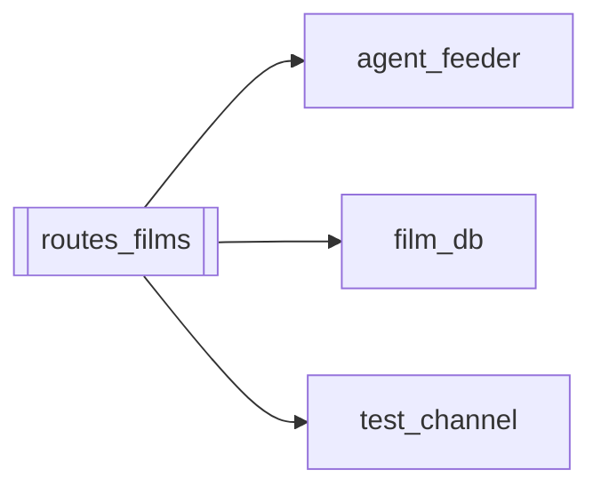

# `routes_films`

[← Index](../generated/module-index.md) · [Brain home](../README.md)

<!-- AUTO:START — sinh bởi scripts/brain_build.py 2026-11-11 02:38. Đừng sửa tay khối này. -->
**File:** `routes_films.py` · **Lớp:** `control` · **370 dòng** (291 code) · **31 hàm**, **0 class** · sha1 `816e9a6c6c`

> FastAPI Router cho Thư viện Phim & Database (đồng bộ trực tiếp trong Pineline V4). Thay vì phải chạy sidecar :8802 riêng mới dùng được films_ui.html, router này gắn trực tiếp vào server.py (port 8804).

### Phụ thuộc

- **Gọi tới (import nội bộ):** [agent_feeder](./agent_feeder.md), [film_db](./film_db.md), [test_channel](./test_channel.md)
- **Được dùng bởi:** —
- **Test:** ❌ chưa có test import trực tiếp
- **Thư viện ngoài:** `check_block`, `fastapi`, `lib_check`

### API routes (31)

| Method | Path | Handler | Dòng |
|---|---|---|---:|
| GET | `/films` | `list_films` | 39 |
| GET | `/films.csv` | `export_films_csv` | 68 |
| POST | `/films/check-block` | `check_block_films` | 133 |
| POST | `/films/check-block-all` | `check_block_all` | 146 |
| POST | `/films/delete` | `delete_films` | 110 |
| POST | `/films/purge-missing` | `purge_missing` | 126 |
| POST | `/films/sync` | `sync_films` | 101 |
| GET | `/films/ui` | `films_ui` | 31 |
| GET | `/films/{job_id}` | `get_film` | 93 |
| GET | `/library` | `get_library` | 160 |
| GET | `/library/accounts` | `library_accounts` | 169 |
| POST | `/library/action` | `library_action` | 178 |
| POST | `/library/clear-samples` | `library_clear_samples` | 207 |
| POST | `/library/cut-sample` | `library_cut_sample` | 216 |
| POST | `/library/enqueue-test` | `library_enqueue_test` | 227 |
| POST | `/library/scan-queue` | `library_scan_queue` | 249 |
| POST | `/library/set-block-status` | `library_set_block_status` | 198 |
| POST | `/library/test-url` | `library_test_url` | 239 |
| GET | `/library/ui` | `films_ui` | 31 |
| GET | `/test-channel/auth-url` | `tc_auth_url` | 278 |
| GET | `/test-channel/batch-progress` | `tc_batch_progress` | 354 |
| POST | `/test-channel/batch-start` | `tc_batch_start` | 344 |
| GET | `/test-channel/callback` | `tc_callback` | 289 |
| POST | `/test-channel/disconnect` | `tc_disconnect` | 323 |
| POST | `/test-channel/finish-auth` | `tc_finish_auth` | 311 |
| GET | `/test-channel/recheck-health` | `tc_recheck_health` | 272 |
| POST | `/test-channel/recheck-one` | `tc_recheck_one` | 359 |
| POST | `/test-channel/recheck-pending` | `tc_recheck_pending` | 366 |
| GET | `/test-channel/reset-quota` | `tc_reset_quota` | 267 |
| GET | `/test-channel/status` | `tc_status` | 262 |
| POST | `/test-channel/test-one` | `tc_test_one` | 329 |

### Hàm & class top-level

| Tên | Dòng | Dài | Tham số | Docstring |
|---|---:|---:|---|---|
| `_get_base_url` | 25 | 2 | `req` |  |
| `films_ui` | 31 | 5 | `` |  |
| `list_films` | 39 | 26 | `q, status, limit, order, work_exists, block_status` |  |
| `export_films_csv` | 68 | 22 | `q, status, limit, order, work_exists, block_status` |  |
| `get_film` | 93 | 5 | `job_id` |  |
| `sync_films` | 101 | 6 | `` |  |
| `delete_films` | 110 | 13 | `payload, req` |  |
| `purge_missing` | 126 | 4 | `payload` |  |
| `check_block_films` | 133 | 10 | `payload` |  |
| `check_block_all` | 146 | 7 | `` |  |
| `get_library` | 160 | 6 | `req` |  |
| `library_accounts` | 169 | 6 | `` |  |
| `library_action` | 178 | 17 | `payload, req` | Ủy thác feeder (skip/priority/add/merge/…) — không gọi film_db.mark_library_* (API không tồn tại). |
| `library_set_block_status` | 198 | 6 | `payload` |  |
| `library_clear_samples` | 207 | 6 | `` |  |
| `library_cut_sample` | 216 | 8 | `payload` |  |
| `library_enqueue_test` | 227 | 9 | `payload` |  |
| `library_test_url` | 239 | 7 | `payload` |  |
| `library_scan_queue` | 249 | 6 | `` |  |
| `tc_status` | 262 | 2 | `` |  |
| `tc_reset_quota` | 267 | 2 | `project_id` |  |
| `tc_recheck_health` | 272 | 3 | `` |  |
| `tc_auth_url` | 278 | 8 | `req, redirect_uri, project_id` |  |
| `tc_callback` | 289 | 19 | `req, code, state` |  |
| `tc_finish_auth` | 311 | 9 | `req, payload` |  |
| `tc_disconnect` | 323 | 3 | `` |  |
| `tc_test_one` | 329 | 12 | `payload` |  |
| `tc_batch_start` | 344 | 7 | `payload` |  |
| `tc_batch_progress` | 354 | 2 | `` |  |
| `tc_recheck_one` | 359 | 4 | `payload` |  |
| `tc_recheck_pending` | 366 | 4 | `payload` |  |

**Cổng nhắc tới:** 8804

**Tín hiệu rủi ro (đếm tĩnh):** broad_except=17 · swallow_except=2

### Lịch sử (từ docs/)

- **Fix logs (1):**
  - [`/library/action` crash — gọi API film_db không tồn tại](../../fixes/2026-11-02-library-action-missing-api.md)
- **Reviews:** [_atoms_http_agents](../../reviews/_atoms_http_agents.md), [2026-11-06-v5-part-atoms](../../reviews/2026-11-06-v5-part-atoms.md), [2026-11-06-v5-func-catalog](../../reviews/2026-11-06-v5-func-catalog.md), [2026-11-02-v4-structure-and-v2-port](../../reviews/2026-11-02-v4-structure-and-v2-port.md)
- Nhắc trong CHANGELOG: **2** lần · DECISIONS: **0** lần

<!-- AUTO:END -->

<!-- MANUAL:START -->
## Vai trò (viết tay)

_Chưa viết. 2–4 câu: module này chịu trách nhiệm gì trong pipeline, ai gọi nó, nó KHÔNG làm gì._

## Luồng chính

_Các hàm vào (entry) → bước chính → output/side effect. Ghi tên hàm thật._

## Bất biến & hợp đồng

_Điều luôn phải đúng (vd: chỉ ghi manifest qua `Manifest.update`; 1 job / ghế). Vi phạm = bug._

## Bẫy đã biết

_Lỗi từng gặp + link `docs/fixes/...`. Những chỗ dễ sửa sai._

## Ghi chú vận hành

_Config key quan trọng, cần restart gì khi sửa (:8801 / :8802 / hot-reload), cách test._
<!-- MANUAL:END -->
