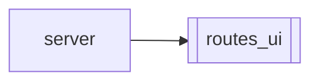

# `routes_ui`

[← Index](../generated/module-index.md) · [Brain home](../README.md)

<!-- AUTO:START — sinh bởi scripts/brain_build.py 2026-11-11 02:38. Đừng sửa tay khối này. -->
**File:** `routes_ui.py` · **Lớp:** `control` · **107 dòng** (81 code) · **10 hàm**, **0 class** · sha1 `bdf45df429`

> Trang UI: /, /ui3, /ui4, /hongguo, /hongguo2, /films/ui, /studio, /v5-map. /hongguo2 = skin WinUI 2.x (Browse/Ranking/New/Library). /films|/film|/films/ui = films_ui.html · /studio = index3 (Lồng tiếng Studio).

### Phụ thuộc

- **Gọi tới (import nội bộ):** —
- **Được dùng bởi:** [server](./server.md)
- **Test:** ❌ chưa có test import trực tiếp
- **Thư viện ngoài:** `fastapi`

### API routes (14)

| Method | Path | Handler | Dòng |
|---|---|---|---:|
| GET | `/` | `index` | 43 |
| GET | `/film` | `ui_films` | 92 |
| GET | `/films` | `ui_films` | 92 |
| GET | `/films/ui` | `ui_films` | 92 |
| GET | `/hongguo` | `ui_hongguo` | 78 |
| GET | `/hongguo2` | `ui_hongguo2` | 84 |
| GET | `/index3.html` | `ui3` | 64 |
| GET | `/index4.html` | `ui4` | 71 |
| GET | `/studio` | `ui_studio` | 99 |
| GET | `/studio/ui` | `ui_studio` | 99 |
| GET | `/ui-hg` | `ui_hongguo` | 78 |
| GET | `/ui3` | `ui3` | 64 |
| GET | `/ui4` | `ui4` | 71 |
| GET | `/v5-map` | `ui_v5_map` | 105 |

### Hàm & class top-level

| Tên | Dòng | Dài | Tham số | Docstring |
|---|---:|---:|---|---|
| `find_index` | 32 | 8 | `` | Tìm index.html ở web/ hoặc ngay cạnh server.py (phòng khi tải file phẳng). |
| `index` | 43 | 9 | `` |  |
| `_html_file` | 54 | 6 | `name` |  |
| `ui3` | 64 | 3 | `` | UI C — Shell vs Data (khung tĩnh, chống giật innerHTML). |
| `ui4` | 71 | 3 | `` | UI D — Full ops: preview + script grid + queue bảng %. |
| `ui_hongguo` | 78 | 3 | `` | UI riêng — điều khiển Hongguo Downloader (search/tải/merge). |
| `ui_hongguo2` | 84 | 3 | `` | Hongguo Downloader 2.x skin (Browse / Ranking / New / Library). |
| `ui_films` | 92 | 3 | `` | Films UI (thư viện phim / mùa mới) — cùng host :8801. |
| `ui_studio` | 99 | 3 | `` | Lồng tiếng Studio — UI3 ops shell. |
| `ui_v5_map` | 105 | 3 | `` | Interactive module/call graph (static HTML; curated nodes). |

### Lịch sử (từ docs/)

- **Fix logs (2):**
  - [Bỏ Hongguo2 — redirect về Hongguo gốc](../../fixes/2026-11-06-drop-hongguo2.md)
  - [Đợt 7: gỡ UI cũ, tách server.py](../../fixes/2026-10-06-batch7-ui-split.md)
- **Reviews:** [_atoms_http_agents](../../reviews/_atoms_http_agents.md), [2026-11-06-v5-part-atoms](../../reviews/2026-11-06-v5-part-atoms.md), [2026-11-06-v5-func-catalog](../../reviews/2026-11-06-v5-func-catalog.md), [2026-11-02-v4-structure-sync](../../reviews/2026-11-02-v4-structure-sync.md), [2026-11-02-v4-structure-and-v2-port](../../reviews/2026-11-02-v4-structure-and-v2-port.md), [2026-11-02-v4-duplication-audit](../../reviews/2026-11-02-v4-duplication-audit.md), [2026-10-06-code-review](../../reviews/2026-10-06-code-review.md)
- Nhắc trong CHANGELOG: **4** lần · DECISIONS: **0** lần

<!-- AUTO:END -->

<!-- MANUAL:START -->
## Vai trò (viết tay)

_Chưa viết. 2–4 câu: module này chịu trách nhiệm gì trong pipeline, ai gọi nó, nó KHÔNG làm gì._

## Luồng chính

_Các hàm vào (entry) → bước chính → output/side effect. Ghi tên hàm thật._

## Bất biến & hợp đồng

_Điều luôn phải đúng (vd: chỉ ghi manifest qua `Manifest.update`; 1 job / ghế). Vi phạm = bug._

## Bẫy đã biết

_Lỗi từng gặp + link `docs/fixes/...`. Những chỗ dễ sửa sai._

## Ghi chú vận hành

_Config key quan trọng, cần restart gì khi sửa (:8801 / :8802 / hot-reload), cách test._
<!-- MANUAL:END -->
