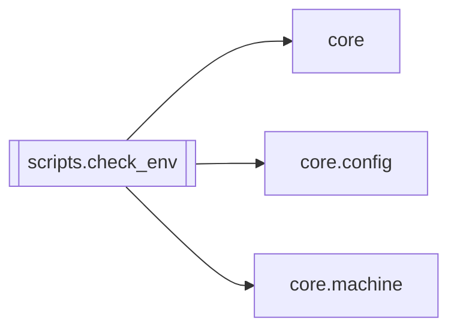

# `scripts.check_env`

[← Index](../generated/module-index.md) · [Brain home](../README.md)

<!-- AUTO:START — sinh bởi scripts/brain_build.py 2026-11-17 19:05. Đừng sửa tay khối này. -->
**File:** `scripts/check_env.py` · **Lớp:** `ops` · **319 dòng** (277 code) · **15 hàm**, **0 class** · sha1 `b5afa6495d`

> check_env.py — "Doctor" kiểm tra máy trước khi chạy Pineline (máy mới / máy khác cấu hình). Chạy:   python scripts/check_env.py            (đầy đủ: gọi thử LLM/Aurora/Hongguo, timeout ngắn) python scripts/check_env.py --

### Phụ thuộc

- **Gọi tới (import nội bộ):** [core](./core.md), [core.config](./core.config.md), [core.machine](./core.machine.md)
- **Được dùng bởi:** —
- **Được nhắc tên file `.py` (subprocess/script) bởi:** [core.machine](./core.machine.md)
- **Test:** ❌ chưa có test import trực tiếp
- **Thư viện ngoài:** `config`, `machine`

### Hàm & class top-level

| Tên | Dòng | Dài | Tham số | Docstring |
|---|---:|---:|---|---|
| `row` | 40 | 2 | `item, status, detail, fix` |  |
| `_load_machine` | 44 | 18 | `` |  |
| `_http_get` | 64 | 10 | `url, timeout` |  |
| `check_python` | 76 | 9 | `` |  |
| `check_programs` | 87 | 16 | `` |  |
| `check_torch` | 105 | 17 | `skip` |  |
| `check_config_files` | 124 | 13 | `` |  |
| `_models_using` | 139 | 9 | `m, prefixes` |  |
| `check_llm` | 150 | 23 | `m, offline` |  |
| `check_aurora` | 175 | 17 | `m, offline` |  |
| `check_cloud` | 194 | 13 | `m, offline` |  |
| `check_hongguo` | 209 | 8 | `m, offline` |  |
| `_dir_row` | 219 | 22 | `item, p, status_if_missing, fix, want_file` |  |
| `check_dirs` | 243 | 34 | `m` |  |
| `main` | 279 | 37 | `argv` |  |

**File/artifact nhắc tới:** `client_secret.json`, `config.json`, `pineline.config.json`

**Tín hiệu rủi ro (đếm tĩnh):** broad_except=7 · subprocess=2 · swallow_except=2

### Lịch sử (từ docs/)

- **Fix logs (1):**
  - [2026-11-11 — machine-config: cổng/thư mục phụ thuộc máy thành setting (V5)](../../fixes/2026-11-11-machine-config.md)
- Nhắc trong CHANGELOG: **1** lần · DECISIONS: **0** lần

<!-- AUTO:END -->

<!-- MANUAL:START -->
## Vai trò (viết tay)

_Chưa viết. 2–4 câu: module này chịu trách nhiệm gì trong pipeline, ai gọi nó, nó KHÔNG làm gì._

## Luồng chính

_Các hàm vào (entry) → bước chính → output/side effect. Ghi tên hàm thật._

## Bất biến & hợp đồng

_Điều luôn phải đúng (vd: chỉ ghi manifest qua `Manifest.update`; 1 job / ghế). Vi phạm = bug._

## Bẫy đã biết

_Lỗi từng gặp + link `docs/fixes/...`. Những chỗ dễ sửa sai._

## Ghi chú vận hành

_Config key quan trọng, cần restart gì khi sửa (:8801 / :8802 / hot-reload), cách test._
<!-- MANUAL:END -->
