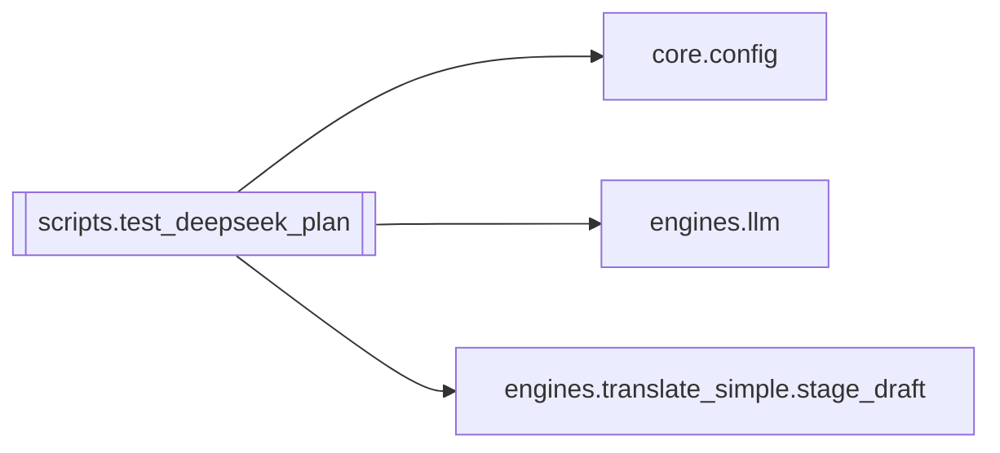

# `scripts.test_deepseek_plan`

[← Index](../generated/module-index.md) · [Brain home](../README.md)

<!-- AUTO:START — sinh bởi scripts/brain_build.py 2026-11-17 19:05. Đừng sửa tay khối này. -->
**File:** `scripts/test_deepseek_plan.py` · **Lớp:** `ops` · **103 dòng** (90 code) · **3 hàm**, **0 class** · sha1 `5489321af1`

> Thử lập plan cả phim (A7) bằng DeepSeek cho 1 job — KHÔNG đụng job (chạy trên bản sao asr.json ở thư mục tạm). Dùng (2026-11-18, kiểm lỗi «DeepSeek trả rỗng» + tắt thinking): python scripts\test_deepseek_plan.py b138b16b

### Phụ thuộc

- **Gọi tới (import nội bộ):** [core.config](./core.config.md), [engines.llm](./engines.llm.md), [engines.translate_simple.stage_draft](./engines.translate_simple.stage_draft.md)
- **Được dùng bởi:** —
- **Test:** ❌ chưa có test import trực tiếp
- **Thư viện ngoài:** `engines`

### Hàm & class top-level

| Tên | Dòng | Dài | Tham số | Docstring |
|---|---:|---:|---|---|
| `_hook_requests` | 27 | 26 | `log` |  |
| `run_once` | 55 | 31 | `job, thinking, work` |  |
| `main` | 88 | 12 | `` |  |

### Config / env keys (1)

`DEEPSEEK_THINKING`

**File/artifact nhắc tới:** `asr.json`

**Tín hiệu rủi ro (đếm tĩnh):** broad_except=2

### Lịch sử (từ docs/)

- Fix logs: —
- Nhắc trong CHANGELOG: **1** lần · DECISIONS: **0** lần

<!-- AUTO:END -->

<!-- MANUAL:START -->
## Vai trò (viết tay)

_Chưa viết. 2–4 câu: module này chịu trách nhiệm gì trong pipeline, ai gọi nó, nó KHÔNG làm gì._

## Luồng chính

_Các hàm vào (entry) → bước chính → output/side effect. Ghi tên hàm thật._

## Bất biến & hợp đồng

_Điều luôn phải đúng (vd: chỉ ghi manifest qua `Manifest.update`; 1 job / ghế). Vi phạm = bug._

## Bẫy đã biết

_Lỗi từng gặp + link `docs/fixes/...`. Những chỗ dễ sửa sai._

## Ghi chú vận hành

_Config key quan trọng, cần restart gì khi sửa (:8801 / :8802 / hot-reload), cách test._
<!-- MANUAL:END -->
