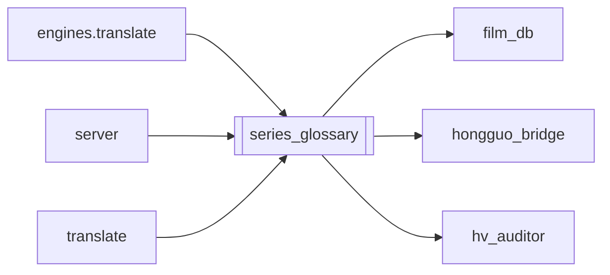

# `series_glossary`

[← Index](../generated/module-index.md) · [Brain home](../README.md)

<!-- AUTO:START — sinh bởi scripts/brain_build.py 2026-11-11 02:38. Đừng sửa tay khối này. -->
**File:** `series_glossary.py` · **Lớp:** `translate` · **199 dòng** (167 code) · **11 hàm**, **0 class** · sha1 `ca16cc6f13`

> Bảng nhân vật / thuật ngữ / xưng hô dùng chung cho CẢ BỘ (mọi mùa). - apply(work_dir, plan): khi dịch 1 mùa → đè các mục đã chốt của bộ lên plan (tên, tên phụ, xưng hô, thuật ngữ); nhân vật mới chỉ có ở mùa này giữ nguyê

### Phụ thuộc

- **Gọi tới (import nội bộ):** [film_db](./film_db.md), [hongguo_bridge](./hongguo_bridge.md), [hv_auditor](./hv_auditor.md)
- **Được dùng bởi:** [engines.translate](./engines.translate.md), [server](./server.md), [translate](./translate.md)
- **Test:** ❌ chưa có test import trực tiếp

### Hàm & class top-level

| Tên | Dòng | Dài | Tham số | Docstring |
|---|---:|---:|---|---|
| `_core_of` | 22 | 8 | `title` |  |
| `series_key` | 32 | 9 | `work_dir` |  |
| `_path` | 43 | 3 | `core` |  |
| `load` | 48 | 23 | `core` |  |
| `_valid_char` | 73 | 2 | `c` |  |
| `_merge_list` | 77 | 14 | `base, top, key` | top đè base theo key; giữ thứ tự: mục của top trước, mục chỉ có ở base sau. |
| `_zh` | 93 | 2 | `x` |  |
| `_pron` | 97 | 2 | `x` |  |
| `_hygiene_chars_terms` | 101 | 13 | `chars, terms` | Series hygiene (3): audit + bỏ mục hv_suspect không sửa được. |
| `apply` | 116 | 23 | `work_dir, plan` |  |
| `save_from` | 141 | 59 | `work_dir, reason` |  |

**File/artifact nhắc tới:** `glossary.json`, `manifest.json`

**Tín hiệu rủi ro (đếm tĩnh):** broad_except=8 · file_writes=2 · swallow_except=4

### Lịch sử (từ docs/)

- **Fix logs (4):**
  - [NMT draft + glossary gầy + REVIEW GPT mini](../../fixes/2026-11-09-mt-draft-slim-gloss.md)
  - [HV Auditor: glossary khóa sai âm Hán Việt (逆→Nghị)](../../fixes/2026-11-09-hv-auditor.md)
  - [逆天而行 dịch sai «Nghị Thiên Nhi Hành» (đúng: Nghịch…)](../../fixes/2026-11-08-nghich-thien-ni-hanh.md)
  - [Lệch xưng hô sau dịch (Ta–Ngươi / sai self–call)](../../fixes/2026-11-02-pronoun-xung-ho.md)
- **Reviews:** [_atoms_engines](../../reviews/_atoms_engines.md), [2026-11-06-v5-part-atoms](../../reviews/2026-11-06-v5-part-atoms.md), [2026-11-06-v5-func-catalog](../../reviews/2026-11-06-v5-func-catalog.md), [2026-11-02-v4-structure-and-v2-port](../../reviews/2026-11-02-v4-structure-and-v2-port.md)
- Nhắc trong CHANGELOG: **1** lần · DECISIONS: **0** lần

<!-- AUTO:END -->

<!-- MANUAL:START -->
## Vai trò (viết tay)

_Chưa viết. 2–4 câu: module này chịu trách nhiệm gì trong pipeline, ai gọi nó, nó KHÔNG làm gì._

## Luồng chính

_Các hàm vào (entry) → bước chính → output/side effect. Ghi tên hàm thật._

## Bất biến & hợp đồng

_Điều luôn phải đúng (vd: chỉ ghi manifest qua `Manifest.update`; 1 job / ghế). Vi phạm = bug._

## Bẫy đã biết

_Lỗi từng gặp + link `docs/fixes/...`. Những chỗ dễ sửa sai._

## Ghi chú vận hành

_Config key quan trọng, cần restart gì khi sửa (:8801 / :8802 / hot-reload), cách test._
<!-- MANUAL:END -->
