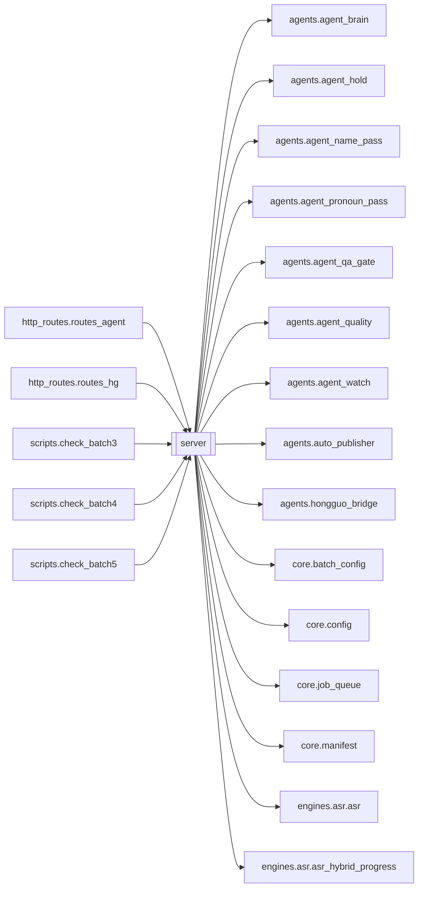

# `server`

[← Index](../generated/module-index.md) · [Brain home](../README.md)

<!-- AUTO:START — sinh bởi scripts/brain_build.py 2026-11-17 19:05. Đừng sửa tay khối này. -->
**File:** `server.py` · **Lớp:** `control` · **7322 dòng** (6384 code) · **198 hàm**, **28 class** · sha1 `c59288d16f`

> server.py — Backend web Phase 1 (FastAPI). Bọc engine (download -> asr -> translate) thành app web: - Phục vụ trang dashboard (web/index.html)

### Phụ thuộc

- **Gọi tới (import nội bộ):** [agents.agent_brain](./agents.agent_brain.md), [agents.agent_hold](./agents.agent_hold.md), [agents.agent_name_pass](./agents.agent_name_pass.md), [agents.agent_pronoun_pass](./agents.agent_pronoun_pass.md), [agents.agent_qa_gate](./agents.agent_qa_gate.md), [agents.agent_quality](./agents.agent_quality.md), [agents.agent_watch](./agents.agent_watch.md), [agents.auto_publisher](./agents.auto_publisher.md), [agents.hongguo_bridge](./agents.hongguo_bridge.md), [core.batch_config](./core.batch_config.md), [core.config](./core.config.md), [core.job_queue](./core.job_queue.md), [core.manifest](./core.manifest.md), [engines.asr.asr](./engines.asr.asr.md), [engines.asr.asr_hybrid_progress](./engines.asr.asr_hybrid_progress.md), [engines.asr.asr_spam](./engines.asr.asr_spam.md), [engines.asr.hardsub_asr](./engines.asr.hardsub_asr.md), [engines.assemble](./engines.assemble.md), [engines.clone_tts](./engines.clone_tts.md), [engines.download](./engines.download.md), [engines.hs_ocr_fast](./engines.hs_ocr_fast.md), [engines.llm](./engines.llm.md), [engines.ocr](./engines.ocr.md), [engines.playlist](./engines.playlist.md), [engines.render](./engines.render.md), [engines.render_fx](./engines.render_fx.md), [engines.separate](./engines.separate.md), [engines.series_glossary](./engines.series_glossary.md), [engines.source_preflight](./engines.source_preflight.md), [engines.split_parts](./engines.split_parts.md), [engines.subs](./engines.subs.md), [engines.translate](./engines.translate.md), [engines.translate_alts](./engines.translate_alts.md), [engines.vram](./engines.vram.md), [http_routes.routes_agent](./http_routes.routes_agent.md), [http_routes.routes_hg](./http_routes.routes_hg.md), [http_routes.routes_ui](./http_routes.routes_ui.md)
- **Được dùng bởi:** [http_routes.routes_agent](./http_routes.routes_agent.md), [http_routes.routes_hg](./http_routes.routes_hg.md), [scripts.check_batch3](./scripts.check_batch3.md), [scripts.check_batch4](./scripts.check_batch4.md), [scripts.check_batch5](./scripts.check_batch5.md)
- **Được nhắc tên file `.py` (subprocess/script) bởi:** [agents.agent_core](./agents.agent_core.md), [agents.agent_feeder](./agents.agent_feeder.md), [app_desktop](./app_desktop.md), [http_routes.routes_agent](./http_routes.routes_agent.md), [http_routes.routes_films](./http_routes.routes_films.md), [http_routes.routes_hg](./http_routes.routes_hg.md), [http_routes.routes_ui](./http_routes.routes_ui.md), [pineline.server.__init__](./pineline.server.__init__.md), [pineline.server.routes.__init__](./pineline.server.routes.__init__.md), [pineline.server.routes.assets](./pineline.server.routes.assets.md), [pineline.server.routes.fs](./pineline.server.routes.fs.md), [pineline.server.routes.jobs](./pineline.server.routes.jobs.md), [pineline.server.routes.queue](./pineline.server.routes.queue.md), [restart_server](./restart_server.md), [scripts.check_batch1](./scripts.check_batch1.md), [scripts.check_batch2](./scripts.check_batch2.md), [scripts.check_batch3](./scripts.check_batch3.md), [scripts.check_batch4](./scripts.check_batch4.md), [scripts.sync_from_v2](./scripts.sync_from_v2.md), [scripts.tree_audit](./scripts.tree_audit.md), [tools.migrate_work](./tools.migrate_work.md)
- **Test:** `tests/test_hardsub_blur_toggle.py`, `tests/test_layout_paths.py`, `tests/test_optimize_b5_b6.py`, `tests/test_park_review_retry.py`, `tests/test_queue_jobs_api.py`, `tests/test_queue_run_one.py`, `tests/test_server_split.py`, `tests/test_source_link.py`, `tests/test_translate_force_default.py`, `tests/test_translate_simple.py`, `tests/test_video_preflight.py`
- **Thư viện ngoài:** `context_studio`, `fastapi`, `faster_whisper`, `huggingface_hub`, `psutil`, `pydantic`, `translate_simple`, `uvicorn`

### API routes (68)

| Method | Path | Handler | Dòng |
|---|---|---|---:|
| POST | `/api/agent/brain/tick` | `api_agent_brain_tick` | 7275 |
| GET | `/api/brand-logos` | `list_brand_logos` | 6227 |
| POST | `/api/clone-voice` | `clone_voice` | 6354 |
| GET | `/api/cookies` | `cookies_status` | 5864 |
| POST | `/api/cookies` | `import_cookies` | 5890 |
| GET | `/api/frames` | `list_frames` | 6217 |
| GET | `/api/fs/list-dirs` | `api_fs_list_dirs` | 3559 |
| POST | `/api/fs/pick-dir` | `api_fs_pick_dir` | 3613 |
| POST | `/api/fs/pick-dirs` | `api_fs_pick_dirs` | 3687 |
| GET | `/api/jobs` | `list_jobs` | 5936 |
| POST | `/api/jobs` | `create_job` | 3005 |
| POST | `/api/jobs/group` | `jobs_group` | 3096 |
| POST | `/api/jobs/local` | `create_local_job_upload` | 3753 |
| POST | `/api/jobs/local-batch` | `create_local_job_batch` | 3476 |
| POST | `/api/jobs/local-path` | `create_local_job_path` | 3405 |
| DELETE | `/api/jobs/{job_id}` | `delete_job` | 7034 |
| GET | `/api/jobs/{job_id}` | `job_detail` | 5950 |
| POST | `/api/jobs/{job_id}/apply-alt` | `apply_alt_pick` | 5739 |
| POST | `/api/jobs/{job_id}/asr-engine` | `set_asr_engine` | 5199 |
| POST | `/api/jobs/{job_id}/asr-select` | `select_asr_source` | 5515 |
| GET | `/api/jobs/{job_id}/asr-sources` | `list_asr_sources` | 5497 |
| POST | `/api/jobs/{job_id}/assemble` | `assemble_job` | 6887 |
| DELETE | `/api/jobs/{job_id}/audio` | `delete_audio` | 6703 |
| POST | `/api/jobs/{job_id}/audio` | `upload_audio` | 6669 |
| GET | `/api/jobs/{job_id}/context-studio` | `get_context_studio` | 5603 |
| POST | `/api/jobs/{job_id}/context-studio` | `run_context_studio_api` | 5659 |
| GET | `/api/jobs/{job_id}/file/{path:path}` | `job_file` | 6981 |
| GET | `/api/jobs/{job_id}/hardsub-asr` | `get_hardsub_asr` | 5828 |
| POST | `/api/jobs/{job_id}/hardsub-asr` | `run_hardsub_asr_api` | 5798 |
| POST | `/api/jobs/{job_id}/mark-done` | `mark_job_done` | 4526 |
| POST | `/api/jobs/{job_id}/merge-parts` | `api_merge_job_parts` | 6942 |
| POST | `/api/jobs/{job_id}/mux` | `mux_job` | 6851 |
| POST | `/api/jobs/{job_id}/reveal` | `reveal_job` | 6953 |
| POST | `/api/jobs/{job_id}/run-all` | `run_all` | 4858 |
| POST | `/api/jobs/{job_id}/run/{stage}` | `run_stage` | 4439 |
| POST | `/api/jobs/{job_id}/script-clean-spam` | `clean_script_spam` | 4787 |
| POST | `/api/jobs/{job_id}/script-line` | `edit_script_line` | 4683 |
| POST | `/api/jobs/{job_id}/source` | `upload_source` | 6591 |
| POST | `/api/jobs/{job_id}/source-path` | `import_source_path` | 6629 |
| POST | `/api/jobs/{job_id}/split-parts` | `api_split_job_parts` | 6931 |
| GET | `/api/jobs/{job_id}/split-plan` | `get_split_plan` | 6909 |
| GET | `/api/jobs/{job_id}/srt/{lang}` | `job_srt` | 6556 |
| POST | `/api/jobs/{job_id}/start` | `start_job` | 3791 |
| POST | `/api/jobs/{job_id}/stop` | `stop_job` | 4505 |
| POST | `/api/jobs/{job_id}/translate` | `retranslate_job` | 6769 |
| GET | `/api/jobs/{job_id}/translate-alts` | `get_translate_alts` | 5694 |
| POST | `/api/jobs/{job_id}/translate-alts` | `run_translate_alts_api` | 5713 |
| POST | `/api/jobs/{job_id}/translate-fill` | `translate_fill` | 4584 |
| POST | `/api/jobs/{job_id}/tts` | `regen_tts` | 6444 |
| POST | `/api/jobs/{job_id}/tts-clip` | `regen_clip` | 6539 |
| POST | `/api/jobs/{job_id}/tts-voice` | `set_tts_voice` | 4826 |
| GET | `/api/jobs/{job_id}/tts-wav-ok` | `tts_wav_ok` | 6428 |
| GET|HEAD | `/api/jobs/{job_id}/video` | `job_video` | 6125 |
| GET | `/api/llm/models` | `get_available_llm_models` | 7289 |
| GET | `/api/models` | `get_available_llm_models` | 7289 |
| POST | `/api/queue/group` | `jobs_group` | 3096 |
| GET | `/api/queue/jobs` | `api_queue_jobs_state` | 3367 |
| POST | `/api/queue/jobs` | `api_queue_jobs_add` | 3212 |
| POST | `/api/queue/jobs/clear` | `api_queue_jobs_clear` | 3400 |
| POST | `/api/queue/jobs/group` | `api_queue_jobs_add_group` | 3229 |
| POST | `/api/queue/jobs/move` | `api_queue_jobs_move` | 3338 |
| POST | `/api/queue/jobs/opts` | `api_queue_jobs_opts` | 3245 |
| POST | `/api/queue/jobs/remove` | `api_queue_jobs_remove` | 3266 |
| POST | `/api/queue/jobs/reorder` | `api_queue_jobs_reorder` | 3354 |
| POST | `/api/queue/jobs/sort` | `api_queue_jobs_sort` | 3329 |
| POST | `/api/queue/jobs/stop` | `api_queue_jobs_stop` | 3395 |
| GET | `/api/voice-sample` | `voice_sample` | 6387 |
| GET | `/api/voices` | `list_voices` | 6209 |

### Hàm & class top-level

| Tên | Dòng | Dài | Tham số | Docstring |
|---|---:|---:|---|---|
| **class `_Stopped`** | 844 | 0 method | | Người dùng bấm Dừng — không phải lỗi. |
| **class `NewJob`** | 1290 | 0 method | |  |
| **class `LocalJobIn`** | 1296 | 0 method | | Tạo job từ video local — không cần URL. |
| **class `LocalBatchIn`** | 1307 | 0 method | | Import nhiều path (file và/hoặc folder), 1 dòng = 1 path. |
| **class `HgSubmitIn`** | 1317 | 0 method | |  |
| **class `HgMergeIn`** | 1324 | 0 method | |  |
| **class `JobGroupReq`** | 1330 | 0 method | | Gom / sửa nhóm series trên hàng chờ. |
| **class `HgBaseIn`** | 1340 | 0 method | |  |
| **class `TTSReq`** | 1344 | 0 method | |  |
| **class `ClipReq`** | 1351 | 0 method | |  |
| **class `MuxReq`** | 1357 | 0 method | |  |
| **class `TranslateReq`** | 1382 | 0 method | |  |
| **class `ScriptLineEdit`** | 1392 | 0 method | | Sửa tay 1 câu trong script.json (zh và/hoặc vi). |
| **class `TTSVoiceReq`** | 1399 | 0 method | |  |
| **class `RunAllReq`** | 1405 | 0 method | |  |
| **class `JobQueueReq`** | 1433 | 0 method | |  |
| **class `JobQueueGroupReq`** | 1439 | 0 method | | Enqueue cả series theo group_id (sort group_index). |
| **class `JobQueueRemoveReq`** | 1445 | 0 method | |  |
| **class `AgentChatReq`** | 1449 | 0 method | | Pineline V2 — chat với AI Agent nhúng. |
| **class `AgentConfirmReq`** | 1459 | 0 method | |  |
| **class `AsrEngineReq`** | 1464 | 0 method | |  |
| **class `AsrSelectReq`** | 1468 | 0 method | | Chọn file ASR sidecar → promote thành asr.json (vd asr.fun_nano.json). |
| **class `ContextStudioReq`** | 1473 | 0 method | | PRE-SCAN Context Studio trước dịch. |
| **class `TranslateAltsReq`** | 1479 | 0 method | | Quét câu → phương án dịch tối ưu (ngữ cảnh + văn phong). |
| **class `ApplyAltReq`** | 1486 | 0 method | |  |
| **class `MarkDoneReq`** | 1491 | 0 method | |  |
| **class `HardsubAsrReq`** | 5790 | 0 method | |  |
| **class `SourcePathIn`** | 6585 | 0 method | |  |
| `_mux_output_ok` | 91 | 6 | `work_dir, min_bytes` |  |
| `_part_pipeline_complete` | 99 | 19 | `work_dir` | Part đã mux + output đủ lớn và không bị đánh stale → không chạy lại pipeline. |
| `_ensure_parent_mux_merged_done` | 120 | 25 | `work_dir, n_parts` | Heal UI parent: đã có Full/merged mà mux còn running@80%. |
| `_parent_full_output_ok` | 147 | 9 | `work_dir, sub_ids` |  |
| `_all_split_parts_complete` | 158 | 14 | `parent_id` | True nếu parent có sub_job_ids và mọi part đã mux/output xong. |
| `_queue_split_parent_merge_if_ready` | 174 | 90 | `parent_id, reason` | Parts đã xong mà parent chưa Full (worker auto-split chết/restart) → xếp ghép nền. |
| `_notify_parent_after_part_done` | 266 | 9 | `part_job_id` | Part mux xong → nếu mọi part xong thì xếp merge về job gốc. |
| `_split_parent_id` | 277 | 5 | `job_id` | d693…_p03 → d693… ; job thường → None. |
| `_job_any_busy` | 284 | 7 | `job_id` | Trả tên stage đang claim, hoặc None. |
| `_job_lineage_busy` | 293 | 15 | `job_id` | Busy của job hoặc parent auto-split (part chạy dưới claim của parent). |
| `_job_on_queue_seat` | 310 | 15 | `job_id, seat` | True nếu job_id là queue.current, part của current, hoặc parent của part đang current. |
| `_queue_seat_blocks` | 327 | 15 | `job_id` | Studio SOP 1 ghế: None = được phép GPU; ngược lại lý do (queue.current=…). |
| `_claim_stage` | 344 | 7 | `job_id, stage` | Giữ chỗ trước khi submit thread — chống bấm 2-3 lần tạo nhiều task. |
| `_release_stage` | 353 | 5 | `job_id, stage` |  |
| `_busy_response` | 360 | 9 | `job_id, work_dir` | 409 nếu job đang có claim hoặc stage 'running' trong manifest, ngược lại None. |
| `_submit_claimed` | 371 | 17 | `executor, job_id, stage, fn, *args, **kwargs` | Claim (job, stage) rồi submit; nhả claim khi xong. Trả 409 nếu đã có claim. |
| `_manifest_running` | 390 | 10 | `work_dir` | Stage đang 'running' trong manifest (nếu có). |
| `_job_proc_alive` | 402 | 6 | `job_id` | True nếu còn subprocess engine/ffmpeg đăng ký cho job. |
| `_manual_hold_override` | 410 | 10 | `request, job_id, stage, source` | fix 2026-11-12 agentH (B): người dùng chạy tay 1 bước trên job đang HOLD → tự gỡ HOLD |
| `_path_key` | 422 | 10 | `p` | Khoá so đường dẫn: work là junction → D:, psutil.cwd() trả đường Z: chưa resolve. |
| `_json_rows` | 434 | 6 | `p` |  |
| `_stage_complete_on_disk` | 442 | 26 | `work_dir, stage` | Artifact ĐỦ (không phải bản dở sau Dừng/crash) — điều kiện để tự nâng stage lên done. |
| `_stage_has_artifact` | 470 | 22 | `work_dir, stage` | Artifact đĩa đủ để coi stage đã xong (dùng heal stale running). |
| `_heal_stale_running` | 494 | 106 | `work_dir` | Sửa stage status=running mồ côi (kill/crash/skip không mark_done). |
| `_unmark_running_on_hold` | 602 | 27 | `work_dir, why` | 2026-11-17b: hàng đợi / Chạy tự động mark_running bước KẾ (vd mux) TRƯỚC khi chạy; nếu |
| `_next_incomplete_stage` | 631 | 8 | `work_dir` | Bước WIRED đầu tiên chưa done (để mark_running đúng — không ép lại ASR). |
| `_engine_script_path` | 644 | 7 | `script` | Đường dẫn script engine: root (V2/V4 phẳng) hoặc package (V5: engines/asr/…). |
| `_run_engine` | 653 | 80 | `script, work_dir, *args` | Chạy engine NẶNG (ASR/TTS) ở TIẾN TRÌNH RIÊNG. |
| `_save_engine_tail` | 743 | 21 | `work_dir, script_name, rc, lines` | fix 2026-11-12 agentH (C): engine lỗi → lưu ≈40 dòng stdout/stderr cuối vào |
| `_iter_job_engine_procs` | 774 | 41 | `job_id, script_name` | Quét toàn hệ thống process Python đang chạy engine cho job_id (kể cả orphan). |
| `_kill_job_engine_procs` | 817 | 13 | `job_id, script_name, exclude_pid` | Kill process engine trùng job (system-wide). Trả số process đã kill. |
| `_noisy_log` | 836 | 6 | `line` | Lọc log rác TTS (ref_text dài, tqdm...). Giữ gen_text + [ok]/[tts]/lỗi. |
| `_kill_job_children` | 848 | 73 | `job_id` | Kill MỌI tiến trình liên quan job (asr/clone_tts/demucs/ffmpeg/aria2c), |
| `_stop_job` | 923 | 83 | `job_id` | Dừng mọi việc đang chạy của 1 job + đưa stage 'running' về 'pending'. |
| `_clear_stop` | 1008 | 12 | `job_id` | Xoá cờ Stop in-memory + file .stop (cả WORK_ROOT lẫn D:\PinelineV2_work). |
| `_check_stopped` | 1022 | 11 | `job_id` | True nếu user bấm Dừng (in-memory hoặc file .stop). |
| `_stage_artifact_payload` | 1041 | 58 | `work_dir, stage` | Nếu đĩa đã có kết quả bước → payload để mark_done. None = chưa có artifact. |
| `_heal_stages_from_disk` | 1101 | 20 | `m` | Misclick/Dừng giữa chừng: file đã ĐỦ mà status còn pending/failed → đánh done. |
| `_force_mark_stage` | 1123 | 15 | `m, stage, require_artifact` | Đánh dấu 1 bước done ngay (không chạy lại). |
| `_url_host` | 1153 | 6 | `v` |  |
| async `_local_only_guard` | 1162 | 14 | `request, call_next` | Chỉ phục vụ máy này: Host lạ = DNS rebinding; Origin/Referer lạ trên /api = trang web |
| async `_quiet_conn_reset` | 1179 | 14 | `` | Trên Windows, khi client (UI poll) đóng kết nối đột ngột giữa request, event |
| `_reset_stale_running` | 1196 | 38 | `` | Khi server khởi động, KHÔNG có thread nào đang chạy. Vậy mọi stage còn ghi |
| `_start_queue_worker` | 1237 | 5 | `` | Worker hàng đợi chỉ chạy SAU khi reset stage treo + kill engine orphan; chạy lúc import |
| `_resume_hg_merge` | 1245 | 10 | `` | Hàng đợi gộp Hongguo nạp lại từ work/logs/hg_merge_state.json → chạy tiếp nếu Hongguo đang mở |
| `_startup_fix_tts` | 1257 | 31 | `work_dir, st` | Khôi phục voice/progress TTS sau crash — không mất cấu hình. |
| `_process_gpu` | 1497 | 37 | `job_id, target` | Phần NẶNG (GPU/LLM): ASR -> Dịch. Chạy ở hàng đợi _gpu (tuần tự). |
| `run_pipeline` | 1536 | 16 | `job_id, url, target, cookies_from_browser` | TẢI (hàng đợi _dl, song song). Tải xong -> đẩy ASR+Dịch sang hàng đợi _gpu |
| `_check_and_run_auto_split_parts` | 1554 | 159 ⚠️ | `job_id, target, audio_mode, voice_vol, orig_vol, use_ocr, fit, reso…` | Tự động phát hiện video dài (>= 3.0h): |
| `_split_parent_finished` | 1719 | 16 | `job_id` | Parent split đã ghép Full (split_info merged + Full còn) hoặc agent_hold.job_finished. |
| `_split_parent_stop_if_finished` | 1737 | 11 | `job_id, where` | True = parent đã xong → log + gỡ parent khỏi hàng đợi (người gọi dừng vòng part). |
| `_force_consumed` | 1750 | 8 | `work_dir, requested_at, artifact` | Lệnh force cũ: artifact đã được tạo lại SAU lúc ra lệnh → không ép lần nữa. |
| `_split_wait_clear` | 1767 | 15 | `wd` | Parent chạy lại vòng part → gỡ dấu chờ part cũ. |
| `_split_wait_parts` | 1784 | 37 | `job_id, wd, sub_ids` | Sau vòng part: còn part chưa xong mà đang park/HOLD → parent held_at=split_parts, trả True (không ghép). |
| `_split_wait_ready` | 1823 | 12 | `agent` | Parent held_at=split_parts: True khi một part chờ đã sẵn sàng (tới hạn retry / hết HOLD / đã xong). |
| `_auto_pipeline` | 1837 | 49 | `job_id, audio_mode, voice_vol, orig_vol, use_ocr, fit, resolution, …` | 1-CLICK (chạy ở hàng _dl): tải (nếu cần) -> đẩy phần GPU sang hàng _gpu. |
| `_translate_gate_action` | 1888 | 9 | `wd, n_miss, gap` | fix 2026-11-11 translate-b2: hỏi translate.post_translate_gate_action (import lúc gọi — |
| `_run_requested_review` | 1899 | 63 | `wd, target` | Rà soát do Agent/user yêu cầu (manifest.agent.review_request): rà tên nhân vật theo bảng |
| `_save_series_glossary` | 1964 | 9 | `wd` |  |
| `_fill_pending_park_on` | 1980 | 10 | `` | fix 2026-11-12 translate-b3 (D1): FILL_PENDING_PARK (mặc định 0 = như cũ: dừng «dịch CHƯA XONG» |
| `_n_fill_pending_rows` | 1992 | 8 | `rows` | Số câu VI trống mang fill_pending=1 (vá cloud thất bại ở translate-b2). |
| `_n_fill_pending` | 2002 | 5 | `wd` |  |
| `_park_fill_pending` | 2009 | 51 | `wd, job_id, n_miss, gap` | translate-b3 D1: True = đã park waiting_review (caller return). Chỉ khi cờ bật, còn câu |
| `_hs_ocr_prefetch` | 2062 | 11 | `wd` | fix 2026-11-14: SIMPLE_ZH_SOURCE bật + luồng simple → mở OCR hardsub NỀN (hs_ocr_fast) song song |
| `_translate_pipeline_simple` | 2075 | 15 | `wd, fresh` | translate-simple: True → luồng dịch mới (translate_simple.pipeline.run) thay cặp |
| `_simple_translate_run` | 2092 | 4 | `wd, target, force, rereview` | Gọi luồng simple (import lúc gọi — hợp reload). Ném lại lỗi (kể cả «stopped by user»). |
| `_auto_translate_simple` | 2098 | 86 | `wd, job_id, target` | translate-simple: chạy luồng mới trong _auto_gpu. True = qua cổng → tiếp cổng TTS cũ; |
| `_auto_gpu` | 2186 | 372 ⚠️ | `job_id, target, audio_mode, voice_vol, orig_vol, use_ocr, fit, reso…` | Phần GPU của 1-click (hàng _gpu, tuần tự): ASR -> Dịch -> TTS -> [Tách nền] |
| `_has_cjk` | 2566 | 2 | `s` |  |
| `_extract_vi_title` | 2570 | 28 | `raw` | Bóc tách tên tiếng Việt từ response LLM có thể dài dòng / giải thích. |
| `_translate_title` | 2600 | 45 | `job_id` | Dịch tiêu đề gốc (Trung) sang tiếng Việt bằng gemma4 local, lưu title_vi. |
| `_maybe_translate_title` | 2647 | 13 | `job_id, title` | Kích hoạt dịch tiêu đề (lazy) nếu còn tiếng Trung. Bỏ qua khi ASR/TTS đang |
| `_asr_labels_from_source` | 2665 | 16 | `src_name` | Suy engine + model từ tên file sidecar (nguồn sự thật). |
| `_sync_asr_labels` | 2683 | 36 | `work_dir, asr` | Ép engine/model khớp asr_source (+ n_segments từ asr.json nếu có). |
| `_apply_hybrid_asr_overlay` | 2721 | 23 | `work_dir, result` | Hybrid FA: UI đọc stages.asr — overlay % từ asr.*.progress.json nếu sidecar đang chạy. |
| `read_job` | 2746 | 131 ⚠️ | `work_dir` |  |
| `_create` | 2889 | 14 | `url, target, cookies_from_browser, group` | Tạo 1 job ở trạng thái CHỜ (chưa chạy). Người dùng bấm ▶ Bắt đầu mới chạy. |
| `_job_id_local` | 2905 | 2 | `key` |  |
| `_create_local_shell` | 2909 | 20 | `target, job_key, title, orig_path, group` | Tạo job local (không URL). job_key ổn định theo path để resume cùng file. |
| `_list_local_videos` | 2931 | 24 | `root, recursive, limit` | Liệt kê file video trong folder (sắp tên tự nhiên). |
| `_import_local_video_file` | 2957 | 45 | `src, target, move, title, group` | Copy/move 1 file video → job local. Trả dict ok/job_id hoặc error. |
| `create_job` | 3005 | 24 | `job` | Thêm link -> tạo job CHỜ. 1 link ra NHIỀU video (multi-P/playlist) -> gom |
| `_patch_job_group` | 3031 | 28 | `job_id, group_id, group_title, group_index, group_total, part_title` | Ghi/xoá group_* trong manifest.request. Trả False nếu job không tồn tại. |
| `_renumber_group` | 3061 | 31 | `group_id, title` | Sắp lại group_index 1..N theo index cũ (hoặc created). Trả job_ids còn trong nhóm. |
| `jobs_group` | 3096 | 113 | `body` | Gom job thành series / thêm vào nhóm / đổi tên / tách. |
| `api_queue_jobs_add` | 3212 | 14 | `req` |  |
| `api_queue_jobs_add_group` | 3229 | 13 | `req` |  |
| `api_queue_jobs_opts` | 3245 | 18 | `body` | {"opts_by_job": {job_id: opts}} — đổi opts job đang chờ tại chỗ (nguyên tử, giữ thứ tự). |
| `api_queue_jobs_remove` | 3266 | 5 | `req` |  |
| `_queue_current_detail` | 3273 | 53 | `job_id` | Stage/progress/ETA thô cho dashboard queue. |
| `api_queue_jobs_sort` | 3329 | 6 | `body` |  |
| `api_queue_jobs_move` | 3338 | 13 | `body` |  |
| `api_queue_jobs_reorder` | 3354 | 10 | `body` |  |
| `api_queue_jobs_state` | 3367 | 25 | `` |  |
| `api_queue_jobs_stop` | 3395 | 2 | `` |  |
| `api_queue_jobs_clear` | 3400 | 2 | `` |  |
| `create_local_job_path` | 3405 | 68 | `body` | Tạo job từ file HOẶC folder video local. |
| `create_local_job_batch` | 3476 | 80 | `body` | Import nhiều path (file + folder). Mỗi folder → 1 group riêng. |
| `api_fs_list_dirs` | 3559 | 51 | `path, count_videos, only_with_video` | Liệt kê folder con trực tiếp (1 cấp) để tick chọn import. |
| `api_fs_pick_dir` | 3613 | 71 | `title, initial` | Mở hộp thoại Windows chọn folder (native). Chạy process riêng để không kẹt uvicorn. |
| `api_fs_pick_dirs` | 3687 | 63 | `initial` | Hộp thoại chọn NHIỀU folder cùng lúc (Ctrl/Shift). Trả paths[]. |
| async `create_local_job_upload` | 3753 | 35 | `file, target` | Tạo job từ upload video (không cần link). File lớn nên dùng /local-path. |
| `start_job` | 3791 | 73 | `job_id` | Chạy tự động các bước còn lại (download -> asr -> dịch) cho 1 job. |
| `_run_stage` | 3866 | 131 ⚠️ | `job_id, stage, target, force, voice, speed, engine, requested_at` | Chạy ĐÚNG 1 bước (người dùng tự chọn). download -> hàng _dl; còn lại -> _gpu. |
| `_save_tts_voice` | 3999 | 3 | `work_dir, voice` | Lưu giọng vào manifest + sidecar — KHÔNG được wipe stages khác. |
| `_save_tts_speed` | 4004 | 2 | `work_dir, speed` |  |
| `_save_tts_engine` | 4008 | 2 | `work_dir, engine` |  |
| `_patch_tts_fields` | 4012 | 41 | `work_dir, **fields` | Ghi field TTS an toàn: đọc đĩa trực tiếp, merge, atomic write. Không dùng |
| `_job_cfg_opts` | 4055 | 9 | `work_dir` | Gộp opts + queue_opts (queue_opts thắng) — dùng khi resolve voice/speed/engine. |
| `_resolve_voice` | 4066 | 24 | `work_dir, voice` | Giọng: arg → stages.tts → tts_config → queue_opts/opts → list[0] (cuối cùng). |
| `_resolve_queue_voice` | 4092 | 22 | `work_dir, voice` | Queue chỉ dùng giọng được chọn rõ ràng hoặc đã lưu cho chính job. |
| `_resolve_speed` | 4116 | 23 | `work_dir, speed` |  |
| `_asr_script` | 4157 | 2 | `engine` |  |
| `_patch_asr_fields` | 4161 | 31 | `work_dir, **fields` | Ghi field ASR an toàn (không wipe stages khác). |
| `_save_asr_engine` | 4194 | 27 | `work_dir, engine` | Lưu engine. Nếu đã có sidecar tương ứng → promote luôn (tránh lệch nhãn/nội dung). |
| `_resolve_asr_engine` | 4223 | 10 | `work_dir, engine` |  |
| `_resolve_tts_engine` | 4235 | 23 | `work_dir, engine` |  |
| `_do_tts` | 4260 | 21 | `work_dir, voice, speed, engine, force` | Chạy TTS clone tiếng Việt (vieneu/omnivoice). Điều phối worker venv riêng |
| `_do_render` | 4283 | 153 ⚠️ | `work_dir, force, audio_mode, voice_vol, orig_vol, add_sub, fit, res…` | Ghép giọng (assemble nếu chưa) rồi render video localize (che+sub+trộn nền). |
| `run_stage` | 4439 | 63 | `job_id, stage, force, voice, speed, engine, request` | Chạy riêng 1 bước của job (chủ động chọn bước nào làm). Kiểm tra điều kiện |
| `stop_job` | 4505 | 18 | `job_id` | DỪNG mọi việc đang chạy của job (kill subprocess asr/tts/demucs/ffmpeg/aria2c |
| `mark_job_done` | 4526 | 55 | `job_id, body` | Đánh dấu bước (hoặc cả job) = done NGAY — không chạy lại / không chờ. |
| `translate_fill` | 4584 | 96 | `job_id, request` | VÁ câu trống ở bước Dịch: chạy lại dịch với LÔ NHỎ (25) — run_translate tự |
| `edit_script_line` | 4683 | 101 | `job_id, req` | Sửa tay zh và/hoặc vi: ghi script.json + regen SRT. Không đụng TTS clip |
| `clean_script_spam` | 4787 | 36 | `job_id` | Rút chuỗi 哈/呃 spam trong script.json (ASR lỗi) + prefill vi trivial nếu trống. |
| `set_tts_voice` | 4826 | 12 | `job_id, req` | Lưu giọng TTS đã chọn vào manifest (để nút Chạy / tự động dùng đúng giọng). |
| `_req_audio` | 4840 | 15 | `work_dir, req` | fix 2026-11-11 B6: audio của run-all / mux = trường client GỬI → queue_opts đã pin của job |
| `run_all` | 4858 | 80 | `job_id, req` | 1-CLICK: chạy tự động toàn bộ pipeline từ bước còn thiếu tới hết. |
| `_queue_run_one` | 4940 | 256 ⚠️ | `job_id, opts` | Run one queued job synchronously through mux and return status + detail. |
| `set_asr_engine` | 5199 | 9 | `job_id, req` | Lưu engine ASR (hybrid_fa / fun_asr_nano / …) cho job. |
| `_list_asr_sources` | 5228 | 51 | `work_dir` | Liệt kê asr.json + asr.*.json có dữ liệu (bỏ progress/meta/chars/bak). |
| `_promote_asr_source` | 5281 | 119 | `work_dir, source` | Copy sidecar → asr.json + sub.zh.srt; backup asr.json cũ. |
| `_invalidate_translate_for_asr` | 5402 | 43 | `work_dir, asr_source, n_asr` | Backup script + đánh dấu translate lệch khi đổi asr_source. |
| `_translate_asr_sync_info` | 5447 | 47 | `work_dir` | UI: script có khớp asr.json không? |
| `list_asr_sources` | 5497 | 15 | `job_id` | Danh sách file ASR có sẵn để chọn (Nano / FireRed / …). |
| `select_asr_source` | 5515 | 13 | `job_id, req` | Promote file ASR (vd asr.fun_nano.json) → asr.json + sub.zh.srt. |
| `_context_studio_input` | 5530 | 7 | `work_dir` | Ưu tiên asr.json → sub.zh.srt. |
| `_do_context_studio` | 5539 | 61 | `work_dir, use_llm` | Chạy PRE-SCAN → ghi pack vào work_dir. |
| `get_context_studio` | 5603 | 53 | `job_id` | Xem pack Context Studio (summary + style_lock + characters). |
| `run_context_studio_api` | 5659 | 32 | `job_id, req` | Chạy Context Studio PRE-SCAN → glossary/style_lock/qa_flags trong work/<job>. |
| `get_translate_alts` | 5694 | 16 | `job_id` | Pack analyze checklist + danh sách câu đa nghĩa (vi_alts.json). |
| `run_translate_alts_api` | 5713 | 23 | `job_id, req` | Quét câu đa nghĩa theo chunk + pack analyze → vi_alts.json. |
| `apply_alt_pick` | 5739 | 49 | `job_id, req` | Chốt một phương án alts[pick] → vi (+ regen SRT). |
| `run_hardsub_asr_api` | 5798 | 27 | `job_id, req` | OCR hardsub → rà/sửa chữ ZH trên ASR (giữ timing). Không thay bước dịch. |
| `get_hardsub_asr` | 5828 | 15 | `job_id` |  |
| `_cookie_info` | 5849 | 12 | `path` | Đếm cookie + kiểm định dạng Netscape của 1 file cookie. |
| `cookies_status` | 5864 | 3 | `` |  |
| `_header_to_netscape` | 5873 | 14 | `header, plat` | Chuyển chuỗi header 'name=value; name2=value2' (copy từ DevTools) -> Netscape. |
| async `import_cookies` | 5890 | 43 | `file, text, platform` | Nhập cookies bằng FILE (.txt Netscape từ extension) HOẶC dán TEXT vào popup. |
| `list_jobs` | 5936 | 11 | `` |  |
| `job_detail` | 5950 | 15 | `job_id` |  |
| `_audio_dur` | 5971 | 11 | `path` | Đo độ dài audio (giây) bằng ffprobe. Lỗi -> 0. |
| `_probe_video` | 5984 | 22 | `path` | Rút width/height/duration/vcodec bằng ffprobe. Lỗi -> {}. |
| `_clear_job_sources` | 6008 | 10 | `work_dir` | Xoá source.* / mảnh .part cũ trước khi import. |
| `_link_or_copy` | 6020 | 9 | `src, dest` | Hard link nếu được (cùng ổ — không tốn thêm dung lượng); khác ổ / FS không hỗ trợ mới copy. |
| `_direct_source_roots` | 6031 | 3 | `` |  |
| `_is_direct_source` | 6036 | 13 | `src` | File trong thư viện (SOURCE_DIRECT_ROOTS) → job đọc thẳng video_path, không đặt file vào job. |
| `_place_source` | 6051 | 11 | `src, work_dir, move` | Trả (đường dẫn video job dùng, cách đặt: direct/move/link/copy). |
| `_finalize_imported_source` | 6064 | 48 | `work_dir, dest, orig_name, source_kind, source_mode` | Ghi meta + mark download done. `dest` có thể nằm ngoài job (source_mode=direct: file thư viện). |
| `_find_video` | 6114 | 8 | `work_dir` | Tìm file video của job — CHỈ ĐỌC (dùng cả ở GET/preview). |
| `job_video` | 6125 | 12 | `job_id` | Stream video đã tải để preview. FileResponse tự xử lý Range -> tua được. |
| `_write_srt` | 6147 | 54 | `work_dir, lang` | Sinh .srt từ json nguồn, ghi ra sub.<lang>.srt. Trả (path, nội dung) hoặc |
| `_clone_voice_list` | 6203 | 3 | `` | Giọng clone dùng chung cho cả 2 engine (registry voices/f5_voices.json). |
| `list_voices` | 6209 | 5 | `` | Giọng clone (ref audio + lời) dùng chung — cả vieneu lẫn omnivoice đều |
| `list_frames` | 6217 | 7 | `` | Danh sách PNG khung trong assets/overlays/frames. |
| `list_brand_logos` | 6227 | 7 | `` | Logo kênh (assets/overlays/logos hoặc brand). |
| `_ref_asr_enabled` | 6243 | 20 | `` | ASR mẫu: mặc định tắt nếu chưa có model (tránh treo tải Whisper 2GB lúc Thêm giọng). |
| `_probe_audio_dur` | 6265 | 10 | `path` |  |
| `_transcribe_ref` | 6277 | 12 | `path` | Lấy transcript của clip mẫu (F5 cần ref_text). Model medium int8 nhẹ VRAM. |
| `_prep_ref` | 6291 | 60 | `raw, max_dur` | Chuẩn hoá clip mẫu: cắt ≤max_dur, xuất wav 24k mono. Trả (wav, ref_text, dur). |
| `clone_voice` | 6354 | 25 | `name, file` | Clone 1 giọng từ file mẫu (3-8s). Đăng ký vào registry chung (VieNeu/OmniVoice). |
| `voice_sample` | 6387 | 38 | `engine, voice, speed` | Đọc câu mẫu bằng engine+giọng (+ tốc độ) để nghe thử. Cache trên đĩa. |
| `tts_wav_ok` | 6428 | 13 | `job_id` | Danh sách index seg_*.wav còn trên đĩa (size OK) — UI khỏi báo thiếu oan khi chưa có tts.json. |
| `regen_tts` | 6444 | 92 | `job_id, req, request` | Lồng tiếng: mặc định RESUME (chỉ đọc câu thiếu). force=true -> đọc lại toàn bộ. |
| `regen_clip` | 6539 | 14 | `job_id, req` | Đọc lại DUY NHẤT 1 câu (index i) khi clip đó lỗi. Nhanh, không đụng câu khác. |
| `job_srt` | 6556 | 13 | `job_id, lang` | Sinh .srt từ asr.json (zh) / script.json (vi), ghi ra file trong job rồi |
| `_reveal_path` | 6571 | 12 | `target` | Mở trình quản lý file, bôi sẵn đúng file (nếu target là file) hoặc mở thư mục. |
| async `upload_source` | 6591 | 35 | `job_id, file` | Import source video qua upload (stream, không nhét cả file vào RAM). |
| `import_source_path` | 6629 | 37 | `job_id, body` | Import source từ đường dẫn local (cùng máy server) — phù hợp file multi-GB. |
| async `upload_audio` | 6669 | 31 | `job_id, file` | Nhập 1 file audio lồng tiếng LÀM SẴN ở ngoài (từ SRT) để dùng cho mux. |
| `delete_audio` | 6703 | 14 | `job_id` | Bỏ audio ngoài đã nhập -> quay lại dùng TTS nội bộ. |
| `_translate_batch_size` | 6719 | 10 | `` | Cỡ lô dịch — đọc TRANSLATE_BATCH (mặc định 20). Không hardcode 100. |
| `_translate_flow` | 6731 | 35 | `work_dir, target, model, review_model, review_only, mode, force` | Luồng dịch: (tùy chọn) DỊCH NHÁP rồi (tùy chọn) SOÁT lại lượt 2. |
| `retranslate_job` | 6769 | 79 | `job_id, req, request` | Dịch job: 1 lượt, HOẶC 2 lượt (nháp + soát), HOẶC chỉ soát bản có sẵn. |
| `mux_job` | 6851 | 33 | `job_id, req, request` | Render video localize -> output.mp4 (che watermark/hardsub + sub Việt + OCR |
| `assemble_job` | 6887 | 19 | `job_id, fit, max_speed` | Ghép clip TTS thành 1 track. |
| `get_split_plan` | 6909 | 19 | `job_id, target_hours` | Xem trước kế hoạch chia part thông minh cho video dài (trước khi chia). |
| `api_split_job_parts` | 6931 | 8 | `job_id, target_hours` | Chia video dài thành các sub-jobs (Part 1, Part 2...) để chạy pipeline độc lập chống lệch time. |
| `api_merge_job_parts` | 6942 | 8 | `job_id` | Ghép các sub-jobs đã render hoàn chỉnh thành bản Full output_full.mp4 (lossless concat 30s). |
| `reveal_job` | 6953 | 25 | `job_id, file` | Mở thư mục job trong Explorer, chọn sẵn 1 file. Không truyền file -> chọn |
| `job_file` | 6981 | 50 | `job_id, path` | Phục vụ 1 file BÊN TRONG work/<job_id>/ (asr.json, script.json, mp3...). |
| `delete_job` | 7034 | 16 | `job_id` | Xoá 1 job = xoá cả thư mục work/<job_id>/ (video, audio, manifest...). |
| `_queue_park_ready` | 7067 | 41 | `job_id` | True khi job đang park (HOLD/soát) có thể chạy tiếp TTS — không nhảy job khác. |
| async `_hg1_hg2_split` | 7228 | 14 | `request, call_next` | `/api/hg2/*` là alias của `/api/hg/*` (`/api/hg2/disk` → `/api/disk`). Classic đã xoá — chỉ RPC. |
| `_start_agent_watch` | 7245 | 10 | `` |  |
| `_start_agent_brain` | 7258 | 14 | `` | Second Brain — daemon full-silent (ops + quality + infra). |
| `api_agent_brain_tick` | 7275 | 10 | `` | Chạy 1 tick Second Brain thủ công (ops/debug). |
| `get_available_llm_models` | 7289 | 7 | `` | Trả về danh sách toàn bộ các model LLM khả dụng (llama-server :8083, Ollama, 9router). |

**Hàm dài ≥120 dòng:** `_auto_gpu` (372, L2186), `_queue_run_one` (256, L4940), `_check_and_run_auto_split_parts` (159, L1554), `_do_render` (153, L4283), `read_job` (131, L2746), `_run_stage` (131, L3866)

### Config / env keys (18)

`AGENT_QA_GATE`, `DL_WORKERS`, `FILL_PENDING_PARK`, `HF_HUB_DISABLE_SYMLINKS`, `HF_HUB_DISABLE_SYMLINKS_WARNING`, `HG_HELPER_SINGLETON`, `HOST`, `JOB_WORKERS`, `PINELINE_PORT`, `PORT`, `PYTHONIOENCODING`, `QUEUE_REVIEW_RETRY_MAX`, `QUEUE_REVIEW_RETRY_SEC`, `REF_ASR`, `REF_ASR_DEVICE`, `REF_ASR_MODEL`, `TRANSLATE_BATCH`, `VIENEU_BOOT_SEC`

**Cổng nhắc tới:** 8000

**File/artifact nhắc tới:** `.bak.json`, `_cookies.txt`, `_f5.wav`, `asr.aligned.json`, `asr.aligned_fa.json`, `asr.aligned_fix.json`, `asr.aligned_n1.json`, `asr.aligned_repaired.json`, `asr.consensus.json`, `asr.firered.json`, `asr.fun_nano.json`, `asr.fun_nano_retry.json`, `asr.hardsub.json`, `asr.json`, `asr.nano_fa.json`, `asr.paraformer_zh.json`, `asr.sensevoice.json`, `bgm.wav`, `context_pack.json`, `dub_fit.wav`, `dub_tts.wav`, `glossary.json`, `hardsub_cues.json`, `manifest.json`, `meta.json`, `no_vocals.wav`, `ocr.json`, `output.mp4`, `output.partial.mp4`, `output_full.mp4`, `qa_flags.json`, `script.display.json`, `script.json`, `script.pre_agent_review.json`, `source.mp4`, `sub.vi.srt`, `sub.zh.srt`, `tts.json`, `tts_config.json`, `vi_alts.json` … (+1)

**Tín hiệu rủi ro (đếm tĩnh):** broad_except=235 · file_writes=24 · global_stmt=2 · pools=3 · subprocess=10 · swallow_except=74

### Lịch sử (từ docs/)

- **Fix logs (40):**
  - [Port V2→V5: preflight/chuẩn hoá video nguồn + extract_pcm bền + FireRed slice khoảng lặng + câu rác «None.» / ](../../fixes/2026-11-13-port-preflight-slice-junk.md)
  - [Port V2→V5: Brain — job đã xong không heal + park tự động ≠ HOLD cần người](../../fixes/2026-11-13-port-brain-finished-hold.md)
  - [Port V2→V5: luồng dịch `translate_simple` (mặc định) + Demucs trước ASR](../../fixes/2026-11-12-port-simple-demucs.md)
  - [Port V2→V5: Second Brain (Telegram events + gỡ HOLD khi chạy tay) + đóng dấu luồng dịch theo job](../../fixes/2026-11-12-port-brain-hold-pipeline.md)
  - [V5 không khởi động được → chuyển về bố cục package bằng sync_from_v2](../../fixes/2026-11-11-v5-package-sync.md)
  - [Studio SOP: 1 job / ghế — ASR→NMT→Aurora∥ REVIEW→TTS→mux→Done→next](../../fixes/2026-11-11-studio-1job-pipeline.md)
  - [REVIEW lỗi bị coi là đã soát · park treo hàng đợi · Brain V4 điều khiển nhầm V2](../../fixes/2026-11-11-review-fail-park-port.md)
  - [2026-11-11 — machine-config: cổng/thư mục phụ thuộc máy thành setting (V5)](../../fixes/2026-11-11-machine-config.md)
  - [REVIEW CLI song song + heal làm UI mất/soát % tụt](../../fixes/2026-11-10-review-heal-parallel.md)
  - [Queue nhảy job khi còn HOLD/soát dở — mất invariant studio 1 job→output](../../fixes/2026-11-10-queue-park-held.md)
  - [Stop lúc soát vẫn nhảy TTS / job không dừng](../../fixes/2026-11-09-stop-during-review-tts.md)
  - [Dịch dừng giữa chừng → nhảy TTS với số câu dở (vd 64/398 vs ASR 2698)](../../fixes/2026-11-08-translate-partial-tts-jump.md)
  - [Auto-split: part xong mà job gốc vẫn pending (không ghép Full)](../../fixes/2026-11-08-split-parent-merge-heal.md)
  - [Restore Hongguo1 nguyên bản + tách Hongguo2](../../fixes/2026-11-08-hongguo1-restore-isolate.md)
  - [Restore Hongguo classic + tách hoàn toàn Hongguo2](../../fixes/2026-11-08-hongguo1-full-split.md)
  - [Hongguo1 kẹt «Đang tải bảng hot…»](../../fixes/2026-11-08-hongguo1-boot-stuck.md)
  - [Helper Pineline leak / lệch WinUI (spawn riêng)](../../fixes/2026-11-08-helper-singleton-winui-parity.md)
  - [Part mux hiện «Sẵn sàng» trong lúc dò hardsub OCR](../../fixes/2026-11-07-mux-heal-hardsub-ocr.md)
  - [Thêm bật/tắt che hardsub (blur)](../../fixes/2026-11-07-hardsub-blur-toggle.md)
  - [V5 split hết ổ vẫn re-encode / thiếu ENOSPC guard](../../fixes/2026-11-06-v5-enospc-port.md)
  - [Phần 6 «đang dịch» nhưng không thấy tiếng Việt (script.json 404)](../../fixes/2026-11-06-translate-stop-ghost.md)
  - [Bấm lồng tiếng / dịch xong rồi lại «force: dịch lại từ đầu»](../../fixes/2026-11-06-translate-force-wipe.md)
  - [Auto-split / ASR promote chồng luồng (parent 80% + TTS lại sau mux)](../../fixes/2026-11-05-autosplit-conflict-guards.md)
  - [V5: queue/jobs dual-route + queue_state đọc N lần](../../fixes/2026-11-04-v5-queue-ssot.md)
  - [Queue metadata từ films.db (V5) — bớt đọc manifest](../../fixes/2026-11-04-film-db-queue-meta.md)
  - … +15 file nữa
- **Reviews:** [_atoms_core_server](../../reviews/_atoms_core_server.md), [2026-11-11-v4-v5-port-review](../../reviews/2026-11-11-v4-v5-port-review.md), [2026-11-09-plan-file-review-style-code](../../reviews/2026-11-09-plan-file-review-style-code.md), [2026-11-06-v5-part-atoms](../../reviews/2026-11-06-v5-part-atoms.md), [2026-11-06-v5-func-catalog](../../reviews/2026-11-06-v5-func-catalog.md), [2026-11-06-v5-eng-swarm](../../reviews/2026-11-06-v5-eng-swarm.md), [2026-11-06-v5-eng-swarm-translate-force](../../reviews/2026-11-06-v5-eng-swarm-translate-force.md), [2026-11-04-v5-declutter-pass2](../../reviews/2026-11-04-v5-declutter-pass2.md), [2026-11-02-v4-structure-sync](../../reviews/2026-11-02-v4-structure-sync.md), [2026-11-02-v4-structure-and-v2-port](../../reviews/2026-11-02-v4-structure-and-v2-port.md)
- Nhắc trong CHANGELOG: **29** lần · DECISIONS: **9** lần

<!-- AUTO:END -->

<!-- MANUAL:START -->
## Vai trò (viết tay)

_Chưa viết. 2–4 câu: module này chịu trách nhiệm gì trong pipeline, ai gọi nó, nó KHÔNG làm gì._

## Luồng chính

_Các hàm vào (entry) → bước chính → output/side effect. Ghi tên hàm thật._

## Bất biến & hợp đồng

_Điều luôn phải đúng (vd: chỉ ghi manifest qua `Manifest.update`; 1 job / ghế). Vi phạm = bug._

## Bẫy đã biết

_Lỗi từng gặp + link `docs/fixes/...`. Những chỗ dễ sửa sai._

## Ghi chú vận hành

_Config key quan trọng, cần restart gì khi sửa (:8801 / :8802 / hot-reload), cách test._
<!-- MANUAL:END -->
