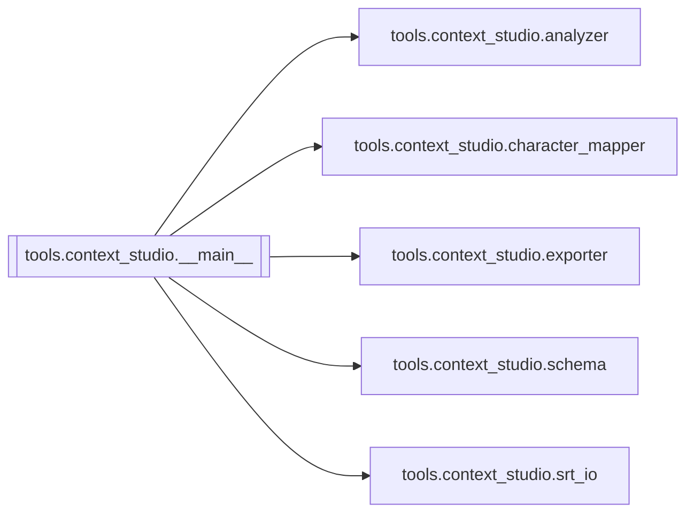

# `tools.context_studio.__main__`

[← Index](../generated/module-index.md) · [Brain home](../README.md)

<!-- AUTO:START — sinh bởi scripts/brain_build.py 2026-11-11 02:38. Đừng sửa tay khối này. -->
**File:** `tools/context_studio/__main__.py` · **Lớp:** `misc` · **67 dòng** (54 code) · **1 hàm**, **0 class** · sha1 `3035da499e`

> CLI: python -m tools.context_studio analyze <srt|asr.json> -o work/<job> Chỉ PRE-SCAN — không dịch.

### Phụ thuộc

- **Gọi tới (import nội bộ):** [tools.context_studio.analyzer](./tools.context_studio.analyzer.md), [tools.context_studio.character_mapper](./tools.context_studio.character_mapper.md), [tools.context_studio.exporter](./tools.context_studio.exporter.md), [tools.context_studio.schema](./tools.context_studio.schema.md), [tools.context_studio.srt_io](./tools.context_studio.srt_io.md)
- **Được dùng bởi:** —
- **Test:** ❌ chưa có test import trực tiếp

### Hàm & class top-level

| Tên | Dòng | Dài | Tham số | Docstring |
|---|---:|---:|---|---|
| `main` | 20 | 44 | `argv` |  |

### Lịch sử (từ docs/)

- Fix logs: —
- **Reviews:** [_atoms_tools_ui](../../reviews/_atoms_tools_ui.md), [2026-11-06-v5-func-catalog](../../reviews/2026-11-06-v5-func-catalog.md)
- Nhắc trong CHANGELOG: **0** lần · DECISIONS: **0** lần

<!-- AUTO:END -->

<!-- MANUAL:START -->
## Vai trò (viết tay)

_Chưa viết. 2–4 câu: module này chịu trách nhiệm gì trong pipeline, ai gọi nó, nó KHÔNG làm gì._

## Luồng chính

_Các hàm vào (entry) → bước chính → output/side effect. Ghi tên hàm thật._

## Bất biến & hợp đồng

_Điều luôn phải đúng (vd: chỉ ghi manifest qua `Manifest.update`; 1 job / ghế). Vi phạm = bug._

## Bẫy đã biết

_Lỗi từng gặp + link `docs/fixes/...`. Những chỗ dễ sửa sai._

## Ghi chú vận hành

_Config key quan trọng, cần restart gì khi sửa (:8801 / :8802 / hot-reload), cách test._
<!-- MANUAL:END -->
