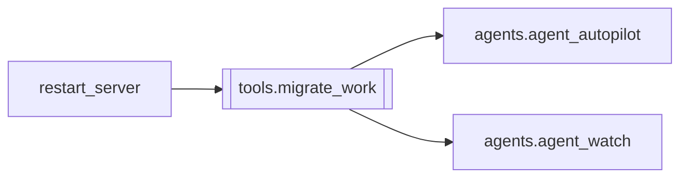

# `tools.migrate_work`

[← Index](../generated/module-index.md) · [Brain home](../README.md)

<!-- AUTO:START — sinh bởi scripts/brain_build.py 2026-11-11 02:38. Đừng sửa tay khối này. -->
**File:** `tools/migrate_work.py` · **Lớp:** `ops` · **299 dòng** (252 code) · **12 hàm**, **0 class** · sha1 `3cdc60d8a9`

> Chuyển Z:\PinelineV5\work sang ổ khác (mặc định D:\PinelineV5_work) giữa 2 job, không mất tiến độ. 1. Copy trước (robocopy /MIR) trong lúc job hiện tại vẫn chạy. 2. Rút các job đang chờ khỏi hàng + tắt Auto-pilot → worke

### Phụ thuộc

- **Gọi tới (import nội bộ):** [agents.agent_autopilot](./agents.agent_autopilot.md), [agents.agent_watch](./agents.agent_watch.md)
- **Được dùng bởi:** [restart_server](./restart_server.md)
- **Test:** `tests/test_restart_guard.py`
- **Thư viện ngoài:** `psutil`, `requests`

### Hàm & class top-level

| Tên | Dòng | Dài | Tham số | Docstring |
|---|---:|---:|---|---|
| `log` | 42 | 11 | `msg` |  |
| `tg` | 55 | 7 | `msg` |  |
| `robocopy` | 64 | 12 | `label` |  |
| `api` | 78 | 6 | `method, url, body, timeout` |  |
| `api_retry` | 86 | 11 | `method, url, body, timeout, tries` | Server đang render nặng có thể trễ >30s — không coi 1 lần timeout là lỗi chết. |
| `running_stages` | 99 | 14 | `` |  |
| `procs` | 115 | 7 | `pattern` |  |
| `kill_with_parent_cmd` | 124 | 31 | `p` |  |
| `start_bat` | 157 | 5 | `name` |  |
| `wait_http` | 164 | 9 | `url, sec` |  |
| `start_services_and_requeue` | 175 | 23 | `pending, opts, ap_was` |  |
| `main` | 200 | 89 | `` |  |

### Config / env keys (3)

`AGENT_TELEGRAM`, `PINELINE_BASE`, `PORT`

**Cổng nhắc tới:** 8802

**File/artifact nhắc tới:** `manifest.json`, `migrate_work.log`, `migrate_work.prev.log`, `migrate_work_plan.json`

**Tín hiệu rủi ro (đếm tĩnh):** broad_except=9 · file_writes=1 · sleep=5 · subprocess=3 · swallow_except=2

### Lịch sử (từ docs/)

- **Fix logs (1):**
  - [Restart hẹn giờ chết giữa chừng, server :8801 nằm chết](../../fixes/2026-10-06-restart-killed-itself.md)
- **Reviews:** [_atoms_tools_ui](../../reviews/_atoms_tools_ui.md), [2026-11-06-v5-func-catalog](../../reviews/2026-11-06-v5-func-catalog.md), [2026-11-02-v4-structure-sync](../../reviews/2026-11-02-v4-structure-sync.md), [2026-11-02-v4-structure-and-v2-port](../../reviews/2026-11-02-v4-structure-and-v2-port.md), [2026-11-02-v4-duplication-audit](../../reviews/2026-11-02-v4-duplication-audit.md)
- Nhắc trong CHANGELOG: **7** lần · DECISIONS: **0** lần

<!-- AUTO:END -->

<!-- MANUAL:START -->
## Vai trò (viết tay)

_Chưa viết. 2–4 câu: module này chịu trách nhiệm gì trong pipeline, ai gọi nó, nó KHÔNG làm gì._

## Luồng chính

_Các hàm vào (entry) → bước chính → output/side effect. Ghi tên hàm thật._

## Bất biến & hợp đồng

_Điều luôn phải đúng (vd: chỉ ghi manifest qua `Manifest.update`; 1 job / ghế). Vi phạm = bug._

## Bẫy đã biết

_Lỗi từng gặp + link `docs/fixes/...`. Những chỗ dễ sửa sai._

## Ghi chú vận hành

_Config key quan trọng, cần restart gì khi sửa (:8801 / :8802 / hot-reload), cách test._
<!-- MANUAL:END -->
