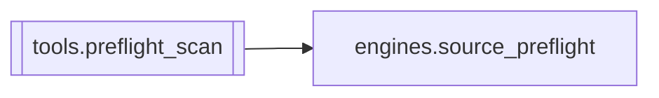

# `tools.preflight_scan`

[← Index](../generated/module-index.md) · [Brain home](../README.md)

<!-- AUTO:START — sinh bởi scripts/brain_build.py 2026-11-17 19:05. Đừng sửa tay khối này. -->
**File:** `tools/preflight_scan.py` · **Lớp:** `misc` · **87 dòng** (76 code) · **2 hàm**, **0 class** · sha1 `4767d58818`

> Quét CHỈ-ĐỌC các job trong work dir: nguồn video nào có vấn đề (preflight). Không ghi manifest, không chuẩn hoá, không đụng file nguồn. Job cũ (đã qua download trước khi có preflight) KHÔNG được chạy lại tự động — dùng s

### Phụ thuộc

- **Gọi tới (import nội bộ):** [engines.source_preflight](./engines.source_preflight.md)
- **Được dùng bởi:** —
- **Được nhắc tên file `.py` (subprocess/script) bởi:** [engines.source_preflight](./engines.source_preflight.md)
- **Test:** ❌ chưa có test import trực tiếp

### Hàm & class top-level

| Tên | Dòng | Dài | Tham số | Docstring |
|---|---:|---:|---|---|
| `scan` | 27 | 39 | `work_root, jobs, quick, only_unchecked, limit` |  |
| `main` | 68 | 16 | `argv` |  |

**File/artifact nhắc tới:** `manifest.json`

**Tín hiệu rủi ro (đếm tĩnh):** broad_except=1 · file_writes=1

### Lịch sử (từ docs/)

- **Fix logs (1):**
  - [Port V2→V5: preflight/chuẩn hoá video nguồn + extract_pcm bền + FireRed slice khoảng lặng + câu rác «None.» / ](../../fixes/2026-11-13-port-preflight-slice-junk.md)
- Nhắc trong CHANGELOG: **0** lần · DECISIONS: **0** lần

<!-- AUTO:END -->

<!-- MANUAL:START -->
## Vai trò (viết tay)

_Chưa viết. 2–4 câu: module này chịu trách nhiệm gì trong pipeline, ai gọi nó, nó KHÔNG làm gì._

## Luồng chính

_Các hàm vào (entry) → bước chính → output/side effect. Ghi tên hàm thật._

## Bất biến & hợp đồng

_Điều luôn phải đúng (vd: chỉ ghi manifest qua `Manifest.update`; 1 job / ghế). Vi phạm = bug._

## Bẫy đã biết

_Lỗi từng gặp + link `docs/fixes/...`. Những chỗ dễ sửa sai._

## Ghi chú vận hành

_Config key quan trọng, cần restart gì khi sửa (:8801 / :8802 / hot-reload), cách test._
<!-- MANUAL:END -->
