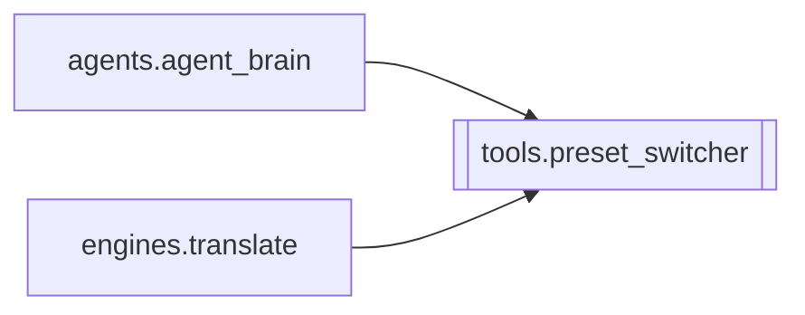

# `tools.preset_switcher`

[← Index](../generated/module-index.md) · [Brain home](../README.md)

<!-- AUTO:START — sinh bởi scripts/brain_build.py 2026-11-17 19:05. Đừng sửa tay khối này. -->
**File:** `tools/preset_switcher.py` · **Lớp:** `ops` · **242 dòng** (193 code) · **6 hàm**, **0 class** · sha1 `edeb2c0fdc`

> preset_switcher.py — Tự động chuyển đổi Preset Model trên llama-server (:8083) Quản lý bộ presets tại E:\models\presets (chạy script start-model.ps1). Chức năng:

### Phụ thuộc

- **Gọi tới (import nội bộ):** —
- **Được dùng bởi:** [agents.agent_brain](./agents.agent_brain.md), [engines.translate](./engines.translate.md)
- **Được nhắc tên file `.py` (subprocess/script) bởi:** [restart_server](./restart_server.md)
- **Test:** `tests/test_translate_b1.py`, `tests/test_translate_b1_scenarios.py`, `tests/test_translate_b2.py`, `tests/test_translate_b2_review.py`, `tests/test_translate_simple.py`
- **Thư viện ngoài:** `requests`

### Hàm & class top-level

| Tên | Dòng | Dài | Tham số | Docstring |
|---|---:|---:|---|---|
| `get_active_preset` | 32 | 23 | `` | Trả về ID hoặc alias của model đang thực sự hoạt động trên llama-server (:8083). |
| `list_available_presets` | 57 | 18 | `` | Trả về danh sách tất cả các preset có trong models.json. |
| `is_model_ready` | 77 | 48 | `target_preset, ping_inference` | Kiểm tra toàn diện xem llama-server :8083 đã khởi động xong và sẵn sàng nhận prompt chưa. |
| `switch_allowed` | 131 | 10 | `` | fix 2026-11-11 translate-b1 C9: đổi preset = KHỞI ĐỘNG LẠI llama-server :8083 dùng chung. |
| `switch_preset` | 143 | 13 | `preset_id, max_wait_sec` | Bản có khoá của _switch_preset_unlocked (xem docstring bên dưới). |
| `_switch_preset_unlocked` | 158 | 85 | `preset_id, max_wait_sec` | Chuyển đổi llama-server sang preset mong muốn và CHỜ ĐỢI cho đến khi AI mở lại hoàn toàn. |

### Config / env keys (3)

`MODEL_PRESETS_DIR`, `PINELINE_FLAG_PRESET_SWITCH`, `PYTEST_CURRENT_TEST`

**File/artifact nhắc tới:** `active.json`, `models.json`

**Tín hiệu rủi ro (đếm tĩnh):** broad_except=7 · sleep=2 · subprocess=1 · swallow_except=2

### Lịch sử (từ docs/)

- **Fix logs (2):**
  - [REVIEW lỗi bị coi là đã soát · park treo hàng đợi · Brain V4 điều khiển nhầm V2](../../fixes/2026-11-11-review-fail-park-port.md)
  - [2026-11-11 — machine-config: cổng/thư mục phụ thuộc máy thành setting (V5)](../../fixes/2026-11-11-machine-config.md)
- **Reviews:** [_atoms_tools_ui](../../reviews/_atoms_tools_ui.md), [2026-11-11-v4-v5-port-review](../../reviews/2026-11-11-v4-v5-port-review.md), [2026-11-06-v5-func-catalog](../../reviews/2026-11-06-v5-func-catalog.md), [2026-11-02-v4-structure-and-v2-port](../../reviews/2026-11-02-v4-structure-and-v2-port.md)
- Nhắc trong CHANGELOG: **2** lần · DECISIONS: **0** lần

<!-- AUTO:END -->

<!-- MANUAL:START -->
## Vai trò (viết tay)

_Chưa viết. 2–4 câu: module này chịu trách nhiệm gì trong pipeline, ai gọi nó, nó KHÔNG làm gì._

## Luồng chính

_Các hàm vào (entry) → bước chính → output/side effect. Ghi tên hàm thật._

## Bất biến & hợp đồng

_Điều luôn phải đúng (vd: chỉ ghi manifest qua `Manifest.update`; 1 job / ghế). Vi phạm = bug._

## Bẫy đã biết

_Lỗi từng gặp + link `docs/fixes/...`. Những chỗ dễ sửa sai._

## Ghi chú vận hành

_Config key quan trọng, cần restart gì khi sửa (:8801 / :8802 / hot-reload), cách test._
<!-- MANUAL:END -->
