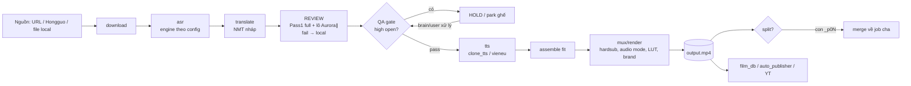

# Quy trình: 1 job từ nguồn tới output.mp4

_Cập nhật: 2026-11-11. Nguồn: `docs/ARCHITECTURE.md`, `server._auto_gpu`, `server._queue_run_one`, fix 2026-11-11 studio-1job-pipeline._

| Stage | Module chính (thẻ) | Đầu vào → đầu ra trong `work/<job>/` | Restart khi sửa |
|---|---|---|---|
| download | [download](../modules/download.md), [hongguo_bridge](../modules/hongguo_bridge.md) | URL/đường dẫn → `source.mp4` (hoặc `download.video_path`) | :8805 |
| asr | [asr](../modules/asr.md), [fun_asr_nano](../modules/fun_asr_nano.md), [firered_asr](../modules/firered_asr.md)… (subprocess, chọn qua `ASR_SCRIPTS` trong server) | `audio.wav` → `asr.json`, `sub.zh.srt` | subprocess mới → không |
| translate | [translate](../modules/translate.md) `run_translate`, [mt_zh_vi](../modules/mt_zh_vi.md), [series_glossary](../modules/series_glossary.md) | `sub.zh.srt` + plan/glossary → `script.json` | :8805 (fill có reload) |
| review | [translate](../modules/translate.md) `run_review`, `review_batch`, `run_review_pass1_full_vi`; [llm](../modules/llm.md) | `script.json` → `script.json` (cờ `rv`) | :8805; key REVIEW_* file-first → hiệu lực ngay |
| QA | [agent_qa_gate](../modules/agent_qa_gate.md), [agent_quality](../modules/agent_quality.md), [agent_hang_fix](../modules/agent_hang_fix.md) | `script.json` → `qa_brain.json`, HOLD flags | :8805 |
| tts | [clone_tts](../modules/clone_tts.md), `rvc_bridge/` | `script.json` → `tts.json`, `seg_*.wav` | :8805 |
| assemble | [assemble](../modules/assemble.md) | `seg_*.wav` → `dub_fit.wav`, `tts_fit.json` | hot-reload qua render |
| mux | [render](../modules/render.md), [render_fx](../modules/render_fx.md), [sfx_lib](../modules/sfx_lib.md), [subs](../modules/subs.md), [media_ts](../modules/media_ts.md) | → `output.mp4` | hot-reload (`_do_render` reload `render`) |
| split/merge | [split_parts](../modules/split_parts.md) | job cha ↔ `_p01…` | :8805 |

## Điểm điều phối

- **`server._auto_gpu`**: phần GPU 1-click, tuần tự ASR → dịch → (REVIEW trong ghế) → TTS → [tách nền] → [OCR] → render; mỗi engine tự SKIP nếu đã xong ⇒ resume được; kiểm cờ Dừng (`_STOP_JOBS`) giữa các bước.
- **`server._queue_run_one`**: worker queue chạy 1 job với opts snapshot (`batch_config.resolve_job_opts`).
- **`server._run_stage`**: chạy 1 stage riêng lẻ (UI / agent).

## Bất biến

- Mỗi stage idempotent theo manifest: `done` thì bỏ qua trừ `force`.
- Không TTS khi còn câu chưa `rv` hoặc QA high mở (Studio SOP, DECISIONS 11-11).
- Opts của job = snapshot lúc xếp hàng (`queue_opts`), không đọc lại batch config giữa chừng.

## Bẫy đã biết (tóm tắt — chi tiết ở `docs/fixes/`)

- Restart giữa translate → mất/ghi đè `script.json` (fix 11-10 `05670-script-wipe`).
- Split parent báo failed giả / không merge (fix 11-03, 11-08).
- Lệch tiếng do AAC priming (worklog 10-05, `media_ts`).
- Queue nhảy job khi HOLD (fix 11-10 `queue-park-held`).
