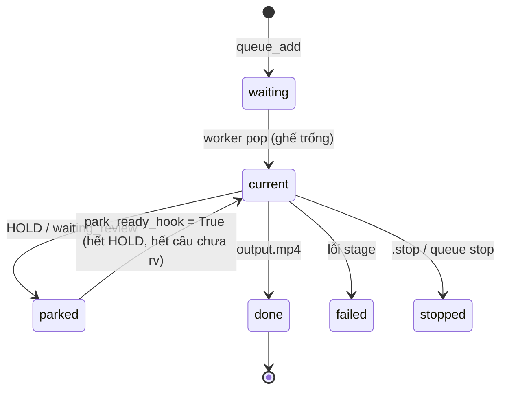

# Quy trình: Queue & Studio SOP (1 job / ghế)

_Cập nhật: 2026-11-11. Nguồn: DECISIONS 11-10 + 11-11, fix `2026-11-10-queue-park-held.md`, `2026-11-11-studio-1job-pipeline.md`, `job_queue.py`._

## Luật (user đã khoá)

1. **Một ghế, một job**, chạy trọn: ASR OK → NMT → REVIEW (Aurora∥, fail → local) → TTS → mux → **Done** → mới tới job kế.
2. Job **HOLD** / **waiting_review** → **park** ghế (không pop job kế).
3. **Không** chạy REVIEW bằng CLI ngoài queue khi studio đang chạy.
4. Restart :8805 khi queue đang chạy → hỏi user yes/no.

## Máy trạng thái (rút gọn)

## Code

| Việc | Hàm |
|---|---|
| Thêm / nhóm / sắp xếp / di chuyển | `job_queue.queue_add`, `queue_add_group`, `queue_sort`, `queue_move`, `queue_reorder`, `queue_front`, `queue_remove`, `queue_update_opts` |
| Runner (server tiêm vào) | `job_queue.set_runner` ← `server._queue_run_one` |
| Điều kiện mở park | `job_queue.set_park_ready_hook` (server gắn) · fallback `_default_park_ready` |
| Lưu trạng thái | `work/logs/queue.json` qua `_save` / `_load` |
| Bận GPU? (heal/watch tránh tranh) | `job_queue.queue_busy` |
| Test | `tests/test_job_queue.py`, `tests/test_job_queue_worker.py`, `tests/test_queue_run_one.py` |

## Ai được đụng vào queue

- UI / API `:8805/api/queue/*` (người).
- `agent_core` tools (chat Telegram) — confirm trừ khi user ra lệnh rõ.
- `agent_autopilot` + `agent_feeder` (sidecar :8802, qua HTTP) — chỉ khi hàng trống.
- `agent_brain` — L1/L3 theo policy + cooldown.

⚠️ Nhiều tác nhân tự động cùng có quyền mutate queue → khi debug "job tự nhảy/tự thêm", kiểm `agent_brain.log`, `agent_watch.log`, log sidecar trước.
