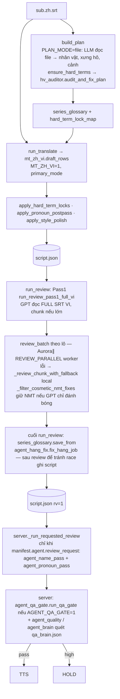

# Quy trình: Dịch → REVIEW → QA

_Cập nhật: 2026-11-11. Nguồn: `translate.py`, DECISIONS 11-09…11-11, fix 11-09 `mt-draft-slim-gloss`, `review-keep-nmt`, `hv-auditor`, 11-10 `review-gpt6-aurora`, 11-11 `pass1-upload-size`, `studio-1job-pipeline`._

## Luồng

## Hàm & key chính

| Bước | Hàm | Key |
|---|---|---|
| Plan | `translate.build_plan`, `_build_plan_from_file` | `PLAN_MODE`, `PLAN_MODEL` |
| Nháp | `translate.run_translate`, `mt_zh_vi` | `MT_ZH_VI`, `TRANSLATE_PRESET` |
| Hậu xử lý | `apply_hard_term_locks`, `apply_pronoun_postpass`, `apply_style_polish` | `PRONOUN_TITLE_POLICY` |
| Pass1 | `run_review_pass1_full_vi`, `_pass1_upload_full_via_chunks` | `REVIEW_PASS1_MAX_UPLOAD_BYTES`, `REVIEW_PASS1_CHUNK_CUES`, `REVIEW_PASS1_ALLOW_CHAT_FALLBACK=0` |
| REVIEW lô | `run_review`, `review_batch`, `_review_parallel_workers`, `_resolve_review_model` | `REVIEW_MODEL`, `AURORA_REVIEW_MODEL`, `REVIEW_BACKUP`, `REVIEW_PARALLEL(_MAX)`, `REVIEW_PRESET`, `REVIEW_PRONOUN_MASK` |
| Sẵn sàng TTS? | `translate_ready_for_tts`, `count_script_missing`, `translate_coverage_gap` | — |

Danh sách key đầy đủ + nơi đọc: [../generated/config-keys.md](../generated/config-keys.md). Lưu ý `config.LLM_FILE_FIRST_KEYS`: các key LLM/REVIEW đọc **file trước env** — sửa `pineline.config.json` có hiệu lực ngay, không cần restart.

## Quyết định user cần tôn trọng (xem DECISIONS)

- NMT là bản chính; GPT chỉ sửa lỗi thật, không "đánh bóng" (11-09 keep-NMT).
- REVIEW được nới văn phong khi vá, không dịch lại toàn bộ (11-10).
- Pass1 phải đọc full file, không chat mẫu (11-11).
- Hang high → LLM trace + chọn phương án rồi mới mở HOLD (11-10, phương án B).

## Đo chất lượng

Bench/so sánh model: `docs/reviews/2026-11-09-mt-*`, `2026-11-09-ab-nmt-primary-vs-old.md`, `2026-11-10-review-parallel-aurora.md`. Đổi model/prompt → chạy lại bench tương tự trước khi đổi mặc định (xem [../workflows/ai-change.md](../workflows/ai-change.md)).
