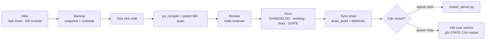

# Workflow: sửa code / config an toàn

_Cập nhật: 2026-11-11. Hợp nhất từ `.cursor/rules/docs-on-change.mdc`, `fix-log-markdown.mdc`, STATE (luật restart). Áp dụng cho người, Cursor và Claude Code._



## 1. Hiểu trước khi sửa

- `/ask-brain <câu hỏi>` hoặc mở `docs/brain/modules/<module>.md`: ai gọi hàm này, artifact dùng chung, fix cũ.
- Kiểm `docs/DECISIONS.md`: thay đổi có ngược quyết định user không? Có → hỏi trước.
- Kiểm `docs/STATE.md`: job nào đang chạy, có đang chờ restart không.

## 2. Backup (user yêu cầu: luôn backup)

```bat
python D:\PinelineV2_tmp\snapshot.py
:: rồi chép bản gốc từng file sắp sửa (giữ đường dẫn tương đối)
Z:\PinelineV5_codebak\<YYYY-MM-DD>_<slug>\
```

Codebak chính là "diff base" để review sau này (`diff -u codebak/x.py x.py`).

## 3. Sửa

- Nhỏ nhất, tại gốc. Không refactor kèm bug fix.
- Ghi trạng thái qua `Manifest.update` / `fileio` (atomic), đọc/ghi `encoding="utf-8"`.
- Key config mới: default trong code + thêm vào `pineline.config.example.json` + nếu là key LLM/REVIEW cân nhắc `config.LLM_FILE_FIRST_KEYS`.
- Sync V2 → V4/V5 nếu thay đổi thuộc phần dùng chung (ghi rõ trong CHANGELOG).

## 4. Kiểm

```bat
python -m py_compile <file.py>
python -m pytest -q tests\<test liên quan>.py
:: rộng hơn khi đụng queue/server:
python -m pytest -q tests
```

## 5. Review

`/review recent` (Claude Code) — code-reviewer đọc diff với codebak, chạy test, kiểm docs.

## 6. Docs (trước khi báo "xong")

| File | Khi nào |
|---|---|
| `docs/CHANGELOG.md` | Luôn — file + hàm + **cần restart gì** |
| `docs/worklog/<ngày>.md` | Luôn — giờ, yêu cầu, đã làm, kết quả/còn treo |
| `docs/fixes/<ngày>-<slug>.md` + README | Khi sửa bug (template có Recheck Pass/Fail) |
| `docs/STATE.md` | Trạng thái/mặc định/chờ restart đổi |
| `docs/DECISIONS.md` | User chọn/bác phương án |
| `docs/ARCHITECTURE.md` / `RUNBOOK.md` | Module/luồng/lệnh mới |

## 7. Sync brain

```bat
python scripts\brain_build.py
```

rồi cập nhật khối MANUAL của module đã đổi hành vi (hoặc `/brain-sync`).

## 8. Restart

- Chỉ khi queue rảnh hoặc user đồng ý. Dùng `restart_server.py --clean-env` (xem RUNBOOK).
- Không bao giờ kill :8000 (Hongguo) hay :8083 (llama-server).
- Thay đổi chỉ trong `render`/`assemble`/`subs`/`media_ts` có hot-reload khi vào bước render; key file-first có hiệu lực ngay.
