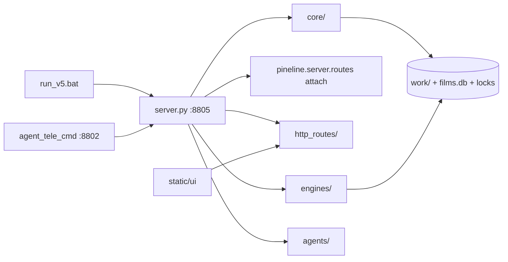

# V5 part atoms — finest-grain map

- **Date:** 2026-11-06
- **Skill:** `v5-part-atomizer`
- **Root:** `Z:\PinelineV5`
- **Format:** atom → file → main function → side effect



---

## 1. Entry

| Atom | File | Main | Side effect |
|---|---|---|---|
| Root stub | `run_v5.bat` | `call apps\run_v5.bat` | delegates |
| Launcher menu | `apps/run_v5.bat` | choice 1/2/3 | sets `PORT=8805`, `TEMP/TMP=D:\PinelineV5_tmp`, ensures `D:\PinelineV5_work` |
| Web server | `server.py` `__main__` | `uvicorn.run(app, host, port)` | default CLI port env `PORT` else 8800; bat forces **8805** |
| Startup heal | `server.py` `@app.on_event("startup")` ×N | `_quiet_conn_reset`, `_reset_stale_running`, `_start_queue_worker`, `_resume_hg_merge`, autopublish/canva hooks | clears stale stages; starts queue worker; resumes HG merge |
| Local guard | `server.py` `_local_only_guard` | middleware | rejects non-loopback |
| Desktop WebView2 | `app_desktop.py` | launches UI against :8805 | process separate from uvicorn |
| Desktop Tauri | `run_tauri.bat` → `src-tauri/` | `devUrl` :8805 | optional auto-start `server.py` |
| Sidecar bat | `apps/run_tele_cmd.bat` | `python -m agents.agent_tele_cmd` | `PINELINE_BASE→:8805`, `AUTOPILOT_PORT=8802` |
| Restart helper | `restart_server.py` | kill/relaunch server | lock-aware restart |

**Router mount (end of `server.py`):**

- Bodies: `include_router(routes_ui|hg|agent|films|uploader_settings)`
- Registries: `pineline.server.routes.{queue,jobs,assets,fs}.attach(server)` then `include_router`

---

## 2. `core/` (one atom each)

### `core/config.py`
Loads `pineline.config.json` → process env (`inject_env`); `get` / `save_config` / `llm_settings` / `agent_llm` / `pass_llm_model` / `venv_python`. **SE:** mutates env + JSON on disk; secrets stay in root config file.

### `core/batch_config.py`
Default queue/job opts layer: `load` / `update` / `reset` / `resolve_job_opts` / `render_kwargs`. **SE:** persists batch defaults used when queue worker accepts a job; fills voice defaults.

### `core/job_queue.py`
In-memory + disk queue (`work/_job_queue.json`): `queue_add|remove|sort|move|reorder|stop|clear`, `set_runner`, `_worker_loop`, `http_queue_state`, `get_job_info` (DB-first). **SE:** background worker calls `server` runner → pipeline; history; stop hooks kill engines.

### `core/job_meta.py`
UI label helpers: `extract_ui_meta`, `parse_season_from_text`, `info_from_manifest_dict` / `info_from_film_row`. **SE:** none (pure derive); feeds queue list titles/seasons.

### `core/film_db.py`
SQLite `data/films.db`: `sync_one` / `sync` / `query` / `get*` / `delete_film*` / library-block APIs / `stats`. **SE:** index for Films UI + queue enrich; optional delete `work/<id>`; upload sync.

### `core/manifest.py`
`Manifest` class on `work/<job_id>/manifest.json`: stage status, 3-way merge, file+thread locks. **SE:** atomic JSON writes; single source of truth for stage runtime.

### `core/fileio.py`
`atomic_write_text|json`, `read_json_checkpoint`, `file_lock`. **SE:** crash-safe writes + lock files under work/data.

---

## 3. HTTP

### 3a. Attach registries (`pineline/server/routes/`) — path map only; body in `server.py`

| Atom | File | Registry role | Handler body lives in |
|---|---|---|---|
| Queue map | `queue.py` `attach` | `/api/queue/*`, `/api/jobs/group` | `api_queue_jobs_*`, `jobs_group` |
| Jobs map | `jobs.py` `attach` | `/api/jobs`, stage run, TTS, split/merge, files | `create_job`, `run_stage`, `run_all`, `mux_job`, … |
| Assets map | `assets.py` `attach` | cookies/voices/frames/brand/clone/models | `cookies_status`, `list_voices`, … |
| FS map | `fs.py` `attach` | `/api/fs/list-dirs`, pick-dir(s) | `api_fs_*` |

### 3b. Router bodies (`http_routes/`)

| Atom | File | Main routes | Side effect |
|---|---|---|---|
| UI shell | `routes_ui.py` | `/`, `/ui3`, `/hongguo`, `/hongguo2`, `/workflow` | serves `static/ui/*.html` via `find_index` / `_html_file` |
| Hongguo + meta | `routes_hg.py` | `/api/hg/*`, `/api/meta/*` | proxies `hongguo_bridge` (:8000); meta_studio thumbs/titles → `data/` + work |
| Agent API | `routes_agent.py` | `/api/agent/chat|confirm|…`, qa-gate, av-sync, heal | binds `agent_core` Runtime → mutates jobs/queue/script |
| Films / library / test-ch | `routes_films.py` | `/films*`, `/library*`, `/test-channel*` | `film_db` + `tools.test_channel` + check_block |
| Settings / uploader / Canva | `routes_uploader_settings.py` | `/api/settings`, `/api/uploader/*`, `/api/auto-publish/*`, `/canva/*` | config JSON; `auto_publisher`; Canva OAuth files in `data/` |

### 3c. `server.py` job/pipeline atoms (handlers behind attach)

| Atom | Function | Side effect |
|---|---|---|
| Create URL job | `create_job` / `_create` | `work/<id>/` + manifest |
| Local import | `create_local_job_*` | copy/hardlink source into work |
| Stage claim | `_claim_stage` / `_submit_claimed` | `_STAGE_BUSY`; executor |
| Run one stage | `_run_stage` / `run_stage` | subprocess `_run_engine` or in-proc engines |
| Run all | `run_all` / `_auto_pipeline` / `_auto_gpu` | download→…→mux (+ optional split) |
| Stop | `_stop_job` / `stop_job` | kill child engine PIDs; stop flag |
| Queue runner wire | `_start_queue_worker` + `job_queue.set_runner` | dequeues → pipeline |

---

## 4. Pipeline (`engines/` + ASR)

**Wired stages** (`WIRED_STAGES`): `download → asr → translate → tts → mux`  
**Optional:** `ocr`, `separate`  
**Cross-cut:** `split_parts`, pronoun analyze/QA, assemble (pre-mux audio fit), render (inside mux path)

| Atom | File | Main | Side effect |
|---|---|---|---|
| Download | `engines/download.py` | `download_video` | source video + manifest request |
| ASR orchestrator | `engines/asr/asr.py` | `run_asr` / `ensure_audio_wav` | `asr.json`, wav; delegates engine |
| ASR SenseVoice | `asr/sensevoice_asr.py` | `run_asr_sensevoice` | segments |
| ASR Paraformer | `asr/paraformer_zh.py` | `run_asr_paraformer` | segments |
| ASR FunNano | `asr/fun_asr_nano.py` | `run_asr_nano` | segments |
| ASR FireRed | `asr/firered_asr.py` | `run_asr_firered` | segments |
| ASR hybrid FA | `asr/hybrid_asr.py` | `run_hybrid_fa` | multi-pass asr |
| ASR nano+FA | `asr/nano_fa_asr.py` | `run_nano_fa` | aligned hybrid |
| Hardsub ASR | `asr/hardsub_asr.py` | `run_hardsub_asr` | OCR-band cues → asr overlay |
| ASR spam heal | `asr/asr_spam.py` | `sanitize_asr_*` | cleans loops/fillers |
| ASR repair/align | `asr/asr_repair.py`, `asr_fix_align.py`, `asr_align_nano_para.py` | repair/align helpers | rewrite asr rows |
| Hybrid progress | `asr/asr_hybrid_progress.py` | `overlay_job_asr` | UI progress mirror |
| Separate | `engines/separate.py` | `run_separate` | vocals/other stems |
| OCR | `engines/ocr.py` | `run_ocr` | name/hardsub hints |
| Pronoun analyze | `engines/pronoun_consistency.py` | `analyze_full_zh`, `ensure_analyze_before_translate`, `run_post_translate_consistency` | `pronoun_plan` / locks in work |
| Translate | `engines/translate.py` | `build_plan`, `run_translate`, `run_review` | `script.json`, plan, glossary hooks |
| Translate alts | `engines/translate_alts.py` | `run_ambiguous_alts` | alt picks JSON |
| LLM I/O | `engines/llm.py` | `chat`, `chatgpt_chat_with_file`, `list_available_models` | Ollama/llama/ChatGPT calls; VRAM unload |
| Series glossary | `engines/series_glossary.py` | (save/load via server) | `data/series_glossary/` |
| TTS clone | `engines/clone_tts.py` | `run_clone_tts`, `synth_one`, `enroll_voice` | `tts.json` + wav clips; RVC bridge optional |
| Assemble | `engines/assemble.py` | `assemble_fit` | fitted voice track timeline |
| Subs | `engines/subs.py` | `to_srt` | srt artifacts |
| Render | `engines/render.py` | `run_render` | video encode + hardsub/FX |
| Render FX | `engines/render_fx.py` | FX helpers | filter graphs |
| Mux | `engines/mux.py` | `run_mux` | `output.mp4` (+ volumes) |
| Split/merge | `engines/split_parts.py` | `split_job_to_subjobs`, `merge_job_parts`, `maybe_auto_split_job`, `try_auto_merge_parent` | `*_p0N` subjobs; parent mux heal; hardlink `output_full` |
| SFX / demucs util | `engines/sfx_lib.py` | stream/subprocess separate | stems |
| Check YT block | `engines/check_block.py` | `check_film_by_job` | films.db block status |
| Script lint | `engines/script_lint.py` | `run_lint` | script fixes |
| Playlist | `engines/playlist.py` | `expand` / `expand_meta` | multi-URL expand |
| Title MT | `engines/title_mt.py` | title helpers | UI titles |
| Media TS | `engines/media_ts.py` | timestamp utils | A/V timing |
| VRAM | `engines/vram.py` | `free_gpu_vram` | GPU cleanup between stages |

**Pronoun QA agent hook:** `agents/agent_pronoun_pass.py` `run_pronoun_pass` → LLM fix batch on script (uses slim plan from translate).

---

## 5. Agents

| Atom | File | Trigger | Calls API / effect |
|---|---|---|---|
| Sidecar entry | `agent_tele_cmd.py` | bat / `python -m` | HTTP control :8802; TG poll; loops → BASE :8805 |
| Tele commands | same `handle_command` | TG text / slash | feeder, autopilot, hg, agent chat |
| Autopilot tick | `agent_autopilot.py` (+ tele loops) | `/on`, timer | `tick_once(BASE)` heal/queue |
| Feeder | `agent_feeder.py` | `feed_tick`, lib cmds | HG library → create/queue jobs; combine seasons |
| Hongguo tools | `agent_hongguo.py` | TG `/hg`, agent tools | `hongguo_bridge` search/rank/catalog/submit |
| Hongguo bridge | `hongguo_bridge.py` | routes_hg + agents | HTTP :8000; merge queue worker; baike |
| Agent brain | `agent_core.py` | `/api/agent/chat` | tool dispatch mutate jobs/script/queue |
| Stage I/O | `agent_stage_io.py` | agent tools | read/write stage artifacts |
| QA gate | `agent_qa_gate.py` | `/api/agent/jobs/{id}/qa-gate` | hold/release translate |
| Heal | `agent_heal.py` | scan-failed / heal-failed | reset stale / rerun |
| Watch | `agent_watch.py` | `/api/agent/watch-once` | stuck-job scan |
| AV sync | `agent_av_sync.py` | av-sync APIs | detect/heal A/V drift |
| Name pass | `agent_name_pass.py` | translate post | character name consistency |
| Pronoun pass | `agent_pronoun_pass.py` | post-translate / QA | script pronoun fixes |
| Error class | `agent_error_class.py` | heal path | classify failures |
| Publisher | `auto_publisher.py` | scan/trigger routes + worker | YT upload; locks; `data/auto_publish_*.json` |
| Meta studio | `meta_studio.py` | `/api/meta/*` | titles/thumbs → `data/series_meta`, thumbnails |
| Canva | `canva_client.py` | `/canva/*` | OAuth + design create (`data/canva_*.json`) |

---

## 6. UI (`static/ui/`)

| Atom | File | Served by | Role |
|---|---|---|---|
| Dashboard | `index3.html` | `routes_ui` `/`, `/ui3` | jobs queue, stage controls, preview |
| Films library | `films_ui.html` | `routes_films` `/films/ui` | films.db browse/sync/block |
| Hongguo classic | `hongguo.html` | `/hongguo` | search/rank/library/merge/seasons |
| Hongguo2 | `hongguo2.html` | `/hongguo2` | Discover \| Ops two-column |
| Workflow | `workflow.html` | `/workflow` | pipeline diagram / ops view |

Desktop shells (WebView2 / Tauri) load same HTTP UI on :8805.

---

## 7. Data

| Atom | Path | Writer | Reader |
|---|---|---|---|
| Job workspace | `work/<job_id>/` (often junction → `D:\PinelineV5_work`) | pipeline + server | UI, agents, queue detail |
| Manifest | `work/<job_id>/manifest.json` | Manifest / stages | job detail, heal |
| Artifacts | `asr.json`, `script.json`, `tts.json`, `output.mp4`, wavs, srt | engines | mux/UI/agent |
| Queue persist | `work/_job_queue.json` | `job_queue._save` | worker restart |
| Title cache HG | `work/_hg_title_cache.json` | hongguo_bridge | search UI |
| Films index | `data/films.db` | `film_db.sync*` | queue enrich, Films UI |
| Auto-publish | `data/auto_publish_{queue,state}.json` | auto_publisher | uploader UI |
| Canva / tele hist | `data/canva_*.json`, `tele_chat_history.json` | canva / tele_cmd | OAuth + TG memory |
| Series meta/gloss | `data/series_meta/`, `data/series_glossary/` | meta_studio / translate | thumbs, locks |
| Thumbnails | `data/thumbnails/` | meta_studio | Films/meta UI |
| Config secret | `pineline.config.json` (root) | settings API / hand-edit | `core.config` |
| Server lock | `.server_8805.lock` | server start | single instance |
| Sidecar lock | `.sidecar_8802.lock` | agent_tele_cmd | single sidecar |
| Job upload lock | under work/publisher paths | auto_publisher | prevent double upload |
| NVENC state | `.nvenc_state.json` (root) | render | encoder session |
| Voices | `voices/*.json`, `voices/clone_refs` | clone enroll | TTS |
| Assets | `assets/{bgm,luts,overlays}` | static | render |
| Tmp | `D:\PinelineV5_tmp` | ffmpeg/models | all engines |

---

## 8. Nested atom tree (quick index)

```
Entry
├─ run_v5.bat → apps/run_v5.bat → server.py:8805 | app_desktop | tele_cmd
core/
├─ config → env + pineline.config.json
├─ batch_config → default opts
├─ job_queue → worker + _job_queue.json
├─ job_meta → labels
├─ film_db → films.db
├─ manifest → work/*/manifest.json
└─ fileio → atomic/lock
HTTP
├─ attach: queue | jobs | assets | fs  →  server.py bodies
└─ bodies: ui | hg | agent | films | uploader_settings
Pipeline
├─ download → asr(*) → translate(+pronoun) → tts → assemble → render/mux
├─ optional: ocr | separate
└─ split_parts ↔ subjobs ↔ merge
Agents
├─ tele_cmd:8802 → feeder | autopilot | hongguo | agent_core
└─ publisher | meta_studio | canva
UI: index3 | films_ui | hongguo | hongguo2 | workflow
Data: work/<id> | films.db | queue json | locks | data/*
```

---

## Liên quan

- `docs/LAYOUT.md`, `docs/ARCHITECTURE.md`, `docs/MANIFEST_CONTRACT.md`
- Skill: `.cursor/skills/v5-part-atomizer/SKILL.md`
