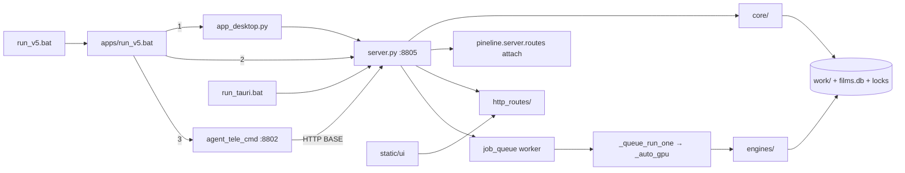
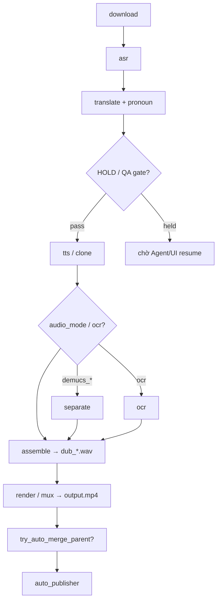

# V5 part atoms — finest-grain map (đầy đủ)

- **Date:** 2026-11-06
- **Skill:** `v5-part-atomizer`
- **Root:** `Z:\PinelineV5`
- **Format mỗi atom:** file → key fn/class → trigger → I/O + side effects → next atom
- **Nguồn:** đọc code live (không đoán)
- **Chi tiết từng hàm (signature / line / full list):** → [2026-11-06-v5-func-catalog.md](./2026-11-06-v5-func-catalog.md) (spine CALL ORDER + 2118 funcs)





---

## Mục lục

1. [Entry](#1-entry)
2. [core/](#2-core)
3. [HTTP — attach + router bodies](#3-http)
4. [Pipeline engines](#4-pipeline-engines)
5. [server.py orchestration](#5-serverpy-orchestration)
6. [Agents](#6-agents)
7. [UI → API](#7-ui--api)
8. [Data layout `work/<job_id>/`](#8-data-layout)
9. [Nested index](#9-nested-index)

---

## 1. Entry

### 1.1 `run_v5.bat` (root stub)

- **File:** `Z:\PinelineV5\run_v5.bat`
- **Key:** `@call apps\run_v5.bat`
- **Trigger:** double-click / CLI
- **I/O:** không; **SE:** chuyển quyền
- **Next:** `apps/run_v5.bat`

### 1.2 `apps/run_v5.bat` (launcher menu)

- **File:** `apps/run_v5.bat`
- **Key:** menu choice `1|2|3`; set `PORT=8805`, `TEMP/TMP=D:\PinelineV5_tmp`, mkdir `D:\PinelineV5_work`
- **Trigger:** user chọn
- **I/O / SE:**
  - `[1]` → `python app_desktop.py`
  - `[2]` → `python server.py --host 127.0.0.1 --port 8805`
  - `[3]` → `PINELINE_BASE=http://127.0.0.1:8805` + `apps/run_tele_cmd.bat`
- **Next:** Desktop | Server | Sidecar

### 1.3 `server.py` — `__main__` + instance lock

- **File:** `server.py`
- **Key:** `uvicorn.run(app, …)`; lock `.server_{port}.lock` via `msvcrt.locking`
- **Trigger:** CLI / bat / desktop / tauri
- **In:** `--host` (env `HOST`), `--port` (env `PORT`, default **8805** trong bat; argparse fallback env)
- **Out / SE:** process HTTP loopback; từ chối instance thứ 2 cùng cổng
- **Next:** startup events → mount routers → idle chờ request / queue worker

### 1.4 Startup hooks (`@app.on_event("startup")`)

| Atom | Fn | SE | Next |
|---|---|---|---|
| Quiet ConnReset | `_quiet_conn_reset` | lọc `ConnectionResetError` trên Proactor | — |
| Reset stale | `_reset_stale_running` | kill orphan engines; `stages.*.status=running→pending`; TTS heal wav count | queue worker |
| Queue worker | `_start_queue_worker` | nếu queue non-empty → `job_queue._ensure_worker()` | `_worker_loop` |
| HG merge resume | `_resume_hg_merge` | `hongguo_bridge.merge_resume()` | merge worker |
| Agent watch | `_start_agent_watch` | `agent_watch.start_watcher` nếu `AGENT_WATCH=1` | heal loop |
| Auto-publisher | `_start_auto_publisher` | `auto_publisher.start_worker()` | publish loop |

### 1.5 Middleware local-only

- **File:** `server.py` → `_local_only_guard`
- **Trigger:** mọi HTTP
- **SE:** từ chối non-loopback
- **Next:** route handlers

### 1.6 `app_desktop.py` (WebView2)

- **File:** `app_desktop.py`
- **Key:** `main`, `start_backend`, `wait_for_server`, `webview.create_window`
- **Trigger:** menu `[1]` / `python app_desktop.py`
- **In:** `PORT` (default 8805), URL `http://127.0.0.1:{PORT}/`
- **Out / SE:** spawn `server.py` nếu port trống; cửa sổ WebView2 (cache `TEMP/PinelineV5_wv_{pid}`); fallback browser
- **Next:** UI `index3` via `/`

### 1.7 Tauri

- **File:** `run_tauri.bat` → `npm run tauri:dev`; config `src-tauri/tauri.conf.json` (`devUrl: http://127.0.0.1:8805`, `frontendDist: ../desktop/tauri_www`)
- **Trigger:** `run_tauri.bat`
- **SE:** nếu chưa có :8805 → `start` server nền; mở cửa sổ native
- **Next:** cùng HTTP UI :8805

### 1.8 Sidecar bat

- **File:** `apps/run_tele_cmd.bat`
- **Key:** `python -m agents.agent_tele_cmd`
- **Env:** `PINELINE_BASE→:8805`, `AUTOPILOT_PORT=8802`, `AGENT_TELEGRAM=1`, tick/watch timers
- **Next:** `agents/agent_tele_cmd.py` `main`

### 1.9 `restart_server.py`

- **File:** `restart_server.py`
- **Key:** `_precheck` (py_compile + smoke import), drain queue (`--after-current`), optional `--hold-file`, `--sidecar`, `_start_server`, `_requeue`
- **Trigger:** CLI ops
- **SE:** kill/relaunch server (giữ sidecar trừ `--sidecar`); restore queue + autopilot state; TG notify
- **Next:** server startup lại

### 1.10 Router mount (cuối `server.py`)

1. `include_router(routes_ui|hg|agent|films|uploader_settings)` — **bodies**
2. `pineline.server.routes.{queue,jobs,assets,fs}.attach(server)` rồi `include_router` — **path registries** → handlers trong `server.py`

---

## 2. `core/`

### 2.1 `core/config.py`

- **Key:** `_load_cfg`, `inject_env`, `get`, `save_config`, `llm_settings`, `agent_llm`, `pass_llm_model`, `venv_python`
- **Trigger:** import server / settings API / engines LLM
- **In:** `pineline.config.json` (root)
- **Out / SE:** mutate `os.environ`; ghi lại JSON khi `save_config`
- **Next:** mọi layer đọc `config.get` / LLM settings

### 2.2 `core/batch_config.py`

- **Key:** `DEFAULTS`, `load`, `update`, `reset`, `resolve_job_opts`, `render_kwargs`, `describe`
- **Trigger:** queue add / UI «Lưu batch» / Telegram `/config` / `_queue_run_one`
- **In/Out:** `work/logs/batch_config.json`
- **SE:** nguồn duy nhất opts mặc định (voice, asr_engine=`nano_fa`, audio_mode, auto_split/merge…)
- **Next:** `job_queue.queue_add` opts → stamp `manifest.queue_opts`

### 2.3 `core/job_queue.py`

| Atom | Fn | Trigger | I/O + SE | Next |
|---|---|---|---|---|
| Persist | `_save` / `_load` | mọi mutate / startup | `work/_job_queue.json` | worker |
| Wire runner | `set_runner(_queue_run_one)` | server import | in-mem `_runner` | worker calls |
| Add | `queue_add`, `queue_add_group` | POST `/api/queue/jobs*` | append `_q`, opts_by_job | `_ensure_worker` |
| Sort/move | `queue_sort`, `queue_move`, `queue_reorder` | API | reorder `_q` | UI poll |
| Stop/clear | `queue_stop`, `queue_clear` | API | stop hook → `_stop_job` | heal |
| State | `http_queue_state`, `queue_state` | GET `/api/queue/jobs` | DB enrich + 1 live manifest (`current`) | UI |
| Info | `get_job_info` / `get_jobs_info` | list/sort | films.db first | labels |
| Done check | `is_wired_done` | runner end | stages download..mux all `done` + `output.mp4` | merge/publish |
| Worker | `_worker_loop` | thread daemon | pop job → `_runner(job, opts)` → hist | `_queue_run_one` |

**Chuỗi:** `queue_add` → `_worker_loop` → `_queue_run_one` → download/auto-split/`_auto_gpu`.

### 2.4 `core/job_meta.py`

- **Key:** `extract_ui_meta`, `parse_season_from_text`, `norm_series_key`, `info_from_manifest_dict`, `info_from_film_row`
- **Trigger:** queue enrich / film sync
- **SE:** pure derive (không ghi disk)
- **Next:** UI titles / sort keys

### 2.5 `core/film_db.py`

- **Key:** `connect` (`data/films.db`), `sync_one` / `sync`, `query`, `get*`, `delete_film*`, `upsert_library_block`, `stats`, `sync_uploads`
- **Trigger:** Films UI, queue enrich, feeder, check-block, upload sync
- **SE:** SQLite index; optional delete `work/<id>`; `events` log; `library_blocks`
- **Next:** UI `/films*`, queue labels

### 2.6 `core/manifest.py` — class `Manifest`

- **Key:** `load`, `save`, `update` (3-way `_merge3`), `mark_running|done|failed`, `stage`, `is_done`
- **Trigger:** mọi stage / server / engines / UI poll
- **Path:** `work/<job_id>/manifest.json`
- **SE:** atomic write (tmp+replace); thread lock + cross-process `file_lock`; chống wipe khi load fail
- **Next:** stage engines đọc/ghi `stages.*`

### 2.7 `core/fileio.py`

- **Key:** `atomic_write_text|json`, `read_json_checkpoint`, `file_lock`
- **Trigger:** manifest, batch_config, ASR resume, publisher…
- **SE:** crash-safe writes + `.lock` files
- **Next:** callers

---

## 3. HTTP

### 3a. Attach registries — `pineline/server/routes/`

Body handlers **sống trong `server.py`**; registry chỉ map path → tên hàm.

#### `queue.py` `attach`

| Methods | Path | Handler |
|---|---|---|
| POST | `/api/queue/group`, `/api/jobs/group` | `jobs_group` |
| POST | `/api/queue/jobs` | `api_queue_jobs_add` |
| POST | `/api/queue/jobs/group` | `api_queue_jobs_add_group` |
| POST | `/api/queue/jobs/opts` | `api_queue_jobs_opts` |
| POST | `/api/queue/jobs/remove` | `api_queue_jobs_remove` |
| POST | `/api/queue/jobs/sort\|move\|reorder` | sort/move/reorder |
| GET | `/api/queue/jobs` | `api_queue_jobs_state` |
| POST | `/api/queue/jobs/stop\|clear` | stop/clear |

#### `jobs.py` `attach` (nhóm chính)

| Nhóm | Paths (rút) | Handlers |
|---|---|---|
| Create | `POST /api/jobs`, `/local-path`, `/local-batch`, `/local` | `create_job`, `create_local_job_*` |
| Run | `…/start`, `…/run/{stage}`, `…/run-all`, `…/stop`, `…/mark-done` | `start_job`, `run_stage`, `run_all`, `stop_job`, `mark_job_done` |
| Translate UX | `…/translate`, `translate-fill`, `script-line`, `script-clean-spam`, alts, context-studio | tương ứng |
| ASR UX | `…/asr-engine`, `asr-sources`, `asr-select`, `hardsub-asr` | tương ứng |
| TTS | `…/tts`, `tts-clip`, `tts-voice`, `tts-wav-ok`, `audio` | tương ứng |
| Mux/split | `…/mux`, `assemble`, `split-plan`, `split-parts`, `merge-parts` | tương ứng |
| Files | `GET …/file/{path}`, `video`, `srt/{lang}`, `reveal`, `DELETE job` | tương ứng |

#### `assets.py` `attach`

`/api/cookies`, `/api/voices`, `/api/frames`, `/api/brand-logos`, `/api/clone-voice`, `/api/voice-sample`, `/api/models`, `/api/llm/models`

#### `fs.py` `attach`

`GET /api/fs/list-dirs`, `POST /api/fs/pick-dir(s)`

---

### 3b. Router bodies — `http_routes/`

#### `routes_ui.py`

| Path | Serve | Next |
|---|---|---|
| `/`, `/ui3`, `/index3.html` | `static/ui/index3.html` | dashboard APIs |
| `/ui4`, `/index4.html` | index4 nếu có | — |
| `/hongguo`, `/ui-hg` | `hongguo.html` | `/api/hg/*` |
| `/hongguo2` | `hongguo2.html` | `/api/hg/*` |
| `/workflow` | `workflow.html` | mostly static links |

#### `routes_hg.py` — Hongguo + Meta

| Nhóm | Paths | Effect / Next |
|---|---|---|
| Ping/search | `/api/hg/ping`, `search`, `resolve`, `series/{id}`, `web-search` | `hongguo_bridge` → Hongguo :8000 |
| Baike | `baike-search`, `baike-info` | baike scrape |
| Rank/catalog | `rank`, `rank-episodes`, `translate-titles` | rank boards + title MT |
| Download ops | `status`, `cancel`, `submit` | HG download queue |
| Library | `library`, `preview`, `poster`, `img`, `open`, `delete`, `update`, `seasons/decline` | disk library + trash |
| Merge | `merge`, `merge-queue`, `merge-queue/clear` | ffmpeg merge worker |
| Meta studio | `/api/meta/generate`, `generate-title`, `thumbnail`, `series-info`, `ai-image`, `baike` | `meta_studio` → `data/series_meta`, `data/thumbnails` |

#### `routes_agent.py`

| Path | Fn | Effect |
|---|---|---|
| `POST /api/agent/chat` | `api_agent_chat` | `agent_core` tools → mutate jobs/queue/script |
| `GET/POST pending/confirm` | confirm gates | apply pending tool |
| `…/review`, `resume`, `qa-gate`, `reset-state` | review/HOLD/QA | manifest.agent.* |
| `scan-failed`, `heal-failed` | heal | reset + rerun |
| `watch-once` | `agent_watch.watch_once` | stuck scan |
| `…/av-sync`, `av-sync-heal`, batch | `agent_av_sync` | A/V drift |

#### `routes_films.py`

| Nhóm | Paths | Effect |
|---|---|---|
| UI | `/films/ui`, `/library/ui` | `films_ui.html` |
| CRUD | `/films`, `/films.csv`, `/films/{id}`, sync/delete/purge | `film_db` |
| Block | `check-block`, `check-block-all` | `engines.check_block` |
| Library YT | `/library*`, cut-sample, enqueue-test… | `tools.lib_check` / test samples |
| Test channel | `/test-channel/*` | `tools.test_channel` OAuth + batch |

#### `routes_uploader_settings.py`

| Nhóm | Paths | Effect |
|---|---|---|
| Settings | `/api/settings`, test-telegram, test-llm | `pineline.config.json` |
| Uploader | `/api/uploader/status|enqueue|remove|clear-done|launch` | upload queue |
| Auto-publish | `/api/auto-publish/*` | `auto_publisher` config/state |
| Canva | `/canva/*`, `/api/canva/*` | `canva_client` OAuth + create |

---

## 4. Pipeline engines

**Wired:** `download → asr → translate → tts → mux`  
**Optional:** `ocr`, `separate`  
**Cross-cut:** `split_parts`, pronoun analyze/QA, assemble (pre-mux), render (inside mux path)

### 4.1 Download — `engines/download.py`

- **Key:** `download_video`
- **Trigger:** `_run_stage(download)` / `_auto_pipeline` / `_queue_run_one` (nếu thiếu video)
- **In:** URL + cookies (`request` trong manifest)
- **Out:** `source.mp4` (hoặc `source.*`), `source.info.json`, `meta.json`; update `stages.download`
- **SE:** yt-dlp + aria2c subprocess; partial fragments
- **Next:** auto-split **hoặc** ASR

### 4.2 ASR package — `engines/asr/`

| Atom | File | Key fn | Out artifacts | Next |
|---|---|---|---|---|
| Orchestrator Whisper | `asr/asr.py` | `run_asr`, `ensure_audio_wav` | `audio.wav`, `asr.json`, `sub.zh.srt` | translate |
| Nano+FA (default) | `asr/nano_fa_asr.py` | `run_nano_fa` | `asr.json` + sidecars `asr.nano_fa.json`… | translate |
| Hybrid FA | `asr/hybrid_asr.py` | `run_hybrid_fa` | `asr.aligned_fa.json` → promote | translate |
| FunASR Nano | `asr/fun_asr_nano.py` | `run_asr_nano` | `asr.fun_nano.json` | translate |
| SenseVoice | `asr/sensevoice_asr.py` | `run_asr_sensevoice` | `asr.sensevoice.json` | translate |
| Paraformer | `asr/paraformer_zh.py` | `run_asr_paraformer` | `asr.paraformer_zh.json` | translate |
| FireRed | `asr/firered_asr.py` | `run_asr_firered` | `asr.firered.json` | translate |
| Hardsub ASR | `asr/hardsub_asr.py` | `run_hardsub_asr` | hardsub cues merge vào asr | UI/translate |
| Spam heal | `asr/asr_spam.py` | `sanitize_asr_*` | rewrite rows | — |
| Repair/align | `asr_repair`, `asr_fix_align`, `asr_align_nano_para` | helpers | sidecars | promote |
| Progress overlay | `asr_hybrid_progress.py` | `overlay_job_asr` | UI progress | — |

**Spawn map (`server.ASR_SCRIPTS`):** engine name → `engines/asr/*.py` via `_run_engine` (subprocess, tránh GIL freeze UI).

**Chuỗi:** video → `ensure_audio_wav` → engine → `asr.json` → translate.

### 4.3 Separate / OCR (optional)

| Atom | File | Key | Out | Next |
|---|---|---|---|---|
| Separate | `engines/separate.py` `run_separate` | Demucs 2-stem | `no_vocals.wav`, `vocals.wav` (+ có thể refresh `audio.wav`) | render demucs modes |
| OCR | `engines/ocr.py` `run_ocr` | frame OCR | `ocr.json` | translate name hints / UI |

### 4.4 Pronoun + Translate

| Atom | File | Key | Trigger | Out / SE | Next |
|---|---|---|---|---|---|
| Analyze ZH | `pronoun_consistency.py` | `analyze_full_zh`, `ensure_analyze_before_translate` | trước/trong translate | `glossary.json` pronouns lock, `pronoun_lock.json`, `sub.zh.analyze.*` | `run_translate` |
| Post QA | same | `run_post_translate_consistency` | sau dịch | `pronoun_qa.json` | TTS / agent pass |
| Build plan | `translate.py` | `build_plan` | start translate | `glossary.json` | batch/oneshot |
| Translate | `translate.py` | `run_translate`, `count_script_missing` | stage / auto | `script.json`, `sub.vi.srt` | HOLD/QA/TTS |
| Review | `translate.py` | `run_review` | QA gate / agent | rewrite `script.json` | TTS |
| Alts | `translate_alts.py` | `run_ambiguous_alts` | API alts | alts JSON | apply-alt |
| Series glossary | `series_glossary.py` | `apply`, `save_from` | auto sau QA | `data/series_glossary/` | next ep |
| LLM I/O | `llm.py` | `chat`, `chatgpt_chat_with_file`, `list_available_models` | translate/agent | Ollama/llama/ChatGPT; VRAM unload | callers |
| Name pass | `agents/agent_name_pass.py` | `run_name_pass` | agent review | script fixes | pronoun pass |
| Pronoun pass | `agents/agent_pronoun_pass.py` | `run_pronoun_pass` | agent review | script fixes | style review |

### 4.5 TTS / Clone — `engines/clone_tts.py`

- **Key:** `run_clone_tts`, `synth_one`, enroll helpers
- **Trigger:** `_do_tts` ← stage/queue/auto
- **In:** `script.json`, voice ref under `voices/`
- **Out:** `tts/seg_XXXX.wav`, `tts.json`, `tts_config.json` (sidecar voice/speed/engine)
- **SE:** venv worker engines `vieneu` | `omnivoice`; resume partial
- **Next:** assemble → render

### 4.6 Assemble / Subs / Render / Mux / SFX

| Atom | File | Key | Out | Next |
|---|---|---|---|---|
| Assemble naive | `assemble.py` `assemble` | `dub_tts.wav` | render (short) |
| Assemble fit | `assemble.py` `assemble_fit` | `dub_fit.wav`, fit timings | render (default / long) |
| Subs | `subs.py` `to_srt*` | `sub.vi.srt` / ASS helpers | render hardsub |
| Render FX | `render_fx.py` | LUT/grain/zoom/BGM pick | filter pieces | `run_render` |
| Render | `render.py` `run_render` | encode + blur hardsub + brand/frame | `output.mp4` (+ partial) | done / merge |
| Mux simple | `mux.py` `run_mux` | ffmpeg copy+mix (legacy/simple) | `output.mp4` | — |
| SFX lib | `sfx_lib.py` | demucs stream + BGM plan | stems / bgm plan | audio_mode `sfx_lib` |

**Lưu ý:** path production 1-click dùng `_do_render` → `assemble*` + `render.run_render` (không chỉ `mux.run_mux`).

### 4.7 Split / Merge — `engines/split_parts.py`

| Atom | Key | Trigger | SE | Next |
|---|---|---|---|---|
| Plan | `compute_smart_plan`, `get_split_plan` API | UI/API | cut points | split |
| Split job | `split_job_to_subjobs` | API / `maybe_auto_split_job` | `*_p01…` work dirs + hardlink parts; parent `split_info` | queue subjobs |
| Auto split | `maybe_auto_split_job` | queue/run-all nếu ≥ `auto_split_min_h` | enqueue parts | ASR trên part |
| Merge | `merge_job_parts`, `try_auto_merge_parent` | API / sau part done | `output.mp4` / `output_full.mp4` hardlink | parent done |
| Guard | `server._maybe_auto_split_guarded` | wrap | disk space / locks | split |

### 4.8 Khác

| Atom | File | Role |
|---|---|---|
| Check YT block | `check_block.py` | films.db block_status |
| Script lint | `script_lint.py` | script fixes |
| Playlist | `playlist.py` | multi-URL expand |
| Title MT | `title_mt.py` | title helpers |
| Media TS | `media_ts.py` | A/V timestamp fix filters |
| VRAM | `vram.py` `free_gpu_vram` | giữa stages |

---

## 5. `server.py` orchestration

### 5.1 Stage constants

- `WIRED_STAGES = ["download","asr","translate","tts","mux"]`
- `OPTIONAL_STAGES = ["ocr","separate"]`
- `RUNNABLE_STAGES = WIRED + OPTIONAL`

### 5.2 Claim / busy / stop

| Atom | Fn | SE | Next |
|---|---|---|---|
| Claim | `_claim_stage` / `_release_stage` | `_STAGE_BUSY` set | prevent double-run |
| Busy probe | `_job_any_busy`, `_manifest_running` | 409 responses | UI |
| Submit | `_submit_claimed` | executor `_dl` or `_gpu` | `_run_stage` |
| Engine spawn | `_run_engine` | subprocess heavy ASR; `_PROCS` | engine main |
| Stop | `_stop_job` | `_STOP_JOBS`, `.stop` file, kill procs/aria2c, running→pending (heal merged mux) | UI pending |
| Clear stop | `_clear_stop` | discard flag + unlink `.stop` | next run |
| Stale heal | `_heal_stale_running` | running without proc → pending | resume |

### 5.3 Create / import

| Atom | Fn | Out | Next |
|---|---|---|---|
| URL job | `create_job` → `_create` | `work/<id>/manifest.json` + request | queue/start |
| Local path/batch/upload | `create_local_job_*` | copy/hardlink source | queue |
| Group | `jobs_group` | patch group_* on manifests + film_db | sort |

### 5.4 Single stage / run-all

| Atom | Fn | Flow |
|---|---|---|
| HTTP run stage | `run_stage` | prereq + cascade reset + claim + mark_running → `_dl`/`_gpu` → `_run_stage` |
| Stage body | `_run_stage` | download\|asr\|translate\|tts\|ocr\|separate\|mux(`_do_render`) |
| HTTP run-all | `run_all` | claim `__all__` → `_auto_pipeline` |
| Auto pipeline | `_auto_pipeline` | download if needed → **auto-split?** → submit `_auto_gpu` |
| Auto GPU | `_auto_gpu` | ASR → translate (+fill) → HOLD? → review → QA gate? → glossary → TTS → separate? → OCR? → `_do_render` |
| Queue one | `_queue_run_one` | resolve opts → stamp queue_opts → download → auto-split? → wait `_auto_gpu` → auto-merge → auto_publish |

### 5.5 Auto-split / stop-heal / wired done

```
_queue_run_one / _auto_pipeline
  └─ _maybe_auto_split_guarded → split_job_to_subjobs
       └─ queue_add(sub_job_ids)  → return status "split"
            └─ mỗi part: full _auto_gpu
                 └─ try_auto_merge_parent → parent output.mp4 done
```

Stop heal: `_stop_job` + `_heal_stale_running` + startup reset; parent mux đã merge không bị đánh pending giả.

### 5.6 Artifact completeness

`_stage_artifact_payload` / `_stage_complete_on_disk` / `mark_job_done`:

| Stage | Artifact tối thiểu |
|---|---|
| download | video file |
| asr | `asr.json` |
| translate | `script.json` |
| tts | `tts/seg_*.wav` hoặc `tts.json` / `dub_fit.wav` |
| mux | `output.mp4` > ~1KB (wired done cần >0 + all stages done) |

---

## 6. Agents

### 6.1 `agent_tele_cmd.py` (sidecar :8802)

- **Trigger:** `python -m agents.agent_tele_cmd` / bat
- **Key:** `main`, `CtrlHandler`, `handle_command`, loops: `telegram_loop`, `autopilot_loop`, `feeder_loop`, `filmdb_loop`, `runwatch_loop`, `config_watch_loop`
- **HTTP control:** `GET /status`, `POST /on|/off|/tick|/cmd`, `GET/POST /config`, dual proxy một số `/films` `/library` `/test-channel` `/canva` `/auto-publish`
- **SE:** `.sidecar_8802.lock`; `data/tele_chat_history.json`; TG poll
- **Next:** HTTP → `PINELINE_BASE` :8805 APIs; `/feed` → feeder; `/on` → autopilot

### 6.2 `agent_autopilot.py`

- **Key:** `tick_once`, `load_state`/`set_enabled`
- **Trigger:** tele `/on`, timer, `POST :8802/tick`
- **SE:** `work/logs/autopilot_state.json`; heal/queue via BASE
- **Next:** feeder / heal / queue

### 6.3 `agent_feeder.py`

- **Key:** `feed_tick`, `candidates`, `add_jobs`, `combine_library_seasons`, `library_action`
- **Trigger:** tele `/feed`, feeder_loop
- **In:** HG library + spec state (`work/logs/feeder_state.json`)
- **Out:** `POST /api/jobs/local-path` + `POST /api/queue/jobs`
- **Next:** queue worker

### 6.4 Hongguo

| Atom | File | Role |
|---|---|---|
| Bridge | `hongguo_bridge.py` | HTTP client :8000; search/rank/library/merge worker; baike; title cache `work/_hg_title_cache.json`; merge state `work/logs/hg_merge_state.json` |
| Agent tools | `agent_hongguo.py` | TG `/hg` + agent_core tools wrapping bridge |

### 6.5 Brain / QA / heal / watch / AV

| Atom | File | Trigger | Effect |
|---|---|---|---|
| Core | `agent_core.py` | `/api/agent/chat` | tool dispatch |
| Stage I/O | `agent_stage_io.py` | tools | read/write artifacts |
| QA gate | `agent_qa_gate.py` | `_auto_gpu` / API | hold TTS until pass |
| Heal | `agent_heal.py` | scan/heal API | reset + rerun |
| Watch | `agent_watch.py` | startup / watch-once | stuck TG |
| AV sync | `agent_av_sync.py` | API | detect/heal drift |
| Error class | `agent_error_class.py` | heal | classify |
| Name/Pronoun | `agent_name_pass`, `agent_pronoun_pass` | review request | script |

### 6.6 Publisher / Meta / Canva

| Atom | File | Trigger | SE |
|---|---|---|---|
| Auto publisher | `auto_publisher.py` | startup worker; after mux done; `/api/auto-publish/*` | YT upload; locks; `data/auto_publish_*.json` |
| Meta studio | `meta_studio.py` | `/api/meta/*` | titles/thumbs → `data/series_meta`, `data/thumbnails` |
| Canva | `canva_client.py` | `/canva/*` | OAuth files `data/canva_*.json` |

---

## 7. UI → API

### 7.1 `static/ui/index3.html` (Dashboard)

**Serve:** `/`, `/ui3`  
**APIs chính:**

- Jobs: `POST /api/jobs`, `/local`, `/local-batch`, `GET /api/jobs`, `GET /api/jobs/{id}`, `…/run/{stage}`, `run-all`, `stop`, `mark-done`, `start`
- Queue: `GET/POST /api/queue/jobs*`, reorder/move/remove/group
- Stage files: `/file/asr.json|script.json|tts.json|output.mp4`, srt, video HEAD
- Translate/TTS/Mux: `translate`, `tts`, `mux`, `assemble`, alts, context-studio, hardsub-asr
- Assets: `/api/voices`, `/api/frames`, `/api/brand-logos`, `/api/clone-voice`, `/api/models`
- FS: `/api/fs/pick-dirs`
- Sidecar batch: `http://127.0.0.1:8802/config`
- HG quick: `/api/hg/library`, `/api/hg/merge`

### 7.2 `static/ui/films_ui.html`

**Serve:** `/films/ui`  
**APIs:** `/films*`, `/library*`, `/test-channel*`, `/api/uploader/*`, `/api/settings*`, `/api/auto-publish/*`, `/api/meta/*`, `/api/hg/poster`

### 7.3 `static/ui/hongguo.html` / `hongguo2.html`

**Serve:** `/hongguo`, `/hongguo2`  
**APIs:** toàn bộ `/api/hg/*` (+ hongguo2: import `POST /api/jobs/local-path` + queue)

### 7.4 `static/ui/workflow.html`

**Serve:** `/workflow`  
**APIs:** chủ yếu static diagram + link `/films/ui` (ít fetch runtime)

### 7.5 Desktop shells

WebView2 / Tauri load cùng origin `:8805` → identical API surface.

---

## 8. Data layout

### 8.1 Job workspace `work/<job_id>/` (thường junction → `D:\PinelineV5_work`)

| Stage / phase | Typical files |
|---|---|
| Always | `manifest.json`, optional `tts_config.json`, `.stop` |
| download | `source.mp4` / `source.*`, `source.info.json`, `meta.json`, `*.part` |
| asr | `audio.wav`, `asr.json`, `sub.zh.srt`, sidecars `asr.*.json`, `audio_resume.wav` |
| separate | `vocals.wav`, `no_vocals.wav` |
| ocr | `ocr.json` |
| translate | `glossary.json`, `script.json`, `sub.vi.srt`, `pronoun_lock.json`, `pronoun_qa.json`, `script.pre_agent_review.json` |
| tts | `tts/seg_XXXX.wav`, `tts.json`, keys sidecars |
| assemble | `dub_fit.wav` / `dub_tts.wav` |
| mux/render | `output.mp4`, `output.partial.mp4`, ASS temp, filter scripts |
| split parent | `split_info` in manifest, `output_full.mp4`, parts dir / subjobs `*_p01` |
| external audio | user-uploaded audio track (API `/audio`) |

### 8.2 Global / shared

| Path | Writer | Reader |
|---|---|---|
| `work/_job_queue.json` | `job_queue._save` | worker restart |
| `work/logs/batch_config.json` | `batch_config` | queue/agent/UI |
| `work/logs/autopilot_state.json` | autopilot | tele |
| `work/logs/feeder_state.json` | feeder | tele |
| `work/logs/hg_merge_state.json` | hongguo_bridge | merge resume |
| `work/_hg_title_cache.json` | bridge | search UI |
| `data/films.db` | `film_db` | queue/Films |
| `data/auto_publish_{queue,state}.json` | publisher | uploader UI |
| `data/series_meta/`, `data/series_glossary/`, `data/thumbnails/` | meta/translate | Films/meta |
| `data/canva_*.json`, `tele_chat_history.json` | canva/tele | OAuth/TG |
| `pineline.config.json` | settings | config |
| `.server_8805.lock`, `.sidecar_8802.lock` | start | single instance |
| `.nvenc_state.json` | render | encoder |
| `voices/*`, `assets/{bgm,luts,overlays}` | enroll/static | TTS/render |
| `D:\PinelineV5_tmp` | ffmpeg/models | engines |

### 8.3 Manifest vs DB (contract)

- **Live truth:** `manifest.json` (stages, request, queue_opts, agent hold/QA)
- **Index:** `films.db` (titles, series_ui, upload/block) — queue poll DB-first, chỉ đọc 1 manifest cho `current`

---

## 9. Nested index

```
Entry
├─ run_v5.bat → apps/run_v5.bat
│  ├─ [1] app_desktop.py → server.py:8805
│  ├─ [2] server.py:8805
│  └─ [3] apps/run_tele_cmd.bat → agent_tele_cmd:8802 → BASE:8805
├─ run_tauri.bat → src-tauri (devUrl :8805)
└─ restart_server.py

core/
├─ config.py          pineline.config.json → env
├─ batch_config.py    work/logs/batch_config.json
├─ job_queue.py       worker + _job_queue.json → _queue_run_one
├─ job_meta.py        labels
├─ film_db.py         data/films.db
├─ manifest.py        work/*/manifest.json
└─ fileio.py          atomic + locks

HTTP
├─ attach: queue | jobs | assets | fs  → server.py bodies
└─ bodies: ui | hg | agent | films | uploader_settings

Pipeline chain
├─ download → [auto_split?] → asr(*) → translate(+pronoun/QA)
├─ [HOLD?] → tts → [separate?] → [ocr?] → assemble → render/mux
└─ [auto_merge parent] → auto_publisher

Agents
├─ tele_cmd:8802 → autopilot | feeder | hongguo | agent_core
└─ publisher | meta_studio | canva | watch | heal | qa_gate

UI: index3 | films_ui | hongguo | hongguo2 | workflow
Data: work/<id> | films.db | queue json | locks | data/*
```

---

## Liên quan

- `docs/LAYOUT.md`, `docs/ARCHITECTURE.md`, `docs/MANIFEST_CONTRACT.md`
- Skill: `.cursor/skills/v5-part-atomizer/SKILL.md`
- Prior short version overwritten 2026-11-06 (this file)
